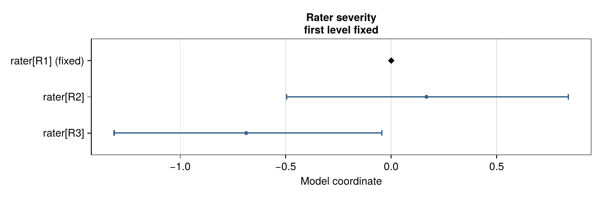

# BayesianMGMFRM.jl

**Estimate person ability, task difficulty and rater severity, with Bayesian uncertainty.**

When judges score a performance, a low score can reflect the performance, the
task or the judge's severity. BayesianMGMFRM.jl models these influences together.
Start with one-dimensional many-facet Rasch measurement (MFRM).

## Start here

**[Your First Rating Analysis](docs/src/first-analysis.md)** answers one question:
*is R2 more severe than R1?* Follow the supplied ratings, one analysis, its
figures and the meaning of the result. You can read it without running Julia.

*Estimated from artificial teaching data. Dots are posterior medians; bars are
90% credible intervals. R1 is a fixed reference. R2's interval spans zero, so
these ratings do not establish which rater is more severe. They do not prove
equivalence.*

To run the example, follow [installation](docs/src/installation.md), then return
to the tutorial. This source and manual are development snapshot
**`20261119-distribution-ci-freeze`**, package **0.1.2 (unreleased)**, for Julia 1.10.8
or newer. Match the source archive to the manual; this is not a stable release.

## After the first analysis

- [Use your own ratings](docs/src/data-validation.md#import-csv).
- [Choose a figure](docs/src/visualization-gallery.md) for a supported fitted model.
- [Find a recipe](docs/src/examples.md), a [function](docs/src/api.md), or the [Stan and brms migration guide](docs/src/migration-stan-brms.md).
- [Check model support](docs/src/scope.md) before changing the model. Generalized,
  multidimensional and multi-outcome extensions remain Experimental.
- [Get help](docs/src/contributing.md) if an operation fails.

## Citation and license

Cite the exact software snapshot and the model references used in your analysis:
see [CITATION.cff](CITATION.cff) and [citation guidance](docs/src/registration.md).
MIT License; see [LICENSE](LICENSE).
