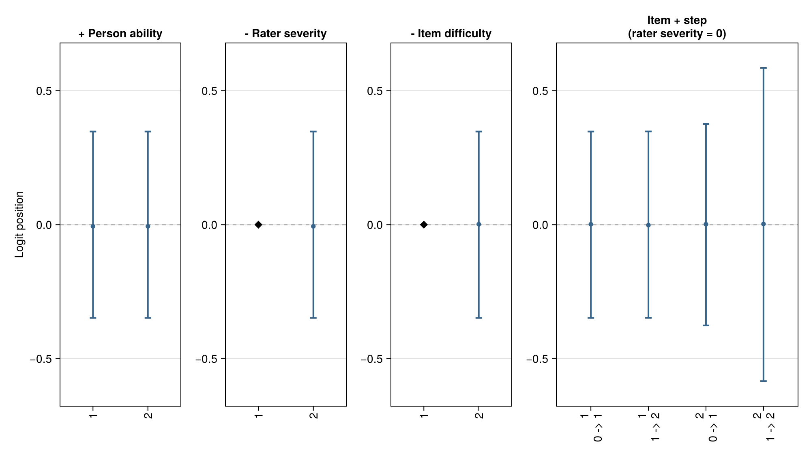
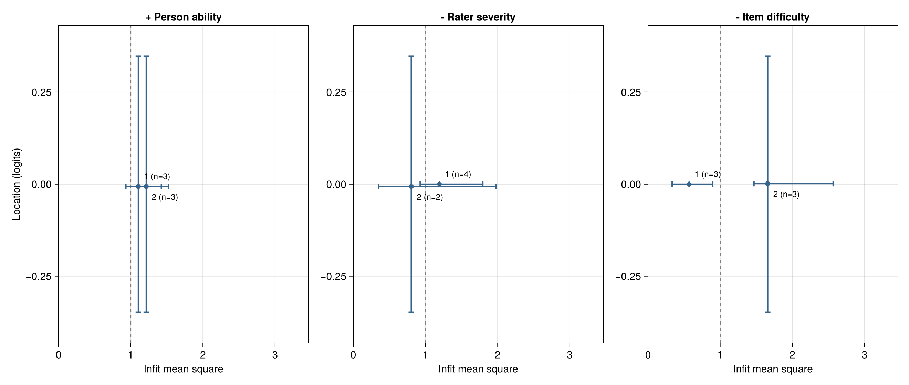
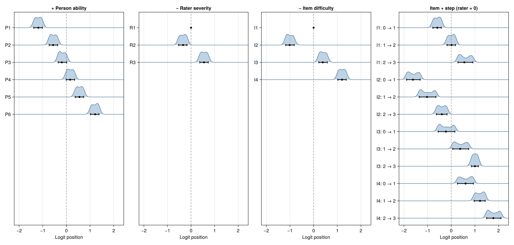
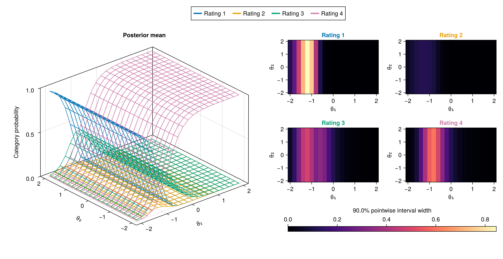

# BayesianMGMFRM.jl

[](https://github.com/Ryuya-dot-com/BayesianMGMFRM.jl/actions/workflows/CI.yml)

**Separate person ability, task difficulty, and rater severity—with full Bayesian uncertainty.**

When human judges score essays, speaking performances, or clinical assessments, raw scores mix who is assessed, what task is assigned, and how strict each judge is. **BayesianMGMFRM.jl** is a Julia package for Bayesian many-facet measurement that disentangles those effects on a shared scale and quantifies uncertainty at every step:

- **Estimate and compare** people, items, raters, and rating-scale thresholds with posterior intervals and Monte Carlo standard errors (MCSE).
- **Validate the design and model** before and after fitting with connectivity checks, posterior predictive checks, cross-validation criteria, and prior sensitivity analysis.
- **Create figures and reproducible reports** that can be saved, shared as portable JSON with SHA-256 verification, and reopened without refitting.

Start with **one-dimensional many-facet Rasch measurement (MFRM)**, the package's supported baseline workflow. Selected generalized, multidimensional, and multi-outcome extensions are available under **Experimental** with explicit identification and prior requirements; see [Model Support](#model-support).

[Quick Start](#quick-start) · [Why BayesianMGMFRM.jl?](#why-bayesianmgmfrmjl) · [Main Workflow](#main-workflow) · [Visualizations](#visualization-and-psychometric-maps) · [Model Support](#model-support) · [Julia Beginner's Guide](docs/src/learning-guide.md#julia-for-beginners) · [Manuscript Reporting Checklist](docs/src/interpreting-results.md#manuscript-reporting-checklist) · [Find Help by Task](docs/src/index.md) · [Development Roadmap](docs/src/roadmap.md)

For ordinary binary test responses without human judges, start with the [Rasch/1PL example](docs/src/examples.md#ordinary-binary-irt-without-raters). **New to Julia?** Read the [5-Minute Julia Guide for R, Python, and FACETS Users](docs/src/learning-guide.md#julia-for-beginners).

---

## Quick Start

**Question: Is rater R2 more severe than rater R1?**
This self-contained example uses 72 supplied artificial ratings to estimate the severity difference between two raters, check numerical precision, and interpret the uncertainty interval. You do not need to prepare your own dataset first.

This README describes a **local development snapshot**. With Julia 1.10.8 or newer, install this checkout in a separate analysis project:

```julia
using Pkg
Pkg.activate("rating-local")
Pkg.develop(path="path/to/BayesianMGMFRM.jl")  # Replace with this checkout's path.
```

Run the example (the last line fits four MCMC chains and saves the result):

```julia
using BayesianMGMFRM
include(joinpath(pkgdir(BayesianMGMFRM), "examples", "first_analysis.jl"))
analysis = FirstMFRMAnalysis.main()
```

**Console output excerpt (`answer.txt`):**

```text
Is R2 more severe than R1?
Artificial ratings: 72; people: 12; items: 4; raters: 3.
Positive values mean that R2 is more severe than R1, after accounting for persons and items.
Numerical checks: passed
Posterior mean: 0.18 logit; 90% interval: [-0.511, 0.889].
The 90% interval includes zero: these ratings do not give a clear direction for the R2-R1 severity difference under this model and prior. This does not show that the raters are equivalent.
MCSE (logit): mean=0.0069; interval endpoints=0.0171, 0.0156.
Illustrative MCSE limits (logit): mean <= 0.01; each endpoint <= 0.02. These are not scientific effect-size thresholds.
Retained-draw diagnostics: ok; maximum R-hat=1.002...; minimum bulk/tail ESS=1850.../2100...
```

**What you get:**
- The estimated rater-severity difference (`0.180 logit`), its 90% equal-tailed credible interval (`[-0.511, 0.889]`), mean/endpoint Monte Carlo standard errors (MCSE), and per-chain HMC/NUTS diagnostic checks.
- A plain-language reminder that a credible interval spanning zero means the direction is unresolved—not that the two raters are proved equivalent.
- Calling `FirstMFRMAnalysis.inputs()` instead of `main()` inspects the data and design without running MCMC.
- The [complete walkthrough](docs/src/examples.md#first-mfrm-analysis) explains the data table, priors, interpretation, and how to reopen saved results without refitting, and the [Manuscript Reporting Checklist](docs/src/interpreting-results.md#manuscript-reporting-checklist) shows how to report these quantities in a paper. (The tutorial's small sample size and priors are teaching choices, not substantive study defaults.)

**Bring your own rating table (unified practitioner verbs):**

```julia
using BayesianMGMFRM

# Replace `ratings` with your own DataFrame or column table; this 8-rating table runs as-is:
ratings = (
    examinee = ["P1", "P1", "P1", "P1", "P2", "P2", "P2", "P2"],
    item     = ["I1", "I1", "I2", "I2", "I1", "I1", "I2", "I2"],
    rater    = ["R1", "R2", "R1", "R2", "R1", "R2", "R1", "R2"],
    score    = [0, 1, 2, 0, 1, 2, 0, 2],
)

data = FacetData(ratings; person = :examinee, rater = :rater, item = :item, score = :score, category_levels = 0:2)
validation = validate_design(data)
validation.passed || error(validation)

spec = mfrm_spec(data; thresholds = :partial_credit, validation_report = validation)
fit_result = fit(spec; backend = :advancedhmc, chains = 4, warmup = 500, ndraws = 500, seed = 20260718)

q = qualify(fit_result)                                           # q.qualified (whole-fit R-hat, ESS, BFMI, divergences)
summary_rows = posterior_summary(fit_result)                      # Posterior mean, SD, median, lower/upper CrI per parameter
diff_r2_r1 = contrast(fit_result; left = "rater[R2]", right = "rater[R1]")
diff_r2_r1.summary                                                # (; mean, sd, median, lower, upper, precision, event_rows, ...)
save_fit("analysis-fit.jls", fit_result)
```

---

## Why BayesianMGMFRM.jl?

1. **Catch broken rating designs before fitting:** Automatically checks rating-network connectedness across raters, tasks, and examinees, verifies design rank, and flags unused or collapsed score categories (`validate_design`, `design_summary`, `ordinal_response_pattern_audit`) before spending compute time.
2. **Full joint Bayesian uncertainty and precision checks:** Propagates uncertainty across persons, items, raters, and step thresholds simultaneously—rather than plugging in point-estimated rater severities when scoring examinees—and checks both whole-fit convergence (`R-hat`, `ESS`, `BFMI`) and focal-estimand Monte Carlo error (`qualify`, `posterior_mcse`, `contrast`).
3. **One unified workflow from prior checks to figures:** Combines prior simulation (`prior_draw`, `simulate`, `prior_predictive_check`), NUTS sampling (`AdvancedHMC` or `CmdStan`), posterior predictive checks (`predictive_check`), cross-validation (`criteria` with PSIS-LOO and WAIC, `compare_models`), power-scaling prior sensitivity (`prior_sensitivity`), Wright and Pathway maps (`BayesianMGMFRM.plot`), and SHA-256 verified portable JSON reports (`save_report` / `load_report`).
4. **Rater-behavior and multi-criterion extensions (`Experimental`) plus Glass-Box transparency:** Provides explicitly identified models for generalized rater slopes (GMFRM), multidimensional fixed-Q traits (2D/3D MGMFRM), within-event multi-criterion dependence (`:none`, `:uniform`, `:star`), temporal rater drift (RW1), and criterion collapse, while exposing exact log-densities, analytical gradients, contrast bases (`facet_basis`), and Stan inputs (`stan_data`).

### Comparison with Related Rating Software

See [Migrating from FACETS and ACER ConQuest](docs/src/migration-facets-conquest.md#software-comparison) for details on sign conventions, identification constraints, and estimator differences.

| Capability / Workflow Stage | `BayesianMGMFRM.jl` | `FACETS` | `ACER ConQuest` | `R (TAM / mirt)` | `brms / CmdStan` |
| --- | --- | --- | --- | --- | --- |
| **Primary estimation & uncertainty** | Joint Bayesian MCMC (`AdvancedHMC` NUTS or `CmdStan`); simultaneous posterior draws & MCSE for all facets | Joint Maximum Likelihood (JMLE); asymptotic point-estimate SEs | Marginal Maximum Likelihood (MML) & Patz–Junker MCMC; asymptotic or MCMC SEs | MML-EM / quasi-MCEM; asymptotic SEs and plausible values | Joint Bayesian MCMC (HMC/NUTS); simultaneous posterior draws & MCSE |
| **Pre-fit rating connectivity & rank audit** | **Built-in** (`validate_design`, graph connectedness, category-gap & rank checks) | Subset connectivity checks during estimation | Design-matrix rank & aliasing checks during model setup | Manual data preparation or custom matrix checks | Manual data preparation & custom code |
| **Core 1D MFRM (RSM / PCM & hard anchors)** | **Supported** (`mfrm_spec`, `anchors = ...`, `rater = nothing` for 1PL) | **Supported** (comprehensive operational facet & anchor options) | **Supported** (general linear facet & anchor expressions) | **Supported** (via facet design matrices in `TAM::tam.mml.mfr`) | Requires custom formula / Stan program & sum-to-zero constraints |
| **Generalized slopes & multidimensional traits (GMFRM / MGMFRM)** | **Experimental** (1D GMFRM, fixed-Q 1D–3D MGMFRM, correlated 2D/3D traits) | 1D Rasch family (fixed unit slopes; diagnostic discrimination indices) | Multidimensional Rasch / 2PL MML (`score` statements) | Multidimensional 2PL / GPCM (`mirt`, `TAM`) | Requires custom non-linear formula or custom Stan program |
| **Multi-criterion rating events & rater-mechanism models** | **Experimental** (`:none` shared-response, `:uniform` paired, `:star` multi-criterion, RW1 drift, criterion collapse, rater group/item) | Bias/interaction tables (`Barcharts`, pairwise bias reports) | Linear interaction terms (`rater*item`, `rater*step`) | Facet interaction terms (`xsi.fixed` / custom design) | Requires writing custom likelihoods & Jacobians in Stan |
| **Prior predictive checks, PSIS-LOO & prior sensitivity** | **Built-in** (`prior_predictive_check`, `predictive_check`, `criteria`, `prior_sensitivity`) | Classic infit/outfit mean-square & standardized residuals | Classic infit/outfit, deviance/AIC, plausible-value checks | Infit/outfit, information criteria (AIC/BIC), item fit | Available via external R packages (`loo`, `priorsense`, `bayesplot`) |
| **Psychometric maps & reproducible portable reports** | **Built-in** (`plot` for Wright, Pathway, 3D surfaces; SHA-256 JSON `save_report`) | Built-in ASCII / GUI Wright maps & score tables | Built-in Wright maps & text/table outputs | Requires external plotting packages (`WrightMap`, `ggplot2`) | Requires custom post-processing & plotting scripts |
| **Best suited for…** | End-to-end Bayesian rating analysis, full joint uncertainty, rater/multi-criterion research, and Glass-Box methods work | Fast operational JMLE scoring, classic Rasch diagnostics, and complex operational anchoring | Large-scale operational MML assessments, regression conditioning, and plausible values | Fast MML estimation and standard IRT/MFRM workflows inside R | Custom hierarchical models outside standard rating specifications |

---

## Main Workflow

Every analysis follows four steps using consistent top-level functions. The [connected workflow guide](docs/src/bayesian-workflow.md) shows what each function accepts, what it returns, and when to stop and inspect a warning:

| Step | What you do | Main functions |
| --- | --- | --- |
| **1. Prepare** | Map person, item, rater, and score columns; verify that raters and tasks are connected across the rating design. | `FacetData`, `design_summary`, `validate_design` |
| **2. Specify and simulate** | Choose the measurement model and priors, inspect the mathematical specification, or simulate synthetic ratings. | `mfrm_spec` (or `Experimental.joint_rating_spec`), `contract`, `prior_draw`, `simulate` |
| **3. Fit and qualify** | Sample the posterior (single process or multi-worker), verify convergence and focal MCSE, and check model fit and prior sensitivity. | `fit` (`prepare_fit`, `run_chain_worker`, `collect_fit`), `qualify`, `diagnostics`, `predictive_check`, `criteria`, `compare_models`, `prior_sensitivity` |
| **4. Interpret, plot, and retain** | Summarize facets and contrasts, compute reliability or classifications, plot posteriors, and save fits or portable reports. | `posterior_summary`, `facet_summary`, `contrast`, `reliability`, `ranking`, `classification`, `BayesianMGMFRM.plot`, `save_fit` / `load_fit`, `save_report` / `load_report` |

Already have a saved fit? Reopen it with `load_fit` or `load_report` before requesting new summaries. Posterior predictive checks may simulate new outcomes, and changing a prior or model specification requires a separate fit.

> **Transparency for methodological researchers (Glass-Box API):**
> Researchers inspecting parameterization, exact log-densities, analytical gradients, or CmdStan inputs can call `contract`, `model_equation`, `constraint_table`, `identification_declarations`, `parameter_names`, `facet_basis`, `coordinates`, `to_ncp_reference`, `from_ncp_reference`, `reparameterize_point`, `reparameterize_draws`, `log_jacobian_to_ncp`, `logprior`, `loglikelihood`, `pointwise_loglikelihood`, `logposterior`, `logdensity_and_gradient`, `stan_data`, and `sampler_controls` directly; see the [API reference](docs/src/api.md).

<details>
<summary><strong>Qualification, model comparison, and saved-report rules</strong></summary>

- **Numerical qualification (`qualify`):**
  For standard MFRM/GMFRM/MGMFRM fits, `qualify(fit).qualified` verifies that all parameter-block diagnostics and sampler telemetry pass their thresholds (`max_rhat`, `min_ess`, `min_bfmi`), while recording `focal_precision_qualification=:not_assessed` so you explicitly check the Monte Carlo error (`posterior_mcse`) of the specific contrasts or parameters you report. For Star multi-criterion models, `qualify(fit).result.numerically_qualified` also checks MCSE for its listed finite-entity correlations, and running `qualify(fit; check_transformed=false)` is treated as a partial check rather than whole-fit qualification; see [qualification boundaries](docs/src/bayesian-workflow.md#Qualification-and-focal-precision).
- **Cross-validation (`criteria`):**
  `criteria(fit)` evaluates WAIC and Pareto-smoothed importance sampling leave-one-out cross-validation (`:psis_loo`) across all retained draws using chain-aware relative efficiency, preserving tail-shape (`pareto_k`) and efficiency warnings. Draw subsetting is rejected so cross-validation scores remain tied to the full retained sample. The earlier tail approximation remains selectable as `:hill_smoothed_loo`; consult `?criteria` and the model-specific guide.
- **Saving and reopening (`save_report` / `load_report`):**
  Use the same entry points across supported and experimental workflows. `save_report("summary.json", result; return_receipt=true)` writes a portable JSON report and returns `(; path, sha256)`; reopen it with `load_report(receipt.path; expected_sha256=receipt.sha256)`. Rater-by-item reports require `practical_threshold`; rater-group reports also require `reference_group`. See the [saving guide](docs/src/api-saved-reporting.md) for native directories, report contents, and reader controls.
- **Model comparison (`compare_models`):**
  `compare_models("a"=>fit_a, "b"=>fit_b; comparison_axis=:model, dataset_id="ratings-v1", observation_ids=rating_ids)` verifies that both models were fitted to the exact same rating observations before comparing predictive criteria. Star multi-criterion fits use the same named-pair syntax and their stored event IDs. Prediction units, LOO estimators, and difference/SE conventions are documented in the [comparison guide](docs/src/bayesian-workflow.md#6.-Compare-Models-Carefully).

</details>

---

## Visualization and Psychometric Maps

Load `CairoMakie` and call `BayesianMGMFRM.plot(x; kind = ...)` (or the dedicated `plot_*` helpers) to generate publication-ready psychometric maps, posterior diagnostics, and 3D multidimensional response surfaces. Titles and structured methodological notes are produced alongside every figure; see the [Visualization Gallery](docs/src/visualization-gallery.md) for reading guides, downloadable PDFs/SVGs, and numerical inputs.

| Shared-Scale Wright Map (`kind = :wright`) | Pathway Map: Location vs. Infit (`kind = :pathway`) |
| --- | --- |
| [](docs/src/assets/visual-guide/wright-map.svg)<br>Places person ability (`+`), rater severity (`-`), item difficulty (`-`), and adjacent-category boundaries (`item + step`) on one shared logit axis with posterior medians, 95% credible intervals, and diamond markers for fixed anchors/references. | [](docs/src/assets/visual-guide/pathway-map.svg)<br>Pairs each facet's logit location (vertical) with its posterior infit mean-square (horizontal) and marginal credible intervals to highlight unexpected rating patterns without conflating severity with misfit. |
| **Ridge Wright Map (`plot_wright(...; kind = :ridge)`)** | **3D Multidimensional Response Surface (`kind = :response_surface`)** |
| [](docs/src/assets/visual-guide/wright-ridge.svg)<br>Displays each individual person's, rater's, item's, and boundary's marginal posterior density on the shared logit scale so skewness and differing uncertainty widths remain visible. | [](docs/src/assets/visual-guide/mgmfrm-response-surface.svg)<br>Shows how two latent abilities jointly shift category probabilities (`0–1`) for a selected item–rater pair, paired with pointwise credible-interval width heatmaps (also available as planar `:panels` or `:heatmaps`). |

*Note on gallery illustrations:* The Wright, Ridge, and Pathway figures above use deterministic artificial draws to illustrate reading conventions and uncertainty displays rather than an empirical study claim; the 3D MGMFRM surface averages 16,000 retained joint draws from a saved experimental fit to simulated ratings.

```julia
using BayesianMGMFRM, CairoMakie

fig_wright  = BayesianMGMFRM.plot(fit_result; kind = :wright, interval = 0.95)
fig_pathway = BayesianMGMFRM.plot(fit_result; kind = :pathway, interval = 0.95)
fig_ppc     = BayesianMGMFRM.plot(fit_result; kind = :predictive)
save("wright-map.svg", fig_wright)
```

<details>
<summary><strong>All 12 unified plot kinds in <code>BayesianMGMFRM.plot(x; kind = ...)</code></strong></summary>

| `kind` | What question it answers | Input `x` |
| --- | --- | --- |
| `:posterior` *(default)* | What are the posterior medians and credible intervals for model parameters? | Fitted model (`MFRMFit`, `GMFRMFit`, `MGMFRMFit`, `StarResult`) |
| `:diagnostics` | Did chains mix well (trace plots and rank histograms)? | Fitted model |
| `:predictive` | Do replicated ratings from the fitted posterior match observed category proportions? | Fitted model |
| `:wright` | Where do persons, raters, items, and category thresholds sit on the shared logit scale (intervals, `:histogram`, or `plot_wright(...; kind = :ridge)`)? | Scalar `MFRMFit` |
| `:pathway` | Which persons, raters, or items show high or low infit/outfit mean-square at their estimated logit location? | Scalar `MFRMFit` |
| `:response_surface` | How do two abilities change category probabilities and pointwise interval widths (`layout = :overlay \| :panels \| :heatmaps`)? | Multidimensional `MGMFRMFit` |
| `:prior_sensitivity` | How much do focal posterior intervals or ridge densities shift across alternative priors? | Prior-sensitivity report ([guide](docs/src/prior-sensitivity.md)) |
| `:prior_predictive_sensitivity` | What score distributions, item means, and rater means do candidate priors imply before fitting? | Prior-predictive sensitivity report ([guide](docs/src/prior-sensitivity.md)) |
| `:design_precision` | How often does a planned rating design achieve a target credible-interval width across simulated cohorts? | Design-precision evaluation ([guide](docs/src/design-planning.md)) |
| `:rater_drift` | How does a rater's severity change across rating time bins (`static` vs. `RW1`)? | Saved `Experimental.RaterDrift` report ([guide](docs/src/rater-drift.md)) |
| `:criterion_collapse_classes` | What is each rater's posterior probability of belonging to the criterion-collapse class? | `Experimental.CriterionCollapse` fit/report ([guide](docs/src/criterion-collapse.md)) |
| `:criterion_collapse_categories` | How do category probability curves differ between ordinary and collapsed rating classes? | `Experimental.CriterionCollapse` fit/report ([guide](docs/src/criterion-collapse.md)) |

</details>

---

## Model Support

Read the [full scope guide](docs/src/scope.md) before selecting a model. Multiple dimensions or generalized slopes require a substantive reason and a design that supports them; the package name does not require a multidimensional analysis, and a converged fit alone does not establish scientific validity.

| When you want to… | Model family | Status | Guide |
| --- | --- | --- | --- |
| Estimate person ability, item difficulty, rater severity, and shared rating-scale or item-specific partial-credit steps | **One-dimensional MFRM** | **Supported** | [Worked theory](docs/src/rating-model-theory.md) · [First analysis](docs/src/examples.md#first-mfrm-analysis) |
| Include extra main-effect facets (e.g., prompt, occasion, rating session) | **User-named additive scalar facets** | **Experimental** (scalar fitting, named joint summaries/MCSE, known-level prediction, save/reload) | [Additive facets](docs/src/additive-facets.md) |
| Allow facet-varying discrimination or multiple fixed-loading dimensions (1D GMFRM, fixed-coefficient MFRM, fixed-Q MGMFRM, 2D correlated variants) | **Generalized and fixed-Q multidimensional MFRM** | **Experimental** (explicit identification constraints and priors per model) | [Experimental guide](docs/src/experimental.md) · [MGMFRM example](docs/src/examples.md#start-with-the-bundled-mgmfrm-data) |
| Fit a three-dimensional correlated ability structure with a pure fixed Q-matrix | **Three-dimensional correlated MGMFRM** | **Experimental** (pure fixed Q, explicit normalized exchangeable scales/LKJ prior, Julia NUTS, native save/reopen) | [Restricted 3D contract](docs/src/correlated-3d.md) |
| Model multiple analytic criteria scored in the same rating event (shared-response, paired ordinal association, or star-factorized residual association) | **Multi-criterion rating-event models** | **Experimental** (shared-response, paired `OrdinalAssociation`, and `Star` complete-event workflows with shared save/reopen entry points) | [Shared-response](docs/src/joint-ratings.md) · [Paired ordinal association](docs/src/ordinal-association.md) · [Star workflow](docs/src/star-association.md) |
| Analyze two ordinal ratings and a binary exact-match outcome jointly across listener cohorts | **Concurrent three-outcome study** | **Experimental** (`ThreeIndicator.ConcurrentInput` design inspection, fitting, contrasts, conditional predictive checks, saved reports) | [Concurrent three-outcome](docs/src/concurrent-three-outcome.md) |
| Investigate rater group severity differences, rater-by-item interactions, criterion collapse, or rater severity drift over time | **Rater-behavior and temporal models** | **Experimental** (observed-group rater, rater-by-item, constant-class criterion collapse, and static vs. RW1 rater drift) | [Rater group effects](docs/src/rater-group-effects.md) · [Rater-by-item](docs/src/interpreting-results.md#jointly-fitted-rater-by-item-effects-experimental) · [Criterion collapse](docs/src/criterion-collapse.md) · [Rater drift](docs/src/rater-drift.md) |
| Estimate exploratory factor loadings, arbitrary correlation/Q structures, or general testlet and rater-halo models | **Exploratory / arbitrary Q / general testlet or halo** | **Not supported for fitting** | [Scope boundaries](docs/src/scope.md) |

<details>
<summary><strong>Experimental parameter scales, slopes, and profile-prediction conventions</strong></summary>

- **Model vs. computation coordinates (`scale=:model`):**
  For the documented scalar/fixed-Q and normalized/correlated-2D generalized fits, call `posterior_summary(fit; scale=:model)` to inspect model-scale parameters. The historical no-keyword call returns computation coordinates.
- **Discrimination and effective slopes:**
  Interpret generalized discrimination parameters using the [fixed multiplier and joint effective slope](docs/src/model-equations.md#Read-model-parameters-and-effective-slopes).
- **Narrower experimental fitting and reporting scopes:**
  The [shared-response](docs/src/joint-ratings.md), [rater-by-item](docs/src/interpreting-results.md#jointly-fitted-rater-by-item-effects-experimental), and [group-effects](docs/src/rater-group-effects.md) guides define their specific identification and reporting boundaries.
- **Criterion collapse (`criterion-collapse.md`):**
  For a constant criterion-collapse class per rater, see [criterion collapse](docs/src/criterion-collapse.md). Its shared `compare_models(result)` compares induced submodels, while `predictive_check(result; category=...)` integrates same-design joint counts. For [conditional profile prediction](docs/src/criterion-collapse.md#Held-out-profile-prediction), use `criteria(...; unit=:performance_rater)` or `compare_models(...; criterion=:loo, unit=:performance_rater)`. These retain the original finite-panel prior and report PSIS diagnostics and numerical precision separately from model adequacy or classification claims.

</details>

---

## Installation

Core usage and the default `AdvancedHMC` NUTS sampler do not require Turing. To use `backend=:turing`, install and load `Turing` as shown in the [fitting guide](docs/src/fitting.md#backends-and-sampler-controls).

The [Quick Start](#quick-start) installs this local source checkout. The registered Julia General release and the published development preview may not include newer experimental features; always use the manual and examples that match the version you install.

<details>
<summary><strong>Install a published version instead</strong></summary>

For the registered release from Julia General:

```julia
using Pkg
Pkg.add("BayesianMGMFRM")
```

For the published development branch, use a separate project environment:

```julia
using Pkg
Pkg.activate("rating-preview")
Pkg.add(url="https://github.com/Ryuya-dot-com/BayesianMGMFRM.jl",
    rev="development/20261013-successor")
Pkg.pin("BayesianMGMFRM")
```

Use the [matching preview manual](https://ryuya-dot-com.github.io/BayesianMGMFRM.jl/preview/20261013-successor/). The [preview landing page](https://ryuya-dot-com.github.io/BayesianMGMFRM.jl/) records its exact commit; pass that commit hash as `rev` to pin the recorded snapshot.

</details>

**Reproducibility note:** Keep the exact source revision, Julia version, `Project.toml`, and `Manifest.toml` with your analysis. A local directory path or the development version string `0.1.2` does not identify an immutable snapshot. Native `.jls` fit archives require their original Julia and package environment; use [portable JSON reports](docs/src/api-saved-reporting.md#reopen-an-analysis-or-share-its-results) to share computed results across environments.

---

## Documentation

| If you want to… | Start here |
| --- | --- |
| Learn the essential Julia syntax for R, Python, or FACETS users | [5-Minute Julia Beginner's Guide](docs/src/learning-guide.md#julia-for-beginners) · [Getting Started](docs/src/learning-guide.md) |
| Understand the measurement model and mathematics | [Worked explanation](docs/src/rating-model-theory.md) · [Equations and priors](docs/src/model-equations.md) |
| Prepare and validate your own rating dataset | [Data validation](docs/src/data-validation.md) · [Runnable examples](docs/src/examples.md) |
| Follow the step-by-step Bayesian workflow | [Connected workflow](docs/src/bayesian-workflow.md) · [Results guide](docs/src/interpreting-results.md) |
| Report a Bayesian rating analysis in a journal manuscript | [Manuscript reporting checklist](docs/src/interpreting-results.md#manuscript-reporting-checklist) |
| Monitor a long MCMC run or tune sampler settings | [Fitting and figures](docs/src/fitting.md) · [Sampling progress](docs/src/fitting.md#sampling-progress) |
| Save, share, or reopen fits and portable reports | [Saved results and reporting](docs/src/api-saved-reporting.md) · [Visualization gallery](docs/src/visualization-gallery.md) |
| Compare with or migrate from FACETS, ConQuest, or R | [Software comparison and migration guide](docs/src/migration-facets-conquest.md) |
| Look up a function or see recent changes | [API reference](docs/src/api.md) · [Release notes](NEWS.md) |

---

## Getting Help and Contributing

See [troubleshooting and contributions](docs/src/contributing.md) for common recovery steps, running tests, and building documentation. Report reproducible issues through [GitHub issues](https://github.com/Ryuya-dot-com/BayesianMGMFRM.jl/issues), including the exact source revision and your Julia/dependency environment.

## Citation and License

Cite both the software version and the measurement-model references used in your analysis. [CITATION.cff](CITATION.cff) and the [versioning and citation guide](docs/src/registration.md) explain what to record; analyses using this unreleased `0.1.2` snapshot should also record the exact source revision.

MIT License. See [LICENSE](LICENSE).
