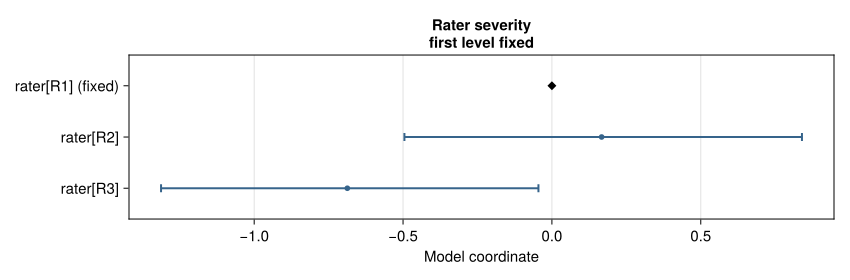
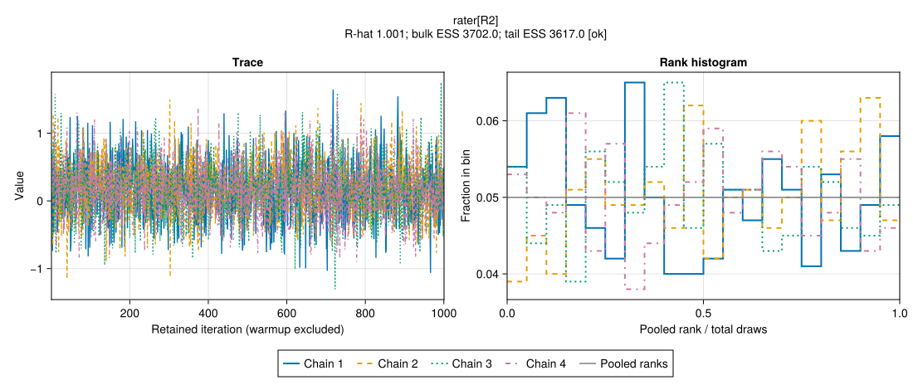
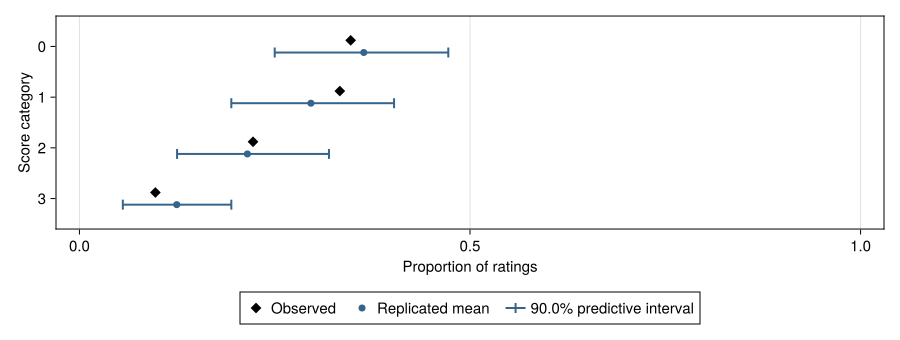

# Is R2 more severe than R1?

Generated from `bayesianmgmfrm.fit_report.v1`.

- Report content hash: `670c59439d85b036f8d359a1b22ef7f472f20cb399ff60513a01564197cd50a7`
- Markdown preview rows per table: 6

## Report Metadata

| field | value |
| --- | --- |
| schema | bayesianmgmfrm.fit_report.v1 |
| object | fit_report |
| created_at | 2026-11-09T14:22:39.912 |
| family | mfrm |
| thresholds | partial_credit |
| dimensions | 1 |
| dimension_labels | ["dim=1"] |
| estimation_status | supported |
| report_status | complete |

## Section Summary

| section | status | n_rows |
| --- | --- | --- |
| diagnostics |  | 33 |
| warmup | computed | 4 |
| rating_design | computed | 11 |
| fixed_coordinates | computed | 2 |
| category_functioning | not_requested | 0 |
| rater_homogeneity | not_requested | 0 |
| q_matrix | not_requested | 0 |
| mcmc_budget_guidance | unsupported | 0 |
| prior_policy | computed | 4 |
| pooling_policy | computed | 3 |
| prior_predictive | not_requested | 0 |
| posterior | computed | 25 |
| direct_posterior | not_requested | 0 |
| posterior_predictive | computed | 24 |
| calibration | not_requested | 0 |
| waic | not_requested | 0 |
| loo | not_requested | 0 |
| dff | not_requested | 0 |
| artifact | not_requested | 0 |

## Table Previews

### diagnostics / sampler_rows

- Rows: 4
- Preview rows: 4

| parameter_space | backend | sampler | chain | n_divergences | n_max_treedepth | n_nonfinite_proposals | flag | acceptance_rate | diagnostic_method | diagnostic_row | diagnostic_status | e_bfmi | first_iteration | last_iteration | max_tree_depth | maximum_log_posterior | mean_log_posterior | mean_n_steps | mean_step_size | mean_tree_depth | minimum_log_posterior | n_draws | n_finite_log_posterior | n_nonfinite_log_posterior | step_size | warmup |
| --- | --- | --- | --- | --- | --- | --- | --- | --- | --- | --- | --- | --- | --- | --- | --- | --- | --- | --- | --- | --- | --- | --- | --- | --- | --- | --- |
| identified | advancedhmc | nuts | 1 | 0 | 0 |  | ok | 0.9181442109778692 | sampler_chain_summary | sampler_chain | recorded | 1.024283139026736 | 1 | 1000 | 5 | -109.90817579027369 | -119.51281287468002 | 14.816 | 0.3272614877647587 | 3.792 | -135.1235954097906 | 1000 | 1000 | 0 | 0.3222486475187402 | 1000 |
| identified | advancedhmc | nuts | 2 | 0 | 0 |  | ok | 0.91532415088238 | sampler_chain_summary | sampler_chain | recorded | 0.9287163482404558 | 1 | 1000 | 5 | -110.00309724883054 | -119.59225315529487 | 14.792 | 0.3359744910324011 | 3.764 | -137.29654833496804 | 1000 | 1000 | 0 | 0.3222486475187402 | 1000 |
| identified | advancedhmc | nuts | 3 | 0 | 0 |  | ok | 0.9422943464388664 | sampler_chain_summary | sampler_chain | recorded | 1.0697438039190632 | 1 | 1000 | 4 | -110.81503524655602 | -119.24197967967979 | 14.976 | 0.2853000393996092 | 3.95 | -131.82478615568192 | 1000 | 1000 | 0 | 0.3222486475187402 | 1000 |
| identified | advancedhmc | nuts | 4 | 0 | 0 |  | ok | 0.9135262916685065 | sampler_chain_summary | sampler_chain | recorded | 1.0126819695019982 | 1 | 1000 | 6 | -110.31768585260713 | -119.26942332710762 | 14.744 | 0.3404585718781916 | 3.722 | -133.00054065478773 | 1000 | 1000 | 0 | 0.3222486475187402 | 1000 |

### diagnostics / parameter_rows

- Rows: 25
- Preview rows: 6

| parameter | parameter_space | rhat | rank_normalized_rhat | ess | bulk_ess | tail_ess | flag | autocovariance_maxlag | bulk_rank_normalized_rhat | classical_compatibility_flag | diagnostic_chains | diagnostic_contract | diagnostic_draws_per_chain | diagnostic_method | diagnostic_row | diagnostic_status | draws_per_chain | folded_rank_normalized_rhat | n_chains | quality_gate_applicable | rank_normalized_flag | split_chains | split_chains_requested | tail_probability | total_draws |
| --- | --- | --- | --- | --- | --- | --- | --- | --- | --- | --- | --- | --- | --- | --- | --- | --- | --- | --- | --- | --- | --- | --- | --- | --- | --- |
| person[P1] | identified | 1.001066895540127 | 1.0010152083854145 | 3845.199656437079 | 3849.105983590111 | 3348.4630717380887 | ok | 496 | 1.0010152083854145 | ok | 8 | rank_normalized_rhat_bulk_tail_ess_v1 | 500 | rank_normalized_split_rhat_bulk_tail_ess | parameter | rank_normalized_available | 1000 | 1.000323389779392 | 4 | true | ok | true | true | 0.1 | 4000 |
| person[P10] | identified | 1.000131421672174 | 1.0019443858717894 | 4000.0 | 6216.430127734232 | 3122.631818916038 | ok | 496 | 1.0001330286993455 | ok | 8 | rank_normalized_rhat_bulk_tail_ess_v1 | 500 | rank_normalized_split_rhat_bulk_tail_ess | parameter | rank_normalized_available | 1000 | 1.0019443858717894 | 4 | true | ok | true | true | 0.1 | 4000 |
| person[P11] | identified | 1.000362908554614 | 1.0003361999239069 | 4000.0 | 3952.9914788547912 | 3350.002641593289 | ok | 496 | 1.0003361999239069 | ok | 8 | rank_normalized_rhat_bulk_tail_ess_v1 | 500 | rank_normalized_split_rhat_bulk_tail_ess | parameter | rank_normalized_available | 1000 | 0.9994312268081463 | 4 | true | ok | true | true | 0.1 | 4000 |
| person[P12] | identified | 1.0009346057240722 | 1.0023395730782896 | 4000.0 | 4751.840271730242 | 2813.2819514503935 | ok | 496 | 1.000925851295834 | ok | 8 | rank_normalized_rhat_bulk_tail_ess_v1 | 500 | rank_normalized_split_rhat_bulk_tail_ess | parameter | rank_normalized_available | 1000 | 1.0023395730782896 | 4 | true | ok | true | true | 0.1 | 4000 |
| person[P2] | identified | 1.0001683321408863 | 1.000219292105782 | 3389.734122907859 | 3563.5672157580893 | 3215.4541615067715 | ok | 496 | 1.000219292105782 | ok | 8 | rank_normalized_rhat_bulk_tail_ess_v1 | 500 | rank_normalized_split_rhat_bulk_tail_ess | parameter | rank_normalized_available | 1000 | 0.9999000849718188 | 4 | true | ok | true | true | 0.1 | 4000 |
| person[P3] | identified | 1.0004676919520674 | 1.0005210017246433 | 3392.242575727069 | 3306.0467819030678 | 3452.1061001131607 | ok | 496 | 1.0005210017246433 | ok | 8 | rank_normalized_rhat_bulk_tail_ess_v1 | 500 | rank_normalized_split_rhat_bulk_tail_ess | parameter | rank_normalized_available | 1000 | 0.9994184225583098 | 4 | true | ok | true | true | 0.1 | 4000 |

*19 additional row(s) omitted.*

### diagnostics / block_rows

- Rows: 4
- Preview rows: 4

| parameter_space | block | flag | autocovariance_maxlag | classical_compatibility_flag | diagnostic_contract | diagnostic_method | diagnostic_row | diagnostic_status | draws_per_chain | ess_threshold | first_parameter | last_parameter | max_rank_normalized_rhat | max_rhat | min_bulk_ess | min_ess | min_tail_ess | n_bad_rank_normalized_rhat | n_bad_rhat | n_chains | n_degenerate_parameters | n_insufficient_chains | n_insufficient_draws | n_low_bulk_ess | n_low_ess | n_low_tail_ess | n_nonfinite_parameters | n_parameters | n_quality_gate_parameters | n_structurally_fixed_parameters | parameter_names | quality_gate_applicable | rank_normalized_flag | rhat_threshold | split_chains | split_chains_requested | total_draws |
| --- | --- | --- | --- | --- | --- | --- | --- | --- | --- | --- | --- | --- | --- | --- | --- | --- | --- | --- | --- | --- | --- | --- | --- | --- | --- | --- | --- | --- | --- | --- | --- | --- | --- | --- | --- | --- | --- |
| identified | item | ok | 496 | ok | rank_normalized_rhat_bulk_tail_ess_v1 | rank_normalized_split_rhat_bulk_tail_ess | parameter_block | rank_normalized_available | 1000 | 400.0 | 15 | 17 | 1.0003964327619945 | 1.000381092408004 | 3756.138377174955 | 3797.4567101085204 | 3128.8390852572466 | 0 | 0 | 4 | 0 | 0 | 0 | 0 | 0 | 0 | 0 | 3 | 3 | 0 | ["item[I2]","item[I3]","item[I4]"] | true | ok | 1.01 | true | true | 4000 |
| identified | person | ok | 496 | ok | rank_normalized_rhat_bulk_tail_ess_v1 | rank_normalized_split_rhat_bulk_tail_ess | parameter_block | rank_normalized_available | 1000 | 400.0 | 1 | 12 | 1.0026058184095603 | 1.0014239005269108 | 3306.0467819030678 | 3389.734122907859 | 2813.2819514503935 | 0 | 0 | 4 | 0 | 0 | 0 | 0 | 0 | 0 | 0 | 12 | 12 | 0 | ["person[P1]","person[P10]","person[P11]","person[P12]","person[P2]","person[P3]","person[P4]","person[P5]","person[P6]"... | true | ok | 1.01 | true | true | 4000 |
| identified | rater | ok | 496 | ok | rank_normalized_rhat_bulk_tail_ess_v1 | rank_normalized_split_rhat_bulk_tail_ess | parameter_block | rank_normalized_available | 1000 | 400.0 | 13 | 14 | 1.0012360591084883 | 1.0012531216187446 | 3377.624403986482 | 3426.822292607759 | 3043.385316583193 | 0 | 0 | 4 | 0 | 0 | 0 | 0 | 0 | 0 | 0 | 2 | 2 | 0 | ["rater[R2]","rater[R3]"] | true | ok | 1.01 | true | true | 4000 |
| identified | thresholds | ok | 496 | ok | rank_normalized_rhat_bulk_tail_ess_v1 | rank_normalized_split_rhat_bulk_tail_ess | parameter_block | rank_normalized_available | 1000 | 400.0 | 18 | 25 | 1.002328060235358 | 1.0007013629732397 | 5238.594335799612 | 4000.0 | 2649.0954171159615 | 0 | 0 | 4 | 0 | 0 | 0 | 0 | 0 | 0 | 0 | 8 | 8 | 0 | ["step[item=I1,1]","step[item=I1,2]","step[item=I2,1]","step[item=I2,2]","step[item=I3,1]","step[item=I3,2]","step[item=... | true | ok | 1.01 | true | true | 4000 |

### warmup

Warmup describes NUTS adaptation or random-walk burn-in. Random walk reports rejected nonfinite proposals; its NUTS event fields do not apply. These counts remain separate from convergence diagnostics and retained-draw warnings. Coverage: recorded = observed; not_run = known zero warmup; not_recorded = history unavailable. Unavailable or inapplicable counts are null in JSON and blank in Markdown, never zero. No warmup pass/fail rule is applied.

### warmup / rows

- Rows: 4
- Preview rows: 4

| phase | backend | chain | expected_iterations | observed_iterations | coverage | n_divergences | n_max_treedepth | n_nonfinite_logdensity |
| --- | --- | --- | --- | --- | --- | --- | --- | --- |
| warmup | advancedhmc | 1 | 1000 | 1000 | recorded | 4 | 0 | 0 |
| warmup | advancedhmc | 2 | 1000 | 1000 | recorded | 4 | 0 | 0 |
| warmup | advancedhmc | 3 | 1000 | 1000 | recorded | 5 | 0 | 0 |
| warmup | advancedhmc | 4 | 1000 | 1000 | recorded | 3 | 0 | 0 |

### rating_design / rows

- Rows: 11
- Preview rows: 6

| status | audit | max_count | min_count | n_components | n_expected | n_missing | n_observed | n_repeated | n_sparse | note | severity | unit |
| --- | --- | --- | --- | --- | --- | --- | --- | --- | --- | --- | --- | --- |
| connected | rating_graph_components | 19 | 19 | 1 |  |  |  |  |  | person_rater_item_graph_connected | info |  |
| connected | rater_linking | 12 | 12 | 1 |  | 0 | 3 |  | 0 | rater_overlap_links_graph_at_minimum_threshold | info | person_item |
| not_declared | anchor_coverage |  |  |  |  | 0 | 0 |  |  | anchors_not_declared | info |  |
| unobserved_grid_cells | observed_cell_coverage | 4 | 4 |  | 36 | 18 | 18 |  |  | structural_vs_accidental_missingness_not_identified_by_observed_long_data | warning |  |
| complete_observed_grid | observed_cell_coverage | 3 | 1 |  | 48 | 0 | 48 |  |  | structural_vs_accidental_missingness_not_identified_by_observed_long_data | info |  |
| complete_observed_grid | observed_cell_coverage | 6 | 6 |  | 12 | 0 | 12 |  |  | structural_vs_accidental_missingness_not_identified_by_observed_long_data | info |  |

*5 additional row(s) omitted.*

### fixed_coordinates / rows

- Rows: 2
- Preview rows: 2

| parameter | facet | level | constraint | fixed_value | level_index | posterior_estimated | prior_applied | sampled | source | uncertainty_status |
| --- | --- | --- | --- | --- | --- | --- | --- | --- | --- | --- |
| rater[R1] | rater | R1 | reference_zero | 0.0 | 1 | false | false | false | default_identification | not_applicable_fixed_by_identification |
| item[I1] | item | I1 | reference_zero | 0.0 | 1 | false | false | false | default_identification | not_applicable_fixed_by_identification |

### mcmc_budget_guidance

local retained-draw budget guidance is currently documented for guarded MGMFRM fits only

### prior_policy / rows

- Rows: 4
- Preview rows: 4

| family | parameter_space | block | status | active | direct_scale_prior | independent_by_parameter | jacobian_policy | location | note | prior_family | scale | scale_parameter |
| --- | --- | --- | --- | --- | --- | --- | --- | --- | --- | --- | --- | --- |
| mfrm | identified_constrained_parameter | person | active | true | true | true | identity | 0.0 | weakly informative independent normal prior on identified person measures | normal | 1.5 | person_sd |
| mfrm | identified_constrained_parameter | rater | active | true | true | true | identity | 0.0 | weakly informative independent normal prior on identified rater severities | normal | 1.0 | rater_sd |
| mfrm | identified_constrained_parameter | item | active | true | true | true | identity | 0.0 | weakly informative independent normal prior on identified item difficulties | normal | 1.0 | item_sd |
| mfrm | identified_constrained_parameter | thresholds | active | true | true | true | identity | 0.0 | weakly informative independent normal prior on identified threshold or step parameters | normal | 1.0 | step_sd |

### pooling_policy / rows

- Rows: 3
- Preview rows: 3

| family | block | status | active | note | pooling |
| --- | --- | --- | --- | --- | --- |
| mfrm | facet_parameters | active | true | v0.1.x fits use independent priors for exposed facet parameter blocks | independent_priors |
| mfrm | facet_hyperparameters | blocked | false | hierarchical facet priors require explicit estimands, hyperpriors, shrinkage diagnostics, and sensitivity evidence | hierarchical_partial_pooling |
| mfrm | rater_consistency | not_applicable | false | minimal MFRM has no rater-consistency parameter | hierarchical_rater_consistency_pooling |

### posterior / rows

- Rows: 25
- Preview rows: 6

| parameter | mean | sd | median | lower | upper | lower_probability | upper_probability | direction | n_draws | practical_equivalence | probability_above_rope | probability_below_rope | probability_equal | probability_in_rope | probability_negative | probability_of_direction | probability_positive | reference | rope_lower | rope_probability_threshold | rope_upper |
| --- | --- | --- | --- | --- | --- | --- | --- | --- | --- | --- | --- | --- | --- | --- | --- | --- | --- | --- | --- | --- | --- |
| person[P1] | -1.2993680172771462 | 0.4783504790410089 | -1.280978636489921 | -2.111468535920125 | -0.5475361539212147 | 0.05 | 0.95 | negative | 4000 | not_requested |  |  | 0.0 |  | 0.9975 | 0.9975 | 0.0025 | 0.0 |  |  |  |
| person[P10] | 0.4797552276886862 | 0.582337797815292 | 0.47526038898597545 | -0.44127060190619627 | 1.464425245727194 | 0.05 | 0.95 | positive | 4000 | not_requested |  |  | 5.551115123125783e-17 |  | 0.20825 | 0.79175 | 0.79175 | 0.0 |  |  |  |
| person[P11] | 0.30952265692898584 | 0.6598438503621658 | 0.2973408568663878 | -0.7553698940752622 | 1.3952729781156654 | 0.05 | 0.95 | positive | 4000 | not_requested |  |  | -5.551115123125783e-17 |  | 0.322 | 0.678 | 0.678 | 0.0 |  |  |  |
| person[P12] | 0.6525763571158258 | 0.7400126143050669 | 0.6292996875159642 | -0.5069746967281297 | 1.9048111641779673 | 0.05 | 0.95 | positive | 4000 | not_requested |  |  | 2.7755575615628914e-17 |  | 0.19225 | 0.80775 | 0.80775 | 0.0 |  |  |  |
| person[P2] | -0.8915417130394473 | 0.45354008085850206 | -0.8868547398267437 | -1.6669471202108936 | -0.17353355876959495 | 0.05 | 0.95 | negative | 4000 | not_requested |  |  | 0.0 |  | 0.98025 | 0.98025 | 0.01975 | 0.0 |  |  |  |
| person[P3] | -0.6540930568176091 | 0.42633804921757007 | -0.6465816211885166 | -1.3693124035980069 | 0.029581038447665842 | 0.05 | 0.95 | negative | 4000 | not_requested |  |  | 0.0 |  | 0.9405 | 0.9405 | 0.0595 | 0.0 |  |  |  |

*19 additional row(s) omitted.*

### posterior_predictive / rows

- Rows: 24
- Preview rows: 6

| level | lower_probability | upper_probability | flag | interval_probability | lower_tail_probability | n_replicates | observed | replicated_lower | replicated_mean | replicated_median | replicated_upper | statistic | two_sided_tail_probability | upper_tail_probability |
| --- | --- | --- | --- | --- | --- | --- | --- | --- | --- | --- | --- | --- | --- | --- |
|  | 0.04999999999999999 | 0.95 | ok | 0.9 | 0.4275 | 4000 | 1.0694444444444444 | 0.8888888888888888 | 1.1001666666666667 | 1.0972222222222223 | 1.3194444444444444 | mean_score | 0.855 | 0.6135 |
| 0 | 0.04999999999999999 | 0.95 | ok | 0.9 | 0.44475 | 4000 | 0.3472222222222222 | 0.25 | 0.3640416666666667 | 0.3611111111111111 | 0.4722222222222222 | category_proportion | 0.8895 | 0.63775 |
| 1 | 0.04999999999999999 | 0.95 | ok | 0.9 | 0.756 | 4000 | 0.3333333333333333 | 0.19444444444444445 | 0.29634722222222215 | 0.2916666666666667 | 0.4027777777777778 | category_proportion | 0.6325 | 0.31625 |
| 2 | 0.04999999999999999 | 0.95 | ok | 0.9 | 0.61125 | 4000 | 0.2222222222222222 | 0.125 | 0.2150138888888889 | 0.20833333333333334 | 0.3194444444444444 | category_proportion | 0.9485 | 0.47425 |
| 3 | 0.04999999999999999 | 0.95 | ok | 0.9 | 0.3345 | 4000 | 0.09722222222222222 | 0.05555555555555555 | 0.1245972222222222 | 0.125 | 0.19444444444444445 | category_proportion | 0.669 | 0.783 |
| P1 | 0.04999999999999999 | 0.95 | ok | 0.9 | 0.523 | 4000 | 0.5833333333333334 | 0.16666666666666666 | 0.6334166666666667 | 0.5833333333333334 | 1.1666666666666667 | person_mean | 1.0 | 0.593 |

*18 additional row(s) omitted.*

## Figures

**Figure 1**

*MFRM posterior intervals*

*Note.* Medians and 90.0% central credible intervals; 3 of 31 coordinates shown.
Diamonds: fixed identification values; anchor uncertainty excluded.
No warnings under the fit's MCMC diagnostic thresholds (whole fit). Intervals do not establish convergence.

[PDF](figures/posterior.pdf) · [SVG](figures/posterior.svg) · [Numerical inputs](figures/posterior.json)

**Figure 2**

*MFRM chain diagnostics free identified coordinates*

*Note.* 1 of 25 coordinates; all 4 chains and 1000 retained draws per chain. 20 rank bins; ties use average ranks.
No warnings under the fit's MCMC diagnostic thresholds (whole fit). R-hat max 1.003; bulk/tail ESS min 3306.0 / 2649.0.
Chain 1: divergences 0; max-depth hits 0; E-BFMI 1.024; nonfinite log density 0 [event flag: ok]
Chain 2: divergences 0; max-depth hits 0; E-BFMI 0.9287; nonfinite log density 0 [event flag: ok]
Chain 3: divergences 0; max-depth hits 0; E-BFMI 1.07; nonfinite log density 0 [event flag: ok]
Chain 4: divergences 0; max-depth hits 0; E-BFMI 1.013; nonfinite log density 0 [event flag: ok]
Similar ranks do not establish convergence. Warmup parameter draws are not stored.

[PDF](figures/diagnostics.pdf) · [SVG](figures/diagnostics.svg) · [Numerical inputs](figures/diagnostics.json)

**Figure 3**

*MFRM posterior predictive check Category proportions*

*Note.* 4000 replicated datasets of 72 ratings each; seed 2026110903.
4000 distinct posterior draws from 4000 retained; Explicit ordered draw indices.
Same rating rows and fitted persons, items and raters.
Bars: pointwise central predictive intervals for category proportions.
No warnings under the fit's MCMC diagnostic thresholds (whole fit).
Same-data check; agreement does not establish convergence or performance for new facets.

[PDF](figures/predictive.pdf) · [SVG](figures/predictive.svg) · [Numerical inputs](figures/predictive.json)

