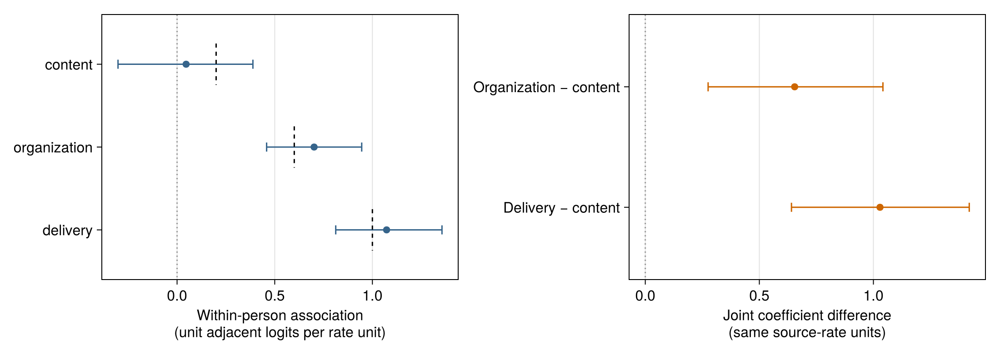
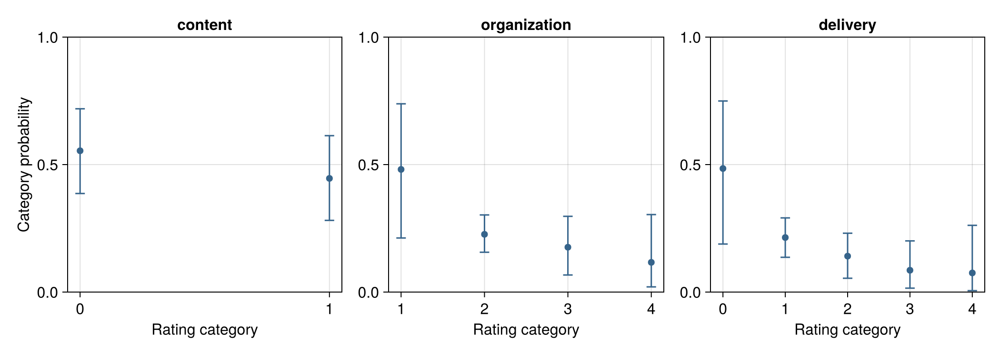
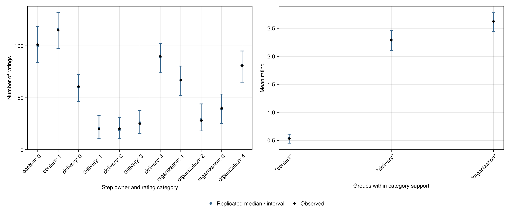
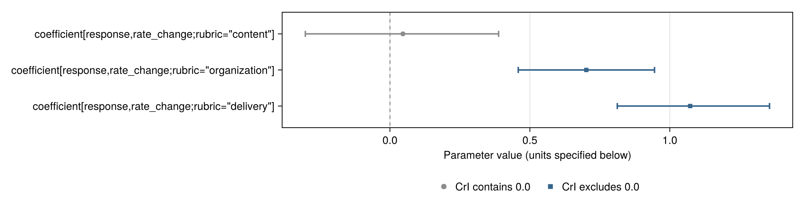

# Compare the Same Predictor Across Criteria

**Does a speaker's change in rate relate more strongly to delivery than to
content?** Fit the associations together and compare their joint posterior
difference. This scalar model can use different category counts
while sharing person, performance and rater effects.

## Specify the ratings

Use one row per rating and criterion. In the artificial example, 24 speakers
each give three presentations; eight raters supply 648 ratings. Content is binary
(0–1), organization has four categories (1–4), and delivery has five (0–4).
These are teaching choices, not a recommended rubric or sample size.

`talk` identifies the same presentation across raters and criteria. Its rate
belongs to that presentation. `aspect` identifies the criterion. Higher scores
must consistently mean more of the modeled trait. One common scalar trait with
unit loadings is an assumption; different category counts do not establish it.

```julia
using BayesianMGMFRM, JSON3
using BayesianMGMFRM.Legacy
using Distributions: Normal, LogNormal

ratings = JSON3.read(read(joinpath(pkgdir(BayesianMGMFRM),
    "examples", "data", "criterion_ratings.json"), String))
spec = mfrm_spec(ratings;
    person=:speaker, performance=:talk, score=:rating,
    facets=(presentation=:talk, assessor=:judge, rubric=:aspect),
    steps=:rubric,
    category_levels=Dict("content"=>0:1, "organization"=>1:4, "delivery"=>0:4),
    decompose=(rate=(between=:mean_rate, within=:rate_change),),
    predictors=(person=(mean_rate=Normal(0,.6),),
        assessor=(experience=Normal(0,.6),),
        response=(rate_change=(by=:rubric, prior=Normal(0,.6)),)),
    population=(person=LogNormal(log(.6),.45),
        presentation=LogNormal(log(.4),.45), assessor=LogNormal(log(.35),.45)),
    prior_sd=(facets=(rubric=.4,), step=.45), intercept=Normal(0,.8))
validate_design(spec)
```

`rubric` is a user-chosen facet name. The `by` declaration creates one coefficient
per level from the **same** source column, with independent copies of the supplied
Normal prior. It does not add a common coefficient or random slopes. The between
coefficient remains common in this example; the three within coefficients differ.
Do not add unrestricted common and full level-specific versions of the same
predictor: they are aliased. All example priors use the supplied artificial units.

## Fit and compare

The next block starts estimation. Use `julia --threads=4` for four parallel chains.
To read the supplied result without computing, skip to the figures below.

```julia
result = fit(spec; chains=4, warmup=600, ndraws=1000, seed=7112,
    chain_execution=:threads, max_parallel_chains=4)
qualify(result)
delivery = "coefficient[response,rate_change;rubric=\"delivery\"]"
content = "coefficient[response,rate_change;rubric=\"content\"]"
difference = BayesianMGMFRM.posterior_contrast(result; left=delivery, right=content)
report = fit_report(result; parameters=[delivery, content])
save_fit("criterion-fit.jls", result)
restored = load_fit("criterion-fit.jls")
```

The difference is computed from paired draws, retaining their dependence. It is
in unit adjacent logits per rate unit, not rating points. Separate significance
or overlap of marginal intervals does not test this difference. Inspect whole-fit
diagnostics and the contrast's mean/interval-endpoint Monte Carlo error.
Same-source declarations permit this contrast; unrelated predictor units remain
protected from accidental subtraction.

## Read the supplied result

The four-chain example passes its whole-fit numerical gates (maximum R-hat
1.0044, minimum bulk/tail ESS 1,531, no retained divergences). The delivery-minus-
content coefficient difference is 1.029, with a 95% interval [0.641, 1.420]. Its
mean MCSE is .0022 and interval-endpoint MCSEs are .0109/.0105. This indicates a
positive difference **in this synthetic dataset under this model and prior**;
it does not establish general detection performance. The between-person and
experience intervals both include zero. The residual-SD priors are close to
the generating SDs; no prior-robustness claim follows from this example.



Points are posterior medians; bars are 95% equal-tailed intervals. The left panel
shows within-person rate associations; the right shows joint differences from
content. Dashed lines on the left mark the synthetic generating values. These
are one artificial fitted example, not empirical evidence about speaking.



Posterior mean category probabilities and pointwise 95% intervals for the same
observed person, presentation and rater. Each criterion uses its own declared
support. These are intervals for probabilities, not replicated-outcome intervals.
Known-performance prediction preserves training rates and unique-performance
means. It does not create a new performance or a causal intervention in rate.



Black diamonds are observed counts/means; blue points and bars are medians and
95% pointwise intervals from 500 posterior-replicated datasets. Both panels are
separated by the steps owner. Raw means on binary and five-category scales are
not comparable. This exploratory PPC checks these summaries; it does not test
all within-assessment dependence, and predictive endpoint MCSE is not assessed.

```julia
using CairoMakie
ppc = predictive_check(result; groupby=:rubric, ndraws=500, seed=8111)
BayesianMGMFRM.plot(ppc; kind=:predictive)
receipt = save_report("criterion-ppc.json", ppc; return_receipt=true)
BayesianMGMFRM.plot(load_report(receipt.path; expected_sha256=receipt.sha256);
    kind=:predictive)  # redraws saved values; no new inference or prediction
```

The supplied computed reports are in `examples/reports/criterion-posterior.json`
and `criterion-ppc.json`; their hashes are in `criterion-sha256.json`. Load them
with `load_report` and `plot` to redraw without fitting. Portable reports preserve
computed values; native joint draws require their source and compatible environment.

## Check unused categories and constant ratings

Always declare the intended support: a five-category criterion remains `1:5`
when the sample uses only `1, 2, 4, 5` or `1, 2, 3, 4`. Do not replace its
support with the observed unique scores.

```julia
check = validate_design(spec)
check.identified                    # structural design screen
check.response_patterns.issues      # category/pattern warnings with IDs and counts
check.response_patterns.category_usage
```

`unused_interior_category` and `unobserved_declared_endpoint` identify unused
possible categories within each steps-owner level. `constant_score_pattern`
identifies person/facet levels with at least two ratings all using one category,
separately within each steps-owner group. Thus binary and five-category scores
are not pooled. A constant whole group produces one warning covering its
subgroups; the detailed `constant_patterns` records still retain their IDs.

These warnings retain every observation and category. They do not reject a fit,
declare a rater unreliable or change numerical qualification. Agreement for one
performance and constant scores over many performances need different
interpretations. Inspect assignment, prior sensitivity, category-count and
variation PPC. `fit` emits a warning summary; `design_summary`, `validate_design`,
and newly computed `fit_report`/`predictive_check` results retain the evidence.
Saved old reports retain their original warnings; recompute `fit_report` from a
compatible native fit to add the new audit without rerunning estimation.

Figure captions summarize these pattern warnings by type and number of issue
records. For a newly computed report or the supplied `criterion-reference.json`, inspect
individual cases in `report.response_patterns.issues`, or print their messages
with `foreach(println, report.response_patterns.warnings)`.
Counts can overlap across facets and are not numbers of distinct people or
ratings. The saved report retains every warning; other model and numerical
warnings remain in the caption. Reports without the structured audit keep their
original warning text.

## Color CrIs relative to a reference

```julia
report = fit_report(result; parameters=[content, delivery])
BayesianMGMFRM.plot(report; kind=:posterior, reference=0.0,
    interval_colors=(contains=:gray55, excludes=:steelblue4))
```

For additive/explanatory posterior plots, `reference` enables coloring: circles
and the `contains` color mean the closed CrI includes that value, even at an
endpoint; squares and `excludes` mean it does not. Fixed values remain diamonds,
not estimated CrIs. The legend names the reference. Omit `reference` to retain
the uniform-color default; choose another finite value in the selected
parameters' units when substantively useful. A common reference across unrelated
units is not automatically meaningful. This display option is refused for PPC.



The supplied synthetic fit's three within-person rate coefficients share source
units. Content's CrI includes zero; organization and delivery's CrIs exclude it.
Colors do not encode posterior null probability, practical importance, numerical
qualification or model adequacy. The external caption retains qualification and
model warnings and summarizes the pattern issues; individual records remain in
the computed report.
The computed example report is `examples/reports/criterion-reference.json`;
`load_report` and `plot(...; reference=0)` redraw it without inference. Reference
and palette are rendering options: supply them again when redrawing a report.

## What the model assumes

- Each support is an explicitly declared consecutive integer sequence. Its
  centered steps sum to zero. Binary groups have one fixed zero step, and their
  difficulty is represented by the declared facet effect. Global shared steps
  require shared support; the dictionary maps every level of the steps facet.
- Probabilities are normalized over each row's support. Returned matrices use
  the union of category labels; unsupported cells are structural zeros, not
  estimated zero-probability events. `category_support` identifies valid cells.
  Model summaries omit unused padding in the rectangular step-coordinate matrix.
- Shared Gaussian person, performance and rater effects induce dependence when
  integrated out. Ratings are conditionally independent given these effects.
  Additional assessment-specific dependence, halo and rater-specific rate slopes
  are not included automatically. Criterion-specific associations need not mean
  different latent abilities, but a common ability must be substantively justified.
- Coefficients describe associations. Observed person means are finite averages,
  not error-free latent habitual rates; decomposition is not detrending. Good
  MCMC diagnostics do not establish adequate information, coverage or robustness.

The likelihood follows the PCM and additive severity formulation in
[Robitzsch and Steinfeld (2018), pp. 105 and 107](https://www.psychologie-aktuell.com/fileadmin/download/ptam/1-2018_20180323/6_PTAM_IRMHR_Main__2018-03-13_1416.pdf).
Predictor ownership and parameterization follow the distinctions in
[De Boeck et al. (2011)](https://www.jstatsoft.org/article/view/v039i12).
The declared Bayesian priors and this exact composition are not a reproduction
of every model in those papers. `stan_data(spec)` exports a dense reference for
`src/stan/explanatory_mixed_facets.stan` when support is declared by owner;
otherwise it uses the existing explanatory reference. These references support
finite density/gradient validation, not a second fitted posterior or speed claim.
