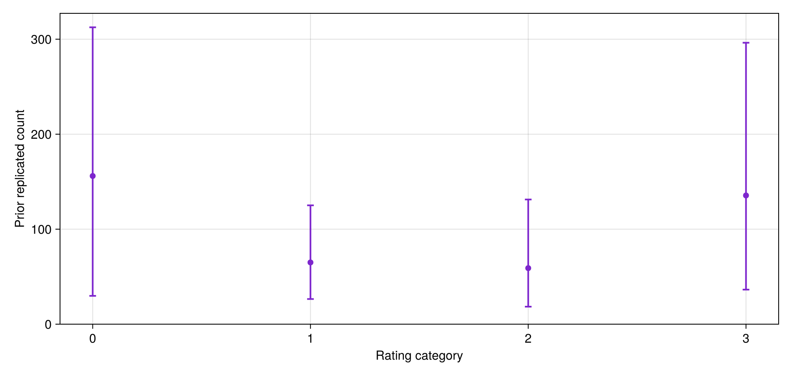
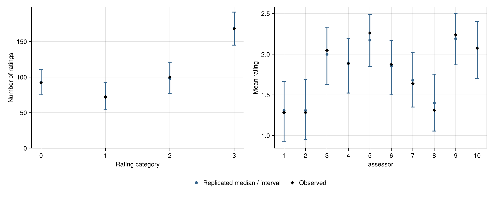
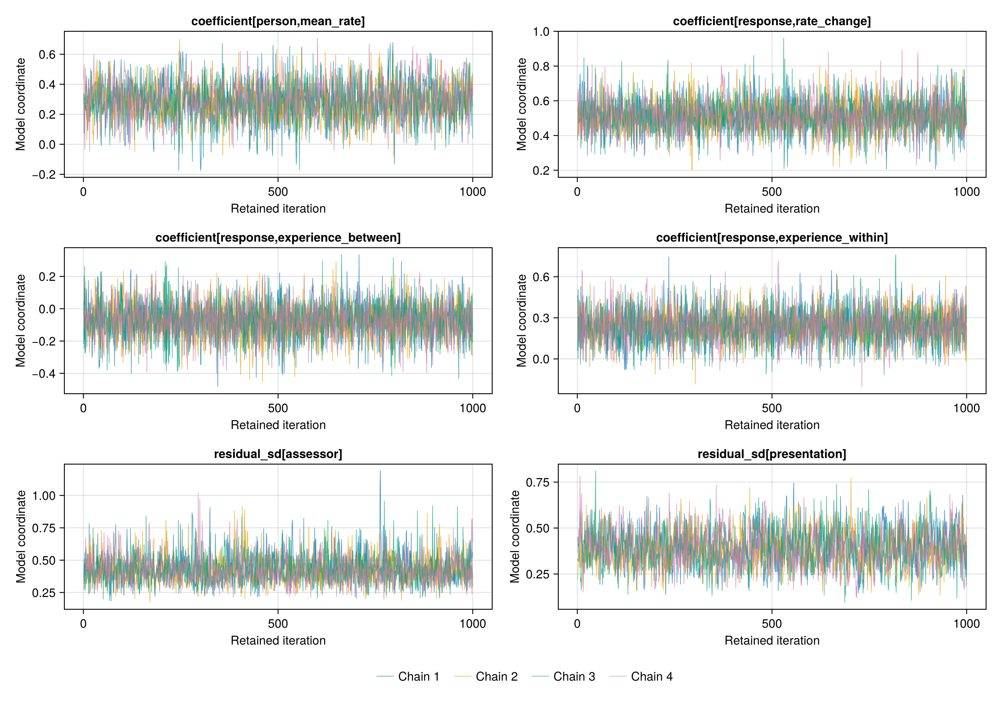
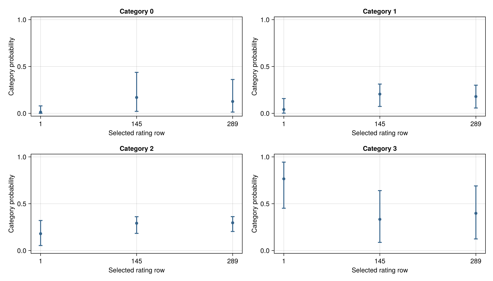
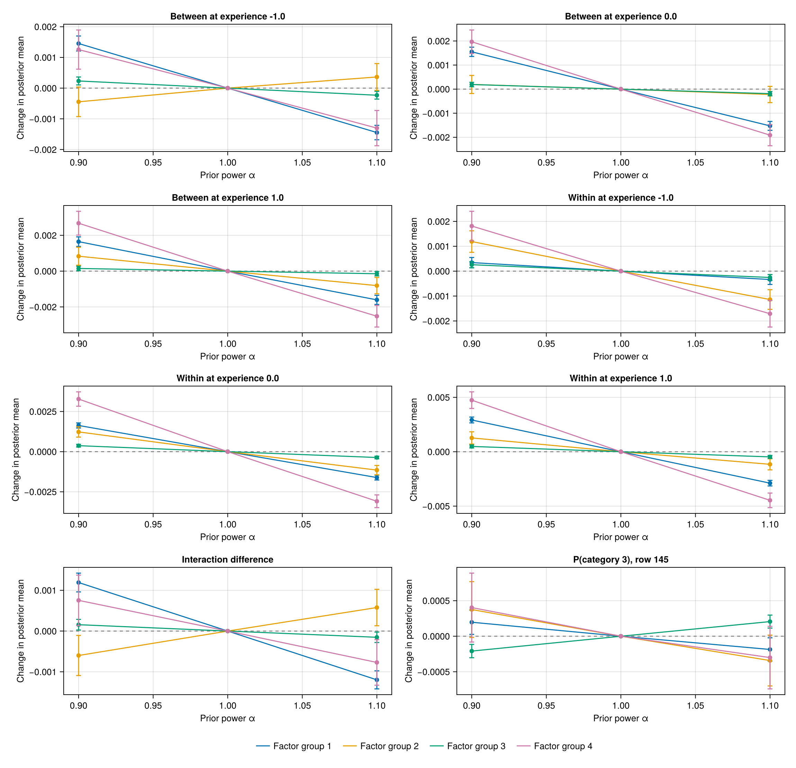
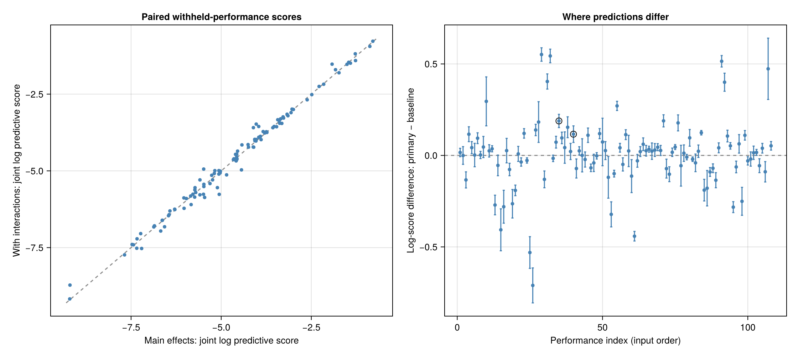

# Check an Explanatory Rating Model

Do the priors produce plausible ratings? Did the chains explore consistently?
Does the fitted model reproduce the data? These are separate questions. This
page uses saved results from the [repeated-performance moderation example](repeated-performances.md).
It starts no fitting or simulation.

## Open the saved figures

```julia
using BayesianMGMFRM, CairoMakie, JSON3
using BayesianMGMFRM.GlassBox
using BayesianMGMFRM.Legacy
root = joinpath(pkgdir(BayesianMGMFRM), "examples", "reports", "explanatory-diagnostics")
hashes = JSON3.read(read(joinpath(root, "sha256.json"), String))
stored(name) = load_report(joinpath(root, name * ".json");
    expected_sha256=hashes[name * ".json"])
BayesianMGMFRM.plot(stored("prior"); kind=:predictive)
BayesianMGMFRM.plot(stored("ppc"); kind=:predictive)
BayesianMGMFRM.plot(stored("trace"); kind=:diagnostics)
BayesianMGMFRM.plot(stored("prediction"); kind=:prediction)
```

The prior and posterior reports use the same plotting verb; their stored type
selects the correct interpretation and caption. Console notes are part of the
figure: retain them when exporting. The artificial example has 36 people,
108 performances, 10 raters and 432 ratings.

## Before conditioning on scores: prior predictions



Purple points and bars are medians and pointwise 95% intervals across 100 prior
replicas at the declared design. They are **not posterior estimates**. Ask whether
these ranges represent reasonable prior beliefs about category use. Broad ranges
alone neither validate nor invalidate a prior. Mixed supports are displayed
separately by steps owner; raw scores from different rubrics are not pooled.

## After fitting: posterior predictions



Blue summaries use 500 posterior replicas; black diamonds are the observed
statistics. Left: category counts. Right: each rater's mean. The bars are pointwise
95% **predictive intervals for these statistics**, conditional on observed owners.
Agreement here can miss rate-dependent misfit and within-performance dependence.
Predictive endpoint MCSE is unassessed for both prior and posterior checks.

## Inspect chains alongside numerical diagnostics



Colors distinguish four chains; all 1,000 retained iterations per chain remain
in their original order. Warmup is not shown. Apparent overlap cannot prove
convergence. This example passes the declared numerical gates: maximum R̂ 1.0044,
minimum bulk ESS 1,640, minimum tail ESS 2,218, E-BFMI .749–.925, and no retained
divergences or depth hits. Twenty warmup divergences remain in telemetry.
Check the actual focal interval precision as well; the 18 predeclared quantities
passed here. Diagnostic success is separate from predictive fit and prior sensitivity.

## Predict a category for a known rating row



Points are posterior mean probabilities; bars are pointwise 95% **credible
intervals for probabilities** at rating rows 1, 145 and 289. These are not intervals
for a future rating. The rows have different recorded people, performances,
raters and attributes: differences between panels/rows are not causal effects
of speaking rate. Row identifiers and attributes remain in `selected_columns`;
probability MCSE remains in `mcse`. Diamonds, when present, mark structural zeros
outside a row's support. New owners and changed stored owner attributes are not supported.

## Use your own fit

With an existing explanatory `result`, select parameters explicitly for traces:

```julia
names = ["coefficient[person,mean_rate]", "coefficient[response,rate_change]"]
traces = fit_report(result; parameters=names, include_draws=true)
probabilities = predictive_probabilities(result; rows=[1, 2, 3])
receipt = save_report("trace-report.json", traces; return_receipt=true)
reopened = load_report(receipt.path; expected_sha256=receipt.sha256)
BayesianMGMFRM.plot(reopened; kind=:diagnostics)
BayesianMGMFRM.plot(probabilities; kind=:prediction)
```

These operations reuse retained draws. By contrast,
`prior_predictive_check(spec; ndraws=100, seed=1)` and
`predictive_check(result; ndraws=500, seed=2, groupby=:assessor)` generate new
replicas; save their returned reports before repeated plotting. Choose counts,
priors and diagnostic precision for your own question, not by copying this example.

## How much do the priors affect the answer?

Open the saved sensitivity calculation with the same `stored` helper:

```julia
BayesianMGMFRM.plot(stored("sensitivity"); kind=:prior_sensitivity)
```



Colors identify coefficient priors (group 1), residual-SD hyperpriors (2), step
priors (3), and those three groups together (4). Points show changes in posterior
means at α=.9,1,1.1; connecting lines guide the eye. Bars are **±2 paired-shift
MCSE**, not posterior credible intervals. Each panel has its own vertical scale;
the last panel uses probability units. Between/within panels use logits per
supplied rate unit, and the interaction difference uses logits per rate ×
experience unit. Small plotted shifts are not estimates of the effects themselves.

Here the largest absolute slope-mean shift is .00475, the interaction-difference
shift .00120, and the selected probability shift .000403. All nonidentity cases
pass the Pareto-k screen (maximum .161); weight ESS ranges from 3,962 to 3,999
of 4,000 draws. All focal mean-MCSE values are below .00304, meeting the declared
.02 numerical bound. This is a local check of one artificial fit. It does not
resolve the original interaction interval's failure to cover the generating value,
establish empirical validity, or test every defensible prior. Quantile/decision
precision and uncertainty from fitting the PSIS tail remain unassessed.

For your own saved explanatory fit, inspect the available factors before selecting:

```julia
factors = logprior(result; components=:factors)
[(f.id, f.role, f.measure, f.selectable) for f in factors.factors]
sensitivity = prior_sensitivity(result;
    powers=["weaker" => (factors=["residual_sd[assessor]"], alpha=.9),
            "baseline" => (factors=["residual_sd[assessor]"], alpha=1.),
            "stronger" => (factors=["residual_sd[assessor]"], alpha=1.1)],
    estimands=["Between-rate association" => "coefficient[person,mean_rate]"],
    max_mean_mcse=.02)
BayesianMGMFRM.plot(sensitivity; kind=:prior_sensitivity)
```

This reuses joint draws; it neither refits nor generates predictive replicas.
Save the report with `save_report` and retain its receipt. An unreliable weight
screen remains a gap in the plot and in the report, not evidence of robustness.
Baseline convergence warnings are never cleared by reweighting.

Only declared top-level or fixed-scale factors are selectable. Conditional
residual distributions with estimated SD and transformation Jacobians remain
unchanged. For a positive-SD LogNormal(μ,s) prior, power α gives a normalized
LogNormal(μ+(1−α)s²/α,s/√α): changing only the log-SD spread would answer a different
question. This follows the selective hierarchical perturbation principle in
[Kallioinen et al. (2024), §§2.1–2.3](https://doi.org/10.1007/s11222-023-10366-5).
The returned factor definitions identify the measure explicitly.

Likelihood power scaling remains a separate unfinished operation. This prior-only
screen does not diagnose prior-data conflict.
The [PCM sensitivity route](prior-sensitivity.md) has a different model contract.

## Does adding the interactions improve predictions?

```julia
comparison = stored("comparison")
BayesianMGMFRM.plot(comparison; kind=:comparison)
comparison.difference, comparison.mcse
```



Here each predictive unit is **all ratings of one performance**. Its shared
residual is integrated once; the speaker and assessors remain represented by
other performances. Both models retain the observed predictor roster, main
effects and common priors. The larger model adds experience × mean speed and
experience × within-person speed deviation. This is one artificial dataset,
not evidence about an empirical speaking population.

The total log predictive score difference is **+0.713** for adding interactions;
computational MCSE is **0.368** (block checks: 0.340 and 0.306). The difference
does not clear the worked example's three-MCSE criterion: neither superiority
nor equivalence is established. Bars are ±2 computational MCSE, **not CrIs or
population confidence intervals**. Crossed-design sampling uncertainty remains
unassessed. All five fits pass retained-draw diagnostics; their warmup warnings
remain in the report and caption. This does not repair the original missed
generating interaction difference.

For your own two saved explanatory fits, name the facet associated with your
declared performance column (called `presentation` in this example):

```julia
larger = criteria(interaction_fit; unit=:performance, integrate=:presentation)
smaller = criteria(main_effect_fit; unit=:performance, integrate=:presentation)
larger.problem_performances, smaller.problem_performances
comparison = compare_models("Interactions" => larger, "Main effects" => smaller;
    criterion=:psis_loo, independent_model_rng=true)
receipt = save_report("comparison.json", comparison; return_receipt=true)
reopened = load_report(receipt.path; expected_sha256=receipt.sha256)
BayesianMGMFRM.plot(reopened; kind=:comparison)
```

Declare independent RNG streams only when you actually ran the models/refits
independently. No estimate is automatically ranked. An unreliable profile remains
diagnostic-only, and the total qualified MCSE becomes unavailable. In the supplied
example, direct refits check performance 40 in both models and replace unstable
PSIS for performance 35 in the smaller model. Black rings mark these contributions.

To prepare a needed refit, use `plan = loo_refit_plan(result, id;
unit=:performance, integrate=:presentation)`, then fit `plan.target` with explicit
sampler settings. The plan preserves original predictor means/deviations and
priors. Supply the saved fit with `criteria(result; unit=:performance,
integrate=:presentation, refits=[id => held_fit], independent_refit_rng=true)`.
This never starts refitting automatically. Inspect all numerical diagnostics and
choose useful precision for the question; `mcse_blocks=(100,200)` optionally
checks PSIS tail-fit variability, with block sizes dividing iterations per chain.
Neither those checks nor the observed predictor roster support prospective
prediction with unknown covariates, new people or new assessors. Integration
requires one iid performance facet; finite-sum-zero effects and performance-specific
response coefficients needing additional integration are refused.
