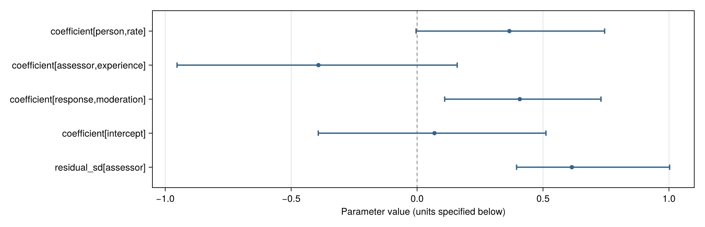
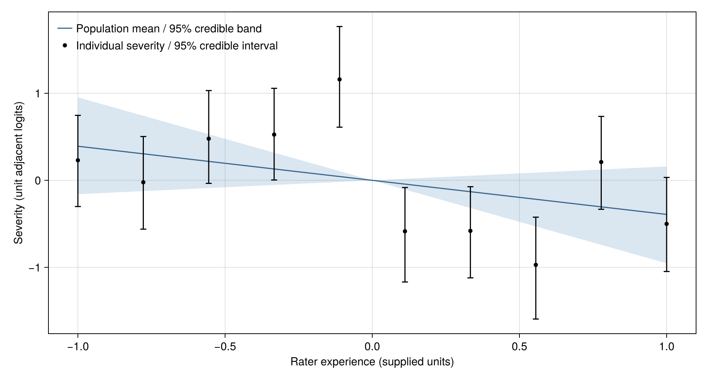
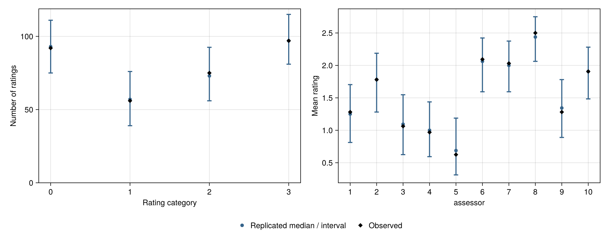

# Explain ratings and rater severity

For a bounded slider including its endpoints, see [Bounded Scores](bounded-scores.md).
This page uses declared ordinal categories.

Use this **scalar model** to ask: does speaking rate relate to
ratings, does experience relate to rater severity, and does experience change
the rate–rating association? It jointly estimates the regression and latent
effects, retaining their uncertainty. Start with one outcome; [criterion-owned supports and effects](criterion-effects.md)
provide an explicit scalar extension for several outcomes when that common-trait
assumption is appropriate.

## Specify who owns each predictor

| Question | Declaration | Positive coefficient means |
| --- | --- | --- |
| One performance per speaker: is rate associated with ratings? | `predictors.person` | Higher latent performance and ratings. |
| Is rater experience associated with severity? | A named facet in `predictors` and `population` | Greater severity, hence **lower** ratings. |
| Does experience change the rate association? | A precomputed rate × experience column in `predictors.response` | A more positive rate association as experience increases. |
| How much rater variation remains? | `population.assessor` | The estimated residual SD measures between-rater severity variation. |

Names such as `assessor` are yours to choose. Owner predictors must be constant
within their person/facet ID. Numeric columns retain the supplied units: encode
categories and construct products explicitly. Choose meaningful centering and
scaling before setting coefficient priors; the package does not standardize them.

## Fit a small artificial example

This supplied dataset has 48 speakers, one performance per speaker, 10 raters,
320 ratings and categories 0–3. `rate` and `experience` are artificial values in
[−1,1]; `moderation` is their product. These priors illustrate the operation,
not recommended priors for a speaking study.

```julia
using BayesianMGMFRM, JSON3
using BayesianMGMFRM.Legacy
using Distributions: Normal, LogNormal  # selective import avoids a `fit` name conflict

ratings = JSON3.read(read(joinpath(pkgdir(BayesianMGMFRM),
    "examples", "data", "explanatory_ratings.json"), String))
spec = mfrm_spec(ratings;
    person=:speaker, score=:rating, category_levels=0:3,
    facets=(assessor=:judge, prompt=:prompt), steps=:global,
    prior_sd=(person=0.7, facets=(prompt=0.0,), step=0.45),
    population=(assessor=LogNormal(log(0.5), 0.5),),
    predictors=(person=(rate=Normal(0.1, 0.6),),
                assessor=(experience=Normal(-0.1, 0.6),),
                response=(moderation=Normal(0, 0.6),)),
    intercept=Normal(0, 0.8))

validate_design(spec)  # necessary structural checks, not proof of adequate information
prior_predictive_check(spec; ndraws=100, seed=9601)  # BEFORE conditioning on ratings
result = fit(spec; chains=4, warmup=600, ndraws=1000, seed=7002)
qualify(result)        # inspect whole-fit diagnostics; not model adequacy
focus = ["coefficient[person,rate]", "coefficient[assessor,experience]",
         "coefficient[response,moderation]", "residual_sd[assessor]"]
report = fit_report(result; parameters=focus)  # intervals and Monte Carlo error
```

A positive rate coefficient describes an association; the experience coefficient
has the opposite sign convention because it predicts **severity**. With the
product included, the rate association at experience e is β_rate + e × β_product.
The experience coefficient alone describes its association when rate is zero.
Do not interpret any of these as causal effects or regress posterior mean
abilities a second time as if they were observed without error.

## Inspect and preserve the result

```julia
using CairoMakie
BayesianMGMFRM.plot(report; kind=:posterior)
ppc = predictive_check(result; groupby=:assessor, ndraws=500, seed=8001)
BayesianMGMFRM.plot(ppc; kind=:predictive)
save_fit("explanatory-fit.jls", result)
restored = load_fit("explanatory-fit.jls")
receipt = save_report("explanatory-report.json", report; return_receipt=true)
stored = load_report(receipt.path; expected_sha256=receipt.sha256)
BayesianMGMFRM.plot(stored; kind=:posterior)  # redraw; no estimation or simulation
```

Figure annotations are written outside the image by default; retain them with the
figure. The PPC compares observed category counts and rater mean ratings with
replicated datasets from the **posterior**. Its intervals describe replicated
data, not coefficients. They are pointwise, and endpoint MCSE is not assessed.
Neither a successful PPC nor passing numerical diagnostics proves the model is appropriate.
Inspect parameter/interval-endpoint MCSE separately; 500 PPC replicates are an
exploratory display. Native draws require their producing source and compatible
environment; portable reports contain computed values, not reusable samples.

### Read the supplied result without fitting

The artificial four-chain example passed its whole-fit numerical diagnostics (maximum
Rhat 1.0031; minimum bulk/tail ESS 1,630; no retained divergences). The rate
coefficient is 0.37 with a 95% credible interval [−0.004, 0.745]; its lower endpoint
MCSE is 0.010, so treating its exact side of zero as a stable decision would be
misleading. The experience coefficient is −0.39 [−0.95, 0.16]. Substantial uncertainty
is part of the answer. The moderation coefficient is 0.41 [0.11, 0.73]. These
numbers describe the artificial dataset, not evidence about actual speakers.



Medians and 95% equal-tailed credible intervals. Person/response coefficients
raise ratings; the experience coefficient predicts severity, whose positive
values lower ratings. Predictor coefficients use their own supplied units; the
SD is in unit logits. The global intercept is also shown.



Black intervals describe individual severity. The blue band describes the
population mean conditional on experience, not a new rater's prediction interval.
These are pointwise intervals and associations, not simultaneous or causal claims.



Observed black diamonds versus posterior-replicated medians and 95% predictive
intervals, for category counts and rater means. This checks two summaries of
known-owner predictions; it cannot establish local independence or general adequacy.

Changing only the rater-SD prior from `LogNormal(log(0.5),0.5)` to
`LogNormal(log(0.8),0.7)` changed its posterior median from 0.61 to 0.68 and its
95% interval from [0.39,1.00] to [0.41,1.20]. Both fits passed numerical diagnostics.
The ten-rater example retains prior sensitivity; two priors are not a general
robustness analysis. Across these fits, focal mean MCSE was at most 0.0083 and
interval-endpoint MCSE at most 0.024. No scientific decision tolerance is implied.

```julia
folder = joinpath(pkgdir(BayesianMGMFRM), "examples", "reports")
checksums = JSON3.read(read(joinpath(folder, "explanatory-sha256.json"), String))
stored = load_report(joinpath(folder, "explanatory-posterior.json");
    expected_sha256=checksums["explanatory-posterior.json"])
BayesianMGMFRM.plot(stored; kind=:posterior)
```

Use `explanatory-ppc.json` with its checksum and `kind=:predictive` for the saved
PPC. Redrawing these computed reports neither estimates nor simulates. This is
one operation example, not SBC or evidence of general recovery or coverage.

## Meaning and boundaries

The adjacent-category logit is θ_person − Σ facet_effect + X_response δ − τ_k,
with multiplier and slopes exactly **1**, not 1.7. Person and population-declared
facets use `effect = X_owner β + σ z`, with independent standard-normal z.
Their residuals have population mean zero; they do **not** sum to zero in the
observed panel. Other facets and step vectors retain the finite sum-zero priors
in [user-named additive facets](additive-facets.md).

- Supply a nonnegative number in `population` to fix an iid residual SD, or
  `LogNormal(logmean, logsd)`, `truncated(Normal(0, s), 0, Inf)` (HalfNormal),
  or `truncated(LocationScale(0, s, TDist(ν)), 0, Inf)` (Half-t) to estimate it. Omit that owner's competing
  `prior_sd` entry. `population=(person=..., assessor=...)` can estimate both
  residual SDs when the allocation provides information. Priors for coefficients
  are explicit `Normal` distributions; other prior families are not yet supported.
- An optional Normal `intercept` adds one global intercept. Duplicate mean
  predictors or coincident estimated covariance components are refused for
  fitting. Estimated residual SDs require repeated observations within owner in
  this domain. Passing these screens does not establish global
  identification. Few raters can make variance estimates prior-sensitive.
- Known-owner prediction preserves fitted owner attributes. You may change
  ordinary response covariates explicitly; decomposed known-performance predictors
  retain their stored source values and means. New persons/raters and population predictions
  are not provided. `predictive_probabilities` returns probability intervals,
  whereas `predictive_check` generates outcomes. Neither automatically refits.
- One person/one performance combines stable person and unique-performance
  variation. [Repeated-performance within/between decomposition](repeated-performances.md)
  is available with explicit performance ownership and effects. Random slopes and heteroscedastic residuals remain separate extensions.
  [Criterion-specific coefficients and mixed supports](criterion-effects.md) use
  explicit declarations; manually adding product columns fits fixed moderation,
  not random slopes.
- This is an additive severity hierarchy. Patz's HRM instead introduces an ideal
  discrete rating and a rater consistency mechanism. The residual severity SD
  here is not within-rater inconsistency, halo or a measure of rater accuracy.

`coordinates` exposes coefficients, residual SDs and the change-of-volume.
Coefficients use white coordinates β = μ + s q. LogNormal SDs use
σ = exp(μ_logσ + s_logσ q) with a standard-normal prior on q. HalfNormal and
Half-t SDs use u = log σ with normalized density `log p(exp(u)) + u`;
this log-scale coordinate is not standard normal. The volume includes m log σ
per iid residual block, log(s_logσ σ) for a LogNormal SD or log σ for a
HalfNormal/Half-t SD, coefficient log scales and finite-subspace scales.
Do not add a second SD prior or Jacobian to this target.
`stan_data` exports dense reference matrices for `src/stan/explanatory_facets.stan`;
serialize matrices as arrays of rows for CmdStan JSON. This is a finite-point
verification reference, not a second fitted posterior or a speed comparison.

## Sources and what they support

- [De Boeck et al. (2011)](https://www.jstatsoft.org/article/view/v039i12):
  explanatory item-response models and person/item/response predictor ownership.
- [Patz et al. (2002)](https://doi.org/10.3102/10769986027004341):
  the distinct ideal-rating HRM; multiple raters do not create new performances.
- [Robitzsch & Steinfeld (2018)](https://www.psychologie-aktuell.com/fileadmin/download/ptam/1-2018_20180323/6_PTAM_IRMHR_Main__2018-03-13_1416.pdf):
  taxonomy and existing R implementations; arbitrary named facets are not unique
  to this package. Formula and scale differences matter when comparing models.
- [Leckie & Baird (2011)](https://doi.org/10.1111/j.1745-3984.2011.00152.x):
  experience, mean severity and residual rater variation in a crossed model.
  Their continuous score-difference likelihood is not this ordinal PCM.

For multiple performances per person, see [between/within associations](repeated-performances.md).

See [category design matrices](design-matrix-mrcml.md) for the coefficients of a task feature in an LLTM. A person covariate instead enters the population mean, as in the [linked group example](equating-and-populations.md).

## [Shared event effects](@id Shared-event-effects-(Experimental))

When several criteria describe the same person/rater assessment, a shared
residual can represent their remaining dependence. Create globally unique
person/rater pair IDs; do not use the rater ID alone. A person/testlet ID can
instead link the items in a testlet. Repeated observations within each event,
and multiple events per person, are needed to separate the event and person SDs.
The structure is an exchangeable Gaussian event effect; it does not identify a
psychological cause of halo or establish recovery across arbitrary designs.

```julia
using Distributions: Normal, truncated
# ratings.event contains the same ID across criteria of one assessment.
spec = mfrm_spec(ratings; person=:person, score=:score,
    facets=(item=:item, rater=:rater, event=:event),
    assessment=:event, steps=:global, category_levels=0:4,
    prior=:default,
    random_effects=(event=truncated(Normal(), 0, Inf),))
fit_event = fit(spec; chains=4, warmup=1000, ndraws=1000, seed=42)
posterior_summary(fit_event; parameters=["residual_sd[event]"])
event_loo = criteria(fit_event; unit=:assessment, integrate=:event)
```

The MRCML shared-effect route reports person deviations and `population_mean` separately.
The predictor-based `population=(event=..., ...)` route retains its `coefficient[intercept]` name.
Add their joint posterior draws for absolute ability on the centered-facet
scale. Shared facet effects enter with a minus sign in the adjacent logit.
Their SD measures event variation, with no sign attached.

HalfNormal and Half-t priors have positive density at zero but no point mass
there. They permit learning small SDs without guaranteeing unbiased boundary
estimation. With a continuous SD prior, `Pr(σ > 0)` is one and is not evidence
for an effect. Report a credible upper bound and probabilities such as
`Pr(σ < δ | data)` for a substantively justified, stated `δ`. Check the MCSE
of that probability along with R-hat, bulk/tail ESS, and sampler diagnostics.

Assessment-unit LOO integrates a single shared effect jointly over all ratings
in the held-out assessment. The other owners must remain represented in the
training data. Inspect quadrature and Pareto-k warnings before interpreting a
score difference. Q3 and Infit/Outfit condition on the estimated shared effects;
their posterior predictive references ask about remaining misfit. Reliability
reports the finite-cohort posterior variance ratio and its numerical MCSE.
Population/design reliability and a credible interval for that posterior
functional are not supplied.

```julia
q3 = diagnostics(fit_event; kind=:residual_correlation, by=:item, unit=:event)
fit_stats = diagnostics(fit_event; kind=:fit_statistics, by=:rater)
rel = reliability(fit_event)
# Fit the standard model to exactly the same rows and declared event IDs.
standard_loo = criteria(fit_standard; unit=:assessment)
comparison = compare_models(:shared => event_loo, :standard => standard_loo;
    criterion=:psis_loo, independent_model_rng=true)
```

The independence flag requires independently generated model/refit draws. High
Pareto-k events can be explicitly refitted with `BayesianMGMFRM.loo_refit_plan`;
failed or unavailable MCSE remains visible. Neither event-wise deletion nor its
Monte Carlo error estimates a population sampling SE for a crossed design.
