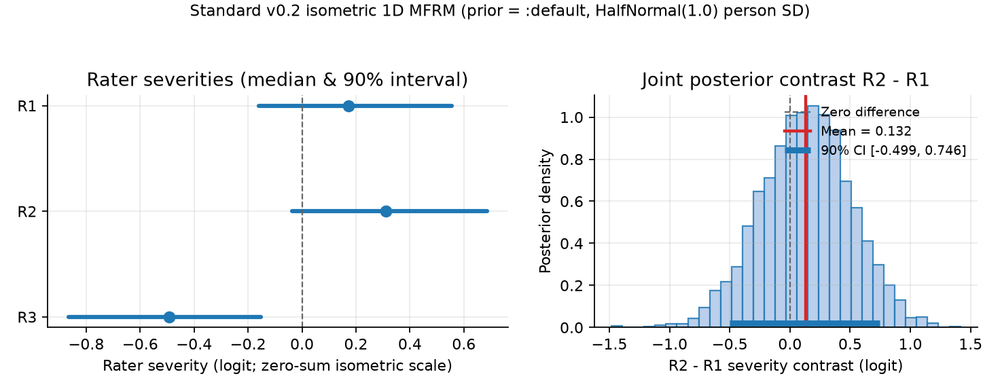
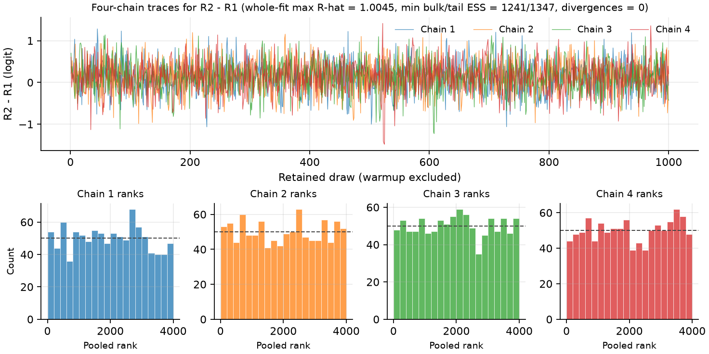
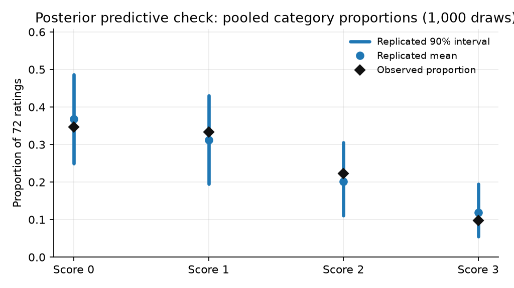

# Your First Rating Analysis

**Is rater R2 more severe than R1, after accounting for the people and tasks
they rated?** This walkthrough answers that question using supplied teaching
data on the standard `0.2.0-DEV` one-dimensional many-facet Rasch model
(`prior = :default`). You can read the figures without installing anything.
To run the analysis yourself, complete [installation](installation.md) first,
then follow the Julia code below.

## 1. Understand the ratings and standard model

Each row is one person's score on one task from one rater. Here are three
rows from the supplied teaching table:

| Person | Item (task) | Rater | Score |
| --- | --- | --- | ---: |
| P1 | I1 | R1 | 0 |
| P1 | I1 | R2 | 0 |
| P1 | I1 | R3 | 2 |

The complete dataset contains **72 artificial ratings: 12 people, four tasks,
three raters, and ordered scores 0–3**. Higher scores mean better performance.
The raters have overlapping assignments, allowing their severity to be compared.
These are teaching data, not evidence about real raters or a recommended sample size.

We use the standard **one-dimensional isometric partial-credit MFRM**
(`prior = :default`):

- **Isometric sum-to-zero facets and steps:** Item difficulties, rater
  severities, and item-specific category steps use orthonormal Helmert
  sum-to-zero bases with marginal prior SD `1.0` for every level. This
  representation is invariant to the alphabetical order of facet labels and
  avoids treating an arbitrary first rater (`R1`) or first item (`I1`) as a
  zero-error reference.
- **Estimated cohort location and person spread:** Overall cohort location is
  absorbed by `population_mean ~ Normal(0, 2.5)` and person ability spread by
  the zero-supporting scale prior `residual_sd[person] ~ HalfNormal(1.0)`.
  Estimating both avoids the over-anchored ceiling/floor sign-reversal collapse
  that arises when both facet references and the person origin are fixed at
  zero, and substantially reduces rater-contrast overestimation when person
  spread is small. Mild residual undercoverage can still remain if true person
  variance is literally zero, so check prior sensitivity when true ability
  spread may be near zero.
- **Transparent prior implications:** Before fitting, inspect
  `design_summary(spec).prior_summary`. On a zero-sum isometric block of
  ``L`` levels with marginal SD ``1.0``, the implied prior SD for any pairwise
  difference is ``\sqrt{2L/(L-1)}`` — here **`1.732` logits** for three raters
  and **`1.633` logits** for four items. Always check prior sensitivity when
  true ability spread may be near zero, scores cluster near the floor or
  ceiling, or a facet has few levels.

## 2. Run the analysis

Run this block in Julia using only the top-level `BayesianMGMFRM` API.
**The `fit` call starts estimation**: four NUTS chains, each with 1,000 warmup
and 1,000 retained draws. To learn from the supplied completed result without
computing, skip the block and continue to step 3.

```julia
using BayesianMGMFRM

ratings = include(joinpath(pkgdir(BayesianMGMFRM), "examples", "first_analysis_ratings.jl"))

spec = mfrm_spec(
    ratings;
    person = :person,
    score = :score,
    facets = (item = :item, rater = :rater),
    steps = :item,
    category_levels = 0:3,
    prior = :default,
)

validation = validate_design(spec)
validation.passed || error("Resolve design errors before fitting: $validation")
design_summary(spec).prior_summary

fitted = fit(spec; chains = 4, warmup = 1000, ndraws = 1000, seed = 2026112401)
qualify(fitted)
contrast(fitted; facet = :rater, left = "R2", right = "R1", interval = 0.90)
```

For a self-contained script that also computes posterior-integrated
`Infit`/`Outfit`, person reliability, posterior predictive checks, and
SHA-256 verified portable handoff persistence, run:

```julia
using BayesianMGMFRM
include(joinpath(pkgdir(BayesianMGMFRM), "examples", "first_analysis_v02.jl"))
analysis = FirstMFRMAnalysisV02.main()
```

`examples/first_analysis.jl` is the ordinary command-line entry for this same
implementation. Pass `--saved-fit path/to/fit.jls` to rebuild reports from a
matching trusted native fit without MCMC. This still generates the seeded
predictive checks; it does not modify the original saved fit.

To inspect the data, pre-fit validation, prior summary, and sampler settings
without running MCMC, call `FirstMFRMAnalysisV02.inputs()`. For frequentist
1D estimation on the same prior-free design (`prior = :none`), pass
`method = :mmle` or `method = :jmle` explicitly to `fit` (see
[Frequentist MFRM](frequentist-mfrm.md)); generalized and
multidimensional models (`gmfrm`, `mgmfrm`) use NUTS exclusively.

## [3. Read the answer](@id read-the-answer)

The supplied completed `0.2.0-DEV` analysis gives a mean R2−R1 severity
contrast of **0.132 logit** (posterior median **0.141 logit**) and a **90%
credible interval of [−0.499, 0.746]**.



*Left: posterior medians (dots) and central 90% credible intervals for all
three raters on the zero-sum isometric scale (`R1`: 0.174 [−0.160, 0.555],
`R2`: 0.310 [−0.037, 0.685], `R3`: −0.493 [−0.866, −0.151]). Right: joint
posterior draws of `R2 − R1` directly from `contrast(fitted; ...)`. Every
rater has quantified uncertainty without pinning `R1 = 0`.*
[Download SVG](assets/first-analysis-v02/figures/posterior.svg)

The 90% interval for `R2 − R1` spans zero. **These ratings do not clearly
establish which rater is more severe under this model and prior.** They do not
prove equivalence. Logits are model units, not raw score points. Always compute
any pairwise comparison directly with `contrast(fitted; ...)` rather than
comparing the overlap of separate rater intervals.

## 4. Check the computation



*Colors identify the four chains. The traces and rank histograms show retained
draws for `R2 − R1`; warmup is excluded. Visual agreement on one contrast does
not replace whole-fit qualification.*

In the supplied fit (`qualify(fitted)`), whole-fit checks pass across all
estimated coordinates:

- **Maximum rank-normalized split-``\hat{R}``:** `1.0045` (threshold `<= 1.01`)
- **Minimum bulk / tail ESS:** `1,240.8 / 1,346.8` (threshold `>= 400`)
- **Retained-draw sampler events:** `0` divergences, `0` maximum-treedepth hits
  (`19` warmup divergences occurred during adaptation and are reported
  separately in the [complete answer](assets/first-analysis-v02/answer.txt))
- **Contrast MCSE (`R2 − R1`):** `0.0064` logit for the mean and
  `0.0176 / 0.0150` logit for the 90% interval endpoints, below this example's
  illustrative limits of `0.01 / 0.02`.

**If your run fails `qualify(fitted)`, retain the fit for diagnosis and
withhold the substantive conclusion.** Passing numerical checks verifies
computation, not model adequacy.

## 5. Check fit statistics, reliability, and predictions

### Posterior-integrated vs. plug-in Infit and Outfit

Call `diagnostics(fitted; kind = :fit_statistics, by = :rater, level = 0.90)`
to compute posterior-integrated mean-square fit statistics alongside
posterior-mean plug-in values:

| Rater | Posterior-integrated Infit (90% CI) | Plug-in Infit | Posterior-integrated Outfit (90% CI) | Plug-in Outfit |
| --- | --- | ---: | --- | ---: |
| R1 | `0.895 [0.634, 1.251]` | `0.666` | `0.890 [0.634, 1.284]` | `0.639` |
| R2 | `0.952 [0.681, 1.376]` | `0.745` | `1.077 [0.726, 1.659]` | `0.817` |
| R3 | `1.300 [1.009, 1.683]` | `1.058` | `1.328 [0.996, 1.774]` | `1.024` |

Notice how Bayesian posterior-mean shrinkage pulls plug-in `Infit`/`Outfit`
below `1.0` (`R1` plug-in Infit `0.666` vs. posterior-integrated `0.895`).
Propagating full posterior uncertainty avoids false overfit flags. Do not treat
uncalibrated rules of thumb (such as `0.7–1.3`) as automatic rater-exclusion
rules.

### Person reliability

`reliability(fitted; facet = :person, interval = 0.90)` separates two
distinct quantities:

- **Finite-cohort posterior reliability:** `0.290` (90% CI `[0.000, 0.767]`)
- **Population marginal reliability** (using the compiled per-draw
  `residual_sd[person]`): `0.512` (90% CI `[0.033, 0.863]`)

Wide intervals are expected with only 12 people and 6 ratings per person.

### Posterior predictive check (PPC)



*Black diamonds show observed proportions for scores 0–3 out of 72 ratings
(`25, 24, 16, 7`). Blue dots and bars summarize 1,000 replicated rating tables
from `predictive_check(fitted; ndraws = 1000, seed = 2026112402, interval = 0.90)`
(90% replicated count intervals `[18, 35]`, `[14, 31]`, `[8, 22]`, `[4, 14]`).*
[Download SVG](assets/first-analysis-v02/figures/predictive.svg)

All four observed proportions fall inside the 90% replicated intervals. This
pooled check rules out gross global category-frequency mismatch, but can miss
rater-specific misfit or within-event local dependence. Note also that
`validate_design(spec)` flags unused category `3` on tasks `I3` and `I4`; the
full declared `0:3` scale is preserved without dropping categories.

## 6. Keep and reopen the result

Use two distinct persistence layers depending on how long you need to keep the
result:

- **Short-term native cache (`save_fit` / `load_fit`):** Fast Julia
  serialization tied to the exact same package source, Julia version, and
  `Manifest.toml`.
- **Long-term portable handoff (`PortableHandoff`):** Self-contained,
  SHA-256-verified JSON preserving joint `(chain, iteration, parameter)` draws,
  original facet ID dictionaries, effective constraints, and qualification
  metadata across environments and languages (including R via
  `read_handoff_mgmfrm()`).

```julia
# Short-term cache (same Julia environment):
save_fit("my_fit.jls", fitted)
reopened = load_fit("my_fit.jls")

# Portable SHA-256 verified JSON handoff:
handoff = BayesianMGMFRM.PortableHandoff.export_handoff(fitted)
BayesianMGMFRM.PortableHandoff.save_handoff("my_handoff.json", handoff)
verified = BayesianMGMFRM.PortableHandoff.load_handoff("my_handoff.json")
```

Inspect the supplied [complete text summary](assets/first-analysis-v02/answer.txt)
and [verified portable handoff receipt](assets/first-analysis-v02/handoff_receipt.json)
bundled with this walkthrough (`FirstMFRMAnalysisV02.main()` writes and verifies
the full `handoff.json` in your local output folder).

## [Recommended standard specification for your own unanchored ratings](@id recommended-standard-specification)

The walkthrough above already uses the recommended standard `0.2.0-DEV`
specification (`prior = :default`) for unanchored 1D ratings. To adapt it to
your own CSV table, continue with
[reading and validating your rating table](data-validation.md#import-csv) and
[choosing and checking priors](bayesian-workflow.md#3.-Check-Prior-Implications).

## Legacy reference-coded (`R1 = 0`, `I1 = 0`) walkthrough note

Earlier `0.1.x` documentation used a reference-coded `FacetData` + `BayesianMGMFRM.Legacy.MFRMPrior`
walkthrough (`R1 = 0`, `I1 = 0`, fixed person SD `1.5`, mean `R2 − R1 = 0.166`
logit, 90% CI `[−0.495, 0.840]`). That script (`examples/legacy/first_analysis.jl`)
and its hash-verified figure bundle (`examples/first_analysis_figures.jl`,
`assets/first-analysis/`) remain available solely for backward-compatibility
checks and historical archive verification. Do not use fixed first-level
references with a fixed zero person origin for new unanchored studies.
