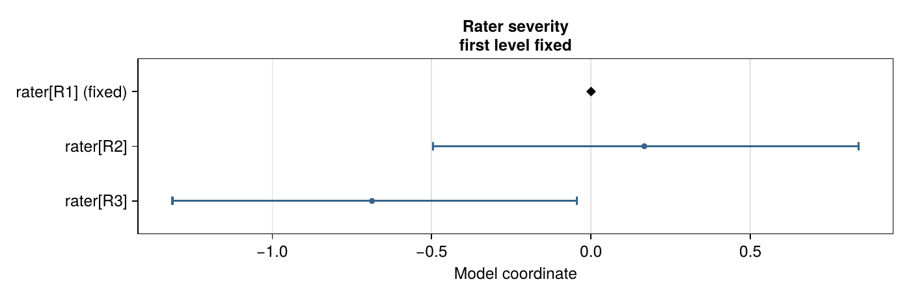
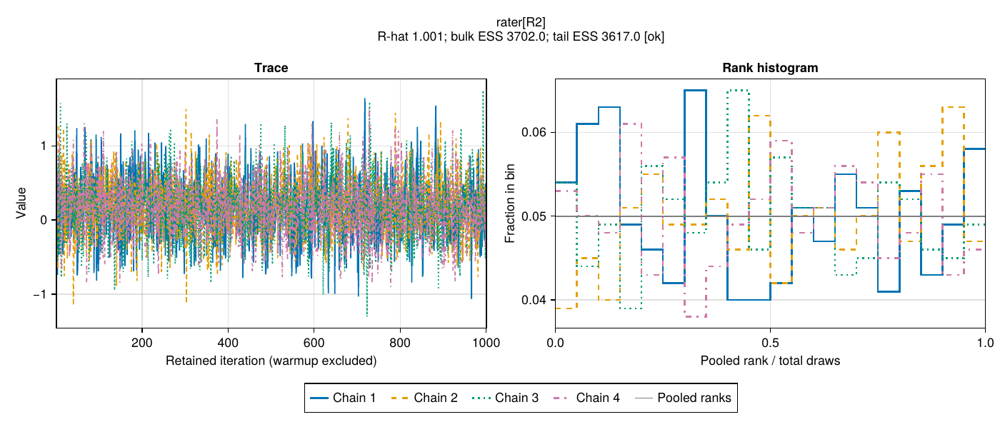
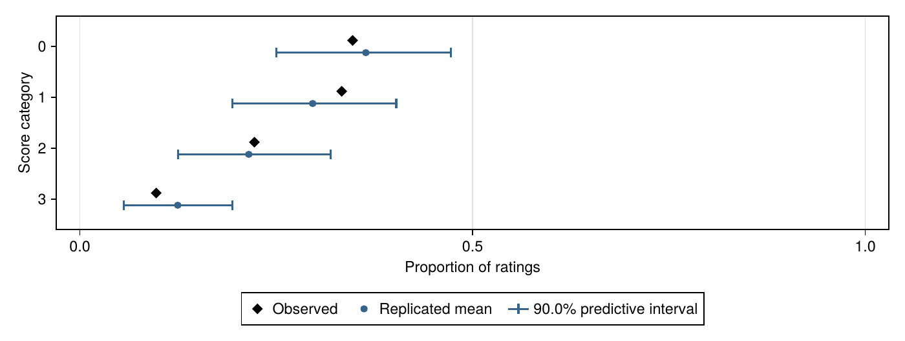

# Your First Rating Analysis

**Is rater R2 more severe than R1, after accounting for the people and tasks
they rated?** This example answers that question using supplied teaching data.
You can read the figures without installing anything. To run the analysis,
complete [installation](installation.md) first, then follow the code below.

## 1. Understand the ratings

Each row is one person's score on one task from one rater. Here are three
rows from the supplied data:

| Person | Item (task) | Rater | Score |
| --- | --- | --- | ---: |
| P1 | I1 | R1 | 0 |
| P1 | I1 | R2 | 0 |
| P1 | I1 | R3 | 2 |

The complete dataset contains **72 artificial ratings: 12 people, four tasks,
three raters, and ordered scores 0–3**. Higher scores mean better performance.
The raters have overlapping assignments, allowing their severity to be compared.
These are teaching data, not evidence about real raters or a recommended sample size.

We use a one-dimensional many-facet partial-credit model. It separates person
ability, task difficulty and rater severity, with category steps specific to
each task. R1 defines zero severity: positive R2 means stricter than R1.
Zero does not mean R1 is unbiased. The first task is also fixed at zero and
category steps are centered to define the scale.

The example uses zero-centered normal priors: SD 1.5 for person coordinates
and SD 1.0 for free rater, item and step coordinates. These describe uncertainty
before observing the ratings; they are teaching choices, not universal defaults.

## 2. Run the analysis

Run this block in Julia after installation. **The last line starts estimation**:
four NUTS chains, each with 1,000 warmup and 1,000 retained draws. To learn from
the supplied result without computing, skip the block and continue to step 3.

```julia
using BayesianMGMFRM
include(joinpath(pkgdir(BayesianMGMFRM), "examples", "first_analysis.jl"))
analysis = FirstMFRMAnalysis.main()
```

The script checks the rating design, fits the model, saves the fit and prints
an answer with numerical checks. A new run can differ from the stored result
shown below. To inspect the data, model and settings without fitting, use
`FirstMFRMAnalysis.inputs()` instead of the last line.

## [3. Read the answer](@id read-the-answer)

The supplied completed analysis gives a mean R2−R1 difference of **0.166 logit**
and a **90% credible interval of [−0.495, 0.840]**.



*Dots are posterior medians; bars contain the central 90% of each parameter's
posterior distribution. R1's diamond is fixed at zero. The text reports a mean,
so it need not equal the plotted dot.* [Download SVG](assets/first-analysis/figures/posterior.svg)
· [PDF](assets/first-analysis/figures/posterior.pdf)

R2's interval extends on both sides of zero. **These ratings do not clearly
establish which rater is more severe under this model and prior.** They do not
prove equivalence. Logits are model units, not score points. For another pair
of raters, estimate their contrast directly rather than compare the overlap
of their separate intervals.

## 4. Check the computation



*Colors identify the four chains. The traces and rank histograms show retained
draws for R2−R1; warmup is excluded. Similar traces help, but this one-parameter
figure does not replace checks of the whole fit.*

In the supplied fit, all 25 estimated coordinates pass the recorded checks:
maximum R-hat is 1.0026, minimum bulk/tail effective sample sizes are 3,306/2,649,
and retained draws have no divergences or maximum-depth hits. The 16 warmup
divergences are reported separately in the [complete answer](assets/first-analysis/answer.txt).

Monte Carlo standard error (MCSE) measures error from using a finite set of
draws. For R2−R1 it is 0.0067 logit for the mean and 0.0132/0.0120 for the
interval endpoints, below this example's limits of 0.01/0.02. These are
computational tolerances, not scientifically important effect sizes.
**If your run reports failed numerical checks, keep the saved fit and withhold
the severity conclusion.** Passing these checks does not establish model fit.

## 5. Check what the model predicts



*Black diamonds show the observed proportions for scores 0–3. Blue dots and
bars summarize proportions in 4,000 replicated rating tables; bars are
pointwise central 90% predictive intervals.*

This is a **posterior predictive check (PPC)**: it uses parameters estimated
from these ratings to generate new ratings for the same people, tasks, raters
and allocation. It is not a prior predictive check or a held-out prediction.
The bars describe variation in replicated proportions, not uncertainty about
the severity difference.

All four observed proportions fall inside the displayed intervals. This
pooled check finds no obvious category-frequency discrepancy, but can miss
rater-specific problems and dependence. The bundle does not establish prior
robustness or predictive-endpoint MCSE. Its defensible answer remains the
uncertain R2−R1 contrast above. The figures on this page all belong to the
supplied fit; running step 2 does not replace them with figures from your run.

## 6. Keep and reopen the result

If you ran step 2, `analysis.directory` gives your output folder. It contains
`answer.txt`, `answer.json` and `fit.jls`. Read your own answer with:

```julia
read(joinpath(analysis.directory, "answer.txt"), String)
```

To reopen the **supplied** answer and figures without fitting, run:

```julia
using BayesianMGMFRM
include(joinpath(pkgdir(BayesianMGMFRM), "examples", "first_analysis_figures.jl"))
review = FirstMFRMFigures.main()
review.figures
```

This verifies and copies the existing report and SVG/PDF files to a new folder,
then returns their paths. Open a returned path in your viewer; none opens
automatically. It generates no predictions and needs no plotting dependency.
Keep your own fit's source and Julia project environment for later restoration;
the [reopening recipe](examples.md#Save-and-reopen-without-refitting) explains how.

You have now followed one rating comparison from data to an answer and its
checks. For your own study, continue with [reading your rating table](data-validation.md#import-csv)
and [choosing and checking priors](bayesian-workflow.md#3.-Check-Prior-Implications).

