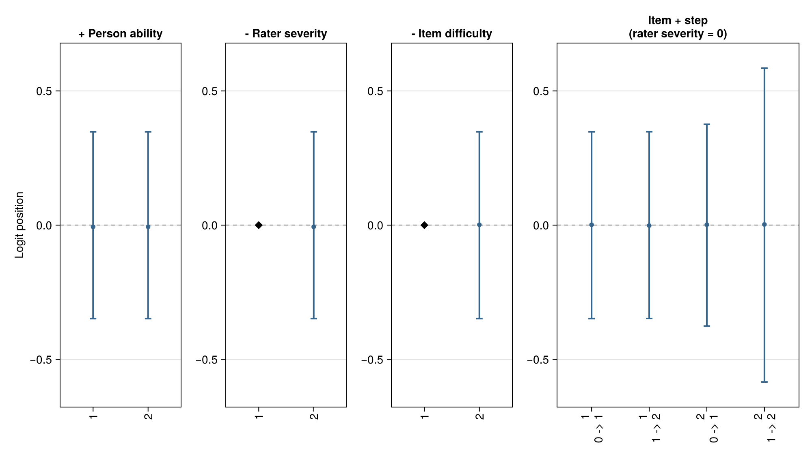
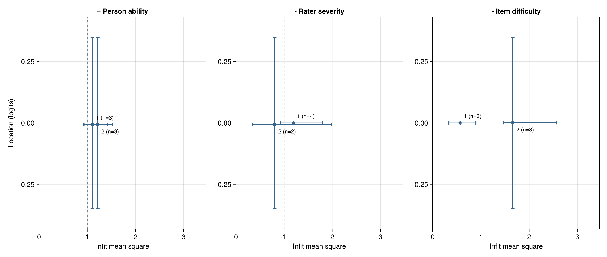
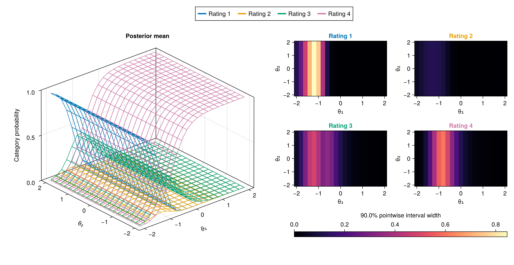

# BayesianMGMFRM.jl

!!! note "Local development manual — 14 October 2026"
    This manual includes unreleased interfaces and examples. It is not the
    documentation of an installed release. Model support and scientific
    acceptance remain as stated on each page.

When several people rate performances, their scores can reflect ability, task
difficulty and rater severity. This package models these influences together and
reports uncertainty about their differences.

**Start with one question:** [Is R2 more severe than R1?](examples.md#First-MFRM-analysis)
The first analysis uses supplied artificial ratings, fits a one-dimensional
model, explains its numerical checks and answers the question with an uncertainty
interval. It saves an answer you can read and a fit you can reopen. You do not
need to choose among all the model families to follow this example.

If the terms are new, read [Getting Started](learning-guide.md) first.
**New to Julia?** Start with the [5-Minute Julia Guide for R, Python, and FACETS Users](learning-guide.md#julia-for-beginners).
**Comparing software?** See the [comparison table with FACETS, ACER ConQuest, R (`TAM`/`mirt`), and `brms`/`CmdStan`](migration-facets-conquest.md#software-comparison).
For your own study, choose assumptions that match its design; a worked teaching
example is not a recommendation to use its sample size or prior everywhere.
Install the matching local source below before running this version's example.

## [Find an answer by task](@id find-by-task)

Start with the question you need to answer; you do not need to know a function
name first. The explanation links lead to concepts, then to executable examples
and the exact function help.

| Your question | Start here | What you should be able to decide |
| --- | --- | --- |
| I am new to Julia (coming from R, Python, or FACETS). Where do I start? | [5-Minute Julia Guide](learning-guide.md#julia-for-beginners) | Install and activate a project, read `:symbol` and `;` keyword syntax, and run your first script |
| How does this package compare with FACETS, ConQuest, R (`TAM`/`mirt`), or Stan? | [Software comparison table](migration-facets-conquest.md#software-comparison) | What is built-in, what is experimental, how uncertainty is quantified, and when to prefer each tool |
| How do I complete my first analysis? | [First MFRM analysis](examples.md#First-MFRM-analysis) | Read the supplied ratings, check the computation, interpret the R2−R1 interval and reopen the answer |
| How do the APIs connect in one analysis? | [Connected workflow](bayesian-workflow.md#connected-analysis) | Follow data → specification/prior → fit → diagnostics/answer → saved result, and distinguish refitting from postprocessing |
| How do I begin a two-dimensional MGMFRM analysis? | [Bundled MGMFRM data](examples.md#Start-with-the-bundled-MGMFRM-data) | Inspect the fixed ratings, Q matrix and prior; distinguish the four-chain teaching fit from the short interface demonstration |
| How do I use my own ratings file? | [Read a CSV and specify Q](data-validation.md#import-csv) | Preserve identifiers and category order, resolve missing/coding errors, and map items to dimensions by name |
| What do persons, raters, facets and dimensions mean? | [Getting Started](learning-guide.md), including [five or more facets](learning-guide.md#facets-levels-dimensions) | Which influence each data column represents; whether the model actually estimates it |
| Which MFRM/GMFRM/MGMFRM route fits my question? | [Model choices](learning-guide.md#Choose-assumptions-before-choosing-a-model-name), [current support](scope.md#Current-Support) | Dimension, slope and threshold choices; which routes remain experimental |
| How are rating probabilities calculated? | [Worked explanation](rating-model-theory.md), then [model equations](model-equations.md) | How a parameter change affects a category probability; who owns the thresholds |
| How does estimation work in Julia or Stan? | [From model to posterior draws](fitting.md#calculation-route), then [sampler controls](fitting.md#Backends-and-Sampler-Controls) | Model versus sampler; warmup, chains, uncertainty and numerical warnings |
| How do I choose and check priors? | [Prior implications](bayesian-workflow.md#3.-Check-Prior-Implications), [sensitivity](prior-sensitivity.md) | Whether generated ratings are plausible on the declared scale |
| How do I obtain intervals, diagnostics and useful reports? | [Reading Results](interpreting-results.md), [manuscript reporting checklist](interpreting-results.md#manuscript-reporting-checklist), [reporting API](api-saved-reporting.md) | Posterior uncertainty versus MCMC error; what to report in Methods and Results |
| How do I check a three-outcome input or read its saved analysis? | [Input inspection](data-validation.md#three-outcome-input), [saved results](api-saved-reporting.md#three-outcome-saved-reports) | Two-ordinal + one-binary (9/9/2) rating tables, trial-history covariates, portable JSON reports, MCSE, and comparison warnings |
| How can I compare models or plan a study? | [Comparison workflow](common_prediction_comparison.md), [recovery precision](common_prediction_comparison.md#Require-small-Monte-Carlo-error), [operation limits](scope.md#common-operation-support) | Aligned prediction targets and explicit recovery MCSE limits; a general design runner remains unavailable |
| How should I allocate ratings before collecting data? | [Plan a rating study](design-planning.md) | Prepare a score-free allocation, bind actual outcomes and retain failed or unfinished datasets |
| Do several criteria assess the same produced response or rating event? | [Shared-response joint ratings](joint-ratings.md), [Star-factorized mixed-support association](star-association.md) | Separate task, response and criterion IDs; choose shared-response, paired uniform, or general `D >= 2` mixed-support star association via `Experimental.joint_rating_spec` |
| Where are help and runnable examples? | [Julia help](learning-guide.md#Use-Julia-help-and-examples), [examples](examples.md), [API by task](api.md) | Inspect data without fitting first; then run a model-specific example |
| How can I reopen and share results? | [Reports and reproducibility](fitting.md#Reports-and-Reproducibility) | A same-environment fit cache versus a portable computed JSON report |
| My analysis stopped or the output is unclear. Where can I get help? | [Troubleshooting and problem reports](contributing.md) | Find the recovery step and provide a reproducible report with the right source and environment |
| What changes when I update the package? | [Versions and saved results](registration.md) | Preserve the original analysis, distinguish source revisions, and regenerate only the affected output |

## Install this development preview

This manual describes a local source checkout. The published successor branch
does not contain all of its interfaces. Use a separate analysis project and
replace the example path with the location of this checkout:

```julia
using Pkg
Pkg.activate("rating-local")
Pkg.develop(path="path/to/BayesianMGMFRM.jl")
using BayesianMGMFRM
pkgdir(BayesianMGMFRM)
```

Turing is an optional backend; add and load it only when selecting
`backend=:turing`, as shown in [sampler controls](fitting.md#Backends-and-Sampler-Controls).

Keep the exact source, `Project.toml` and `Manifest.toml`. A developed path
remains mutable; preserving its manifest alone does not preserve the source.
For an existing native cache, restore its original complete environment using
[the reproduction guide](api-saved-reporting.md#saved-result-reproduction).
The declared Julia minimum is 1.10.8. Earlier local sources completed the scalar
MFRM and normalized D2 MGMFRM examples, including fitting and restoration, on
macOS with that Julia version. JointRatings has separate saved-result checks
under Julia 1.12.5/macOS. See the [operation-specific compatibility table](api-saved-reporting.md#What-the-development-version-has-actually-verified)
for the source, startup and platform limits. Installing this checkout is not
scientific acceptance or a stable release.
The [published preview](https://ryuya-dot-com.github.io/BayesianMGMFRM.jl/)
identifies its own matching public source and earlier scope.

Examples ship with the package and can be located independently of your working
directory:

```julia
using BayesianMGMFRM
include(joinpath(pkgdir(BayesianMGMFRM), "examples", "inspect_ratings.jl"))
```

This first example inspects artificial ratings and constructs a specification;
it performs no fitting. Continue with the [examples](examples.md).

## [Visual Tour: Psychometric Maps and Bayesian Diagnostics](@id visual-tour)

Load `CairoMakie` and call `BayesianMGMFRM.plot(x; kind = ...)` to create
shared-scale Wright maps, location-by-infit Pathway maps, 3D multidimensional
response surfaces, posterior predictive checks, and prior-sensitivity plots.
Every figure includes structured methodological notes explaining the scale,
identification references, and uncertainty intervals; see the
[Visualization Gallery](visualization-gallery.md) for full-resolution figures
and reading guides.

| Shared-Scale Wright Map (`kind = :wright`) | Pathway Map (`kind = :pathway`) | 3D MGMFRM Response Surface (`kind = :response_surface`) |
| --- | --- | --- |
| [](visualization-gallery.md#Wright-Map:-locate-the-facets) | [](visualization-gallery.md#Pathway-Map:-connect-location-with-response-patterns) | [](visualization-gallery.md#MGMFRM-in-3D:-abilities-become-probabilities) |
| Compare person abilities (`+`), rater severities (`-`), item difficulties (`-`), and adjacent-category boundaries on one logit axis (also supports `person_display = :histogram` and `plot_wright(...; kind = :ridge)`). | Inspect posterior location alongside infit/outfit mean-square and marginal credible intervals to spot unusual rating patterns. | Visualize how two abilities shift category probabilities (`0–1`) and pointwise credible-interval widths (`layout = :overlay`, `:panels`, or `:heatmaps`). |

*Note:* The Wright and Pathway illustrations use deterministic artificial draws
to demonstrate the display conventions; the 3D surface reuses 16,000 retained
joint draws from a saved experimental fit to simulated ratings. See the
[Visualization Gallery](visualization-gallery.md) for all 12 unified plot kinds
(`:posterior`, `:diagnostics`, `:predictive`, `:wright`, `:pathway`,
`:response_surface`, `:prior_sensitivity`, `:prior_predictive_sensitivity`,
`:design_precision`, `:rater_drift`, `:criterion_collapse_classes`, and
`:criterion_collapse_categories`).

`BayesianMGMFRM.jl` provides conservative Bayesian workflows for many-facet
Rasch measurement. It combines long-format rating-data validation, identified
model construction, Bayesian fitting, diagnostics, predictive checks,
portable reports, and optional figures directly from saved or newly fitted
models.

## New to Many-Facet Models?

Start with the [beginner's guide](learning-guide.md). It follows a concrete
rating example and separates the research question, data design and model choice.
No Julia or Bayesian modeling experience is needed to read it.

1. [Getting Started](learning-guide.md): persons, items, raters, dimensions and
   the differences between MFRM, GMFRM and MGMFRM.
2. [How Rating Models Work](rating-model-theory.md): category probabilities,
   a worked calculation, priors, identification and ability correlation.
3. [Reading Results and Comparing Models](interpreting-results.md): uncertainty,
   diagnostics, predictive comparison and simulation for study planning.

For executable Julia workflows, continue to the [short runnable examples](examples.md).

## What Is Supported

The stable fitting surface covers one-dimensional MFRM with rating-scale or
partial-credit steps (including ordinary binary/polytomous 1PL models with
`rater = nothing`). The following additional configurations require explicit
experimental opt-in:

- a fixed-coefficient multidimensional MFRM with independent abilities;
- a two-dimensional between-item MFRM with estimated population correlation;
- either admitted multidimensional MFRM route with an explicit exchangeable
  rater prior and a supplied rater kernel SD;
- a one-dimensional scalar GMFRM with item discrimination and rater consistency;
- a multidimensional fixed-Q confirmatory MGMFRM with independent abilities;
- that independent MGMFRM with an explicitly normalized exchangeable or source
  prior, matched fixed/free item slopes, or fixed location/step mean profiles;
- an explicit two-dimensional correlated MGMFRM, covering fitting, summaries,
  diagnostics, MCSE, prior/conditional posterior prediction, manual caches and
  report/figure bundles;
- a three-dimensional correlated MGMFRM ([Correlations among Three Traits](correlated-3d.md))
  under a pure fixed-Q and normalized exchangeable prior contract (`Experimental.correlated(spec; scales = ...)` / `Experimental.Correlated3D`);
- user-named additive scalar facets ([User-Named Additive Facets](additive-facets.md))
  for additional main-effect facets with explicit step ownership and priors;
- a two-study concurrent three-outcome workflow ([Concurrent Three-Outcome Study](concurrent-three-outcome.md))
  with full numerical Gaussian/half-normal/LKJ prior configuration (`Experimental.ThreeIndicator`).

For simultaneous multi-criterion ratings of the same produced response or rating
event, `Experimental.joint_rating_spec(...; association = :none | :uniform | :star)`
and `Experimental.fit` connect three bounded experimental routes:
[Shared-response Joint Ratings](joint-ratings.md) (`:none`),
[Paired Ordinal Association](ordinal-association.md) (`:uniform`), and
[Star-Factorized Multi-Criterion Association](star-association.md) (`:star`, supporting general `D >= 2` and mixed category scales).

Separate experimental routes jointly fit
[rater-by-item severity](interpreting-results.md#Jointly-fitted-rater-by-item-effects-(experimental)),
[observed-group rater severity](rater-group-effects.md),
[criterion-collapse mixtures](criterion-collapse.md), or
[temporal rater drift (RW1)](rater-drift.md) in their documented scalar models.
These are not fitted by adding `bias` terms to the common `mfrm_spec` route, and
they preserve their own numerical and scientific boundaries.

Broader discrimination structures, exploratory loadings, and correlation
estimation above three dimensions are not supported. See
[Scope and Releases](scope.md) for the exact boundary and
[Experimental Models](experimental.md) for the provisional API.
Before choosing MGMFRM, review [what is estimated and what is fixed](scope.md#What-Changes-When-You-Choose-MGMFRM):
its fixed Q pattern still has estimated active loadings, and its rater
consistency parameter has a different meaning from reliability.
The [common-operation table](scope.md#common-operation-support) connects each
route to fitting, comparison, recovery and reporting, while the
[scientific-evidence table](scope.md#current-scientific-evidence) distinguishes
implemented operations from supported inferential claims.

## Recommended Path

The sequence below uses the unified practitioner workflow (Layer 1) for stable
MFRM entry points. For multidimensional MFRM, GMFRM/MGMFRM, or multi-criterion
joint ratings, follow the [model-specific fitting and prior routes](bayesian-workflow.md#2.-Inspect-the-Model-Before-Fitting).

1. Build long-format ratings with [`FacetData`](@ref).
2. Run [`design_summary`](@ref) and [`validate_design`](@ref) to inspect
   coverage, connectedness, category use, optional groups, and anchors.
3. Create an [`mfrm_spec`](@ref) and review its [`contract`](@ref).
   [`getdesign`](@ref) and [`model_equation`](@ref) provide optional parameter
   and equation inspection.
4. Use [`prior_draw`](@ref) and [`prior_predictive_check`](@ref) before fitting.
5. Call `fit(spec; backend = :advancedhmc, ...)` with explicit sampling settings
   for the supported stable model. Bare `fit(spec)` selects random-walk
   Metropolis and one chain; see [how estimation works](fitting.md#calculation-route).
6. Review [`qualify`](@ref) and [`diagnostics`](@ref) (along with detailed
   [`sampler_diagnostics`](@ref), [`mcmc_diagnostics`](@ref), and
   [`parameter_block_diagnostics`](@ref)).
7. Inspect [`posterior_summary`](@ref), [`facet_summary`](@ref),
   [`category_summary`](@ref), [`contrast`](@ref), estimand-specific
   [`posterior_mcse`](@ref), [`predictive_check`](@ref), [`criteria`](@ref), and
   [`prior_sensitivity`](@ref). Generate figures via `BayesianMGMFRM.plot(fit; kind = :posterior)`
   or the specific helpers in the [plotting guide](fitting.md#Posterior-interval-figures).
8. Persist or reopen results with [`save_fit`](@ref) / [`load_fit`](@ref) and
   [`save_report`](@ref) / [`load_report`](@ref), or export
   `fit_report(fit; view = :public)`, [`fit_report_public`](@ref), and
   [`fit_report_markdown`](@ref). Check report completeness with
   [`fit_report_health`](@ref) or set `require_complete = true`.

## Documentation

- [Data Validation](data-validation.md) explains the input contract and design
  checks.
- [Model Equations](model-equations.md) records the mathematical and source
  contracts.
- [Bayesian Workflow](bayesian-workflow.md) presents the analysis sequence and
  interpretation checks.
- [Bayesian Fitting](fitting.md) covers backends, experimental restrictions,
  diagnostics, and reports.
- [Experimental Models](experimental.md) documents the provisional
  namespace and its stability boundary.
- [Examples](examples.md) points to runnable scripts.
- [Migrating from FACETS and ACER ConQuest](migration-facets-conquest.md)
  maps the overlapping RSM/PCM models, sign and identification conventions,
  estimator differences, and supported individual hard anchors.
- [Scope and Releases](scope.md) states supported and unsupported surfaces.
- [Development Roadmap](roadmap.md) separates available capabilities, evidence
  gaps and the order for comparisons and extensions.
- [API](api.md) lists the public functions by workflow layer.

```@contents
Pages = [
    "learning-guide.md",
    "rating-model-theory.md",
    "interpreting-results.md",
    "data-validation.md",
    "model-equations.md",
    "bayesian-workflow.md",
    "fitting.md",
    "experimental.md",
    "examples.md",
    "migration-facets-conquest.md",
    "scope.md",
    "api.md",
    "api-data-design.md",
    "api-fitting-artifacts.md",
    "api-workflow-diagnostics.md",
    "api-validation-evidence.md",
]
Depth = 2
```
