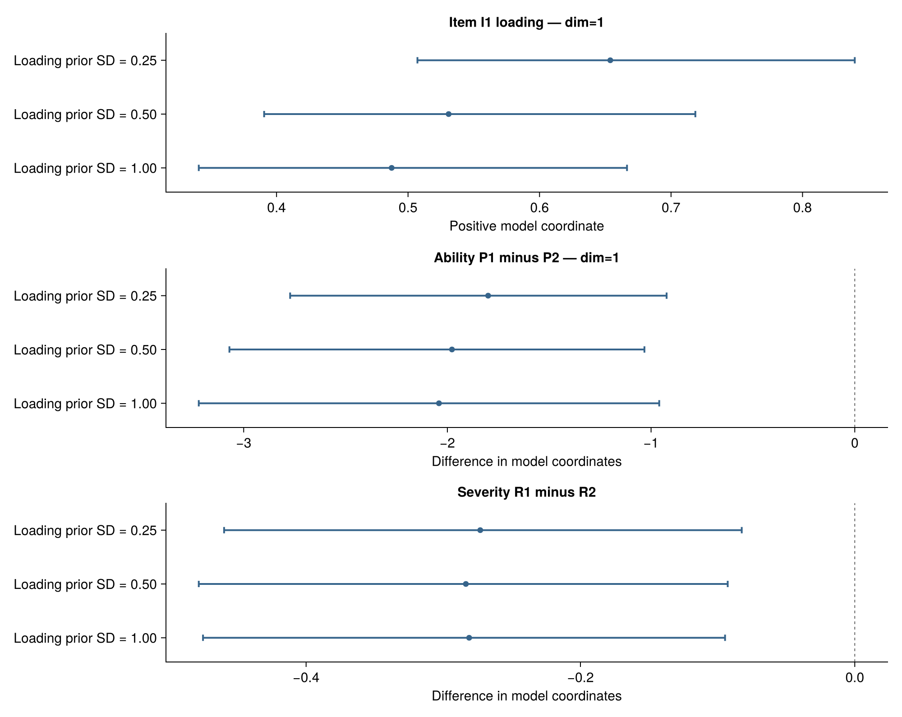
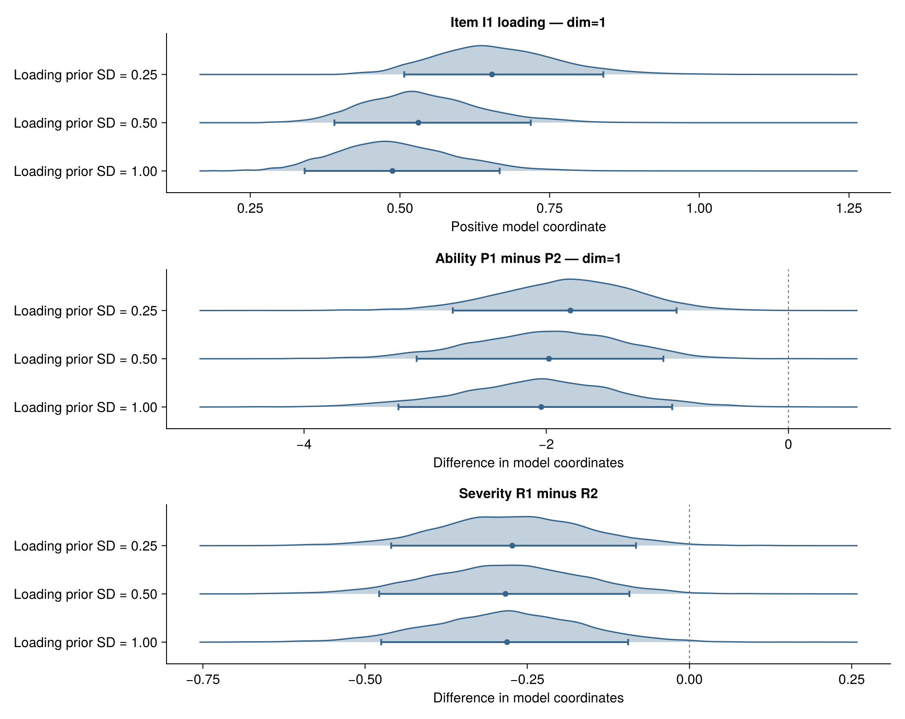
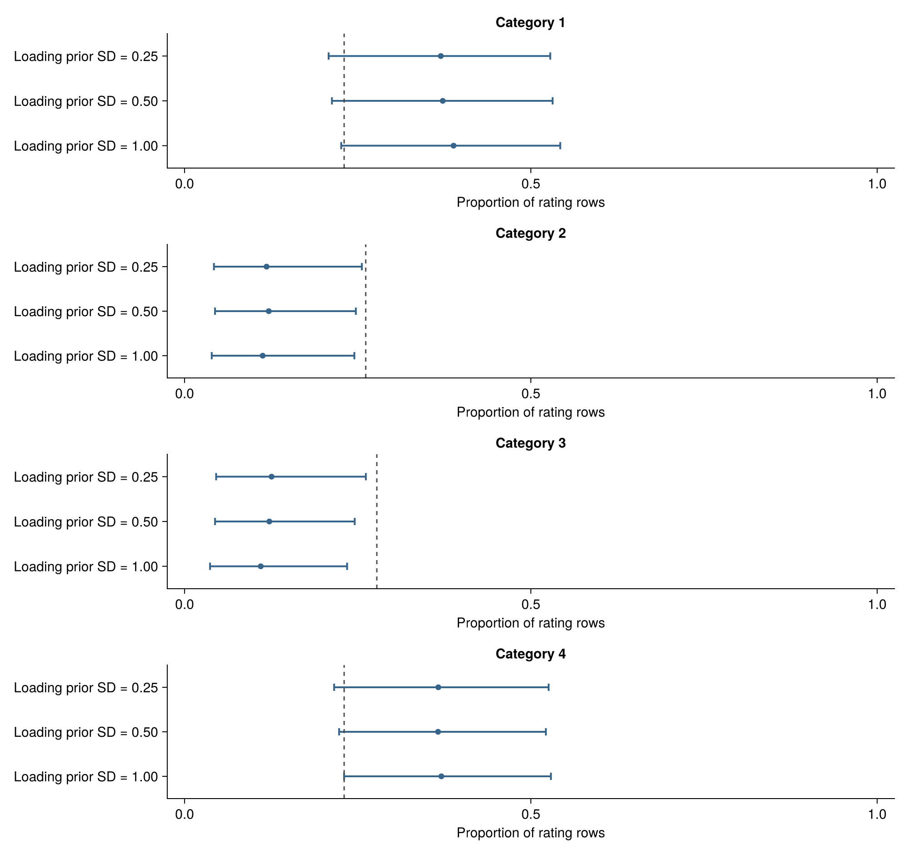
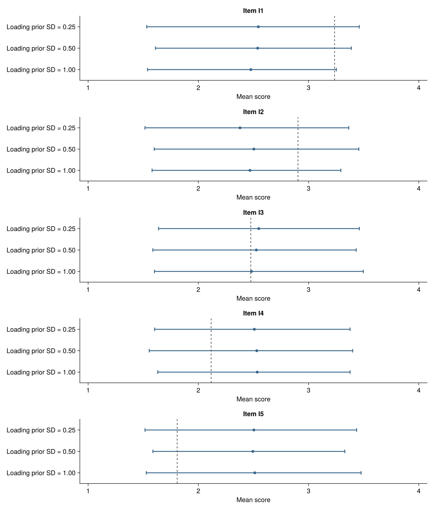
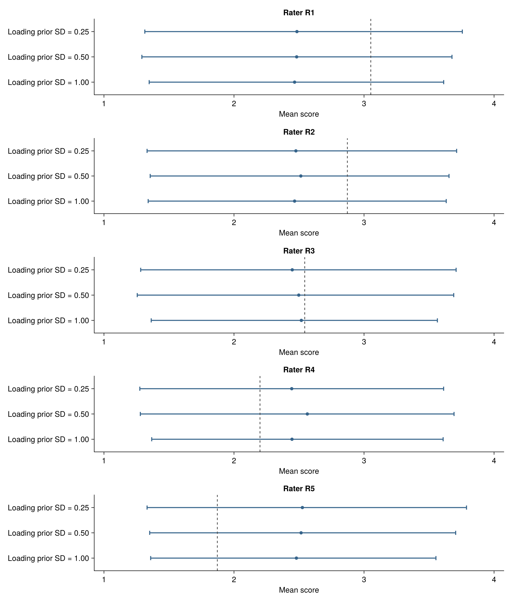

# Would a different prior change my answer?

This workflow compares **already fitted prior variants**, and can
reweight a saved baseline for the bounded PCM factors described below.
Start with a scientific question: for example, whether one
rater is more severe than another, or how uncertain a particular loading is.
Declare plausible alternative priors and the quantities of interest before
examining their answers. A prior is not preferable simply because it produces a
preferred conclusion, a smaller interval, or a better recovery score.

The default `vary=:loading_sd` scope is the normalized-prior MGMFRM with the same Q
matrix, dimensions, category scale, identification, data and all prior settings
except the SD of log item loadings (`log_discrimination_sd`). These functions
require the `BayesianMGMFRM.` prefix and are not part of a released stable API.
They do not launch fits. MFRM/GMFRM, different identifying scales, free latent
correlations and the joint-rating prototype are not yet supported by this
particular comparison entry point.

An explicit `vary=:mean_profile` also compares saved independent D1 item-step
PCM fits using `Experimental.MeanProfilePrior`, with item slopes and rater
consistency fixed at one. Only item/step means and `item_sd`/`step_sd` may vary.
Person/rater SDs, category/owner IDs, coefficient policies and all remaining
prior fields must match. This option does not admit scalar `MFRMPrior`, free
slopes or a mixture of profile and non-profile prior families.

## [When does a prior comparison support a decision?](@id prior-sensitivity-decisions)

Distinguish a change in a named estimate from a change in the conclusion you
need. Report the difference in its scientific units, numerical error, and
practical meaning. A stable prediction does not imply stable class membership,
loadings or severity effects. A change well beyond MCSE establishes sensitivity
on that comparison, not which prior is scientifically preferable. A wider prior
is not automatically less biased, and passing MCMC checks does not settle
either prior adequacy or predictive fit.

Every compared fit needs whole-fit diagnostics and precision for the actual
summary. For independent sampling runs, a difference of posterior means has
MCSE `sqrt(MCSE_a^2 + MCSE_b^2)`; this is numerical error, not a data-sampling
standard error or a credible interval for a cross-model parameter difference.
Do not impose pairing just because the data or draw counts match. Estimates
reweighted from the same draws instead require their covariance to be retained.
The existing comparison output does not add a generic difference-MCSE operation
for arbitrary model types.

Importance weighting can sometimes reuse a fit for another prior, but unreliable
weight or function tails can invalidate selected summaries. Similar numbers
from such a calculation are not evidence of robustness. See
[Vehtari et al. (2024)](https://www.jmlr.org/papers/v25/19-556.html) and the
[reference function-specific diagnostics](https://mc-stan.org/loo/reference/E_loo.html).
A justified direct fit to the alternative target can provide separate evidence;
it does not retroactively validate a failed weighting estimate. The saved-fit
comparison and the factor-power operation below retain their distinct scopes.
Separate rater-item, group-effects, drift and research halo models are not
accepted by these normalized-PCM entry points.

Keep failed/missing alternatives and unresolved precision visible. When the
selected conclusion changes under defensible assumptions, report that dependence
or limit the conclusion; do not tune priors to obtain a preferred decision.
Use the [rater interpretation guide](interpreting-results.md#rater-decision-evidence)
to separate this assessment from category adequacy, mechanism classification
and fairness.

## Reweight a fixed-scale PCM prior factor

For an independent D1 partial-credit fit with both slope types fixed at one and
an exchangeable `Experimental.MeanProfilePrior`, the same `prior_sensitivity`
verb accepts a single baseline. First inspect `logprior(baseline;
components=:factors)`: it lists `rater_severity` and `item_step_residual`, their
facet/owner IDs, coordinate groups, fixed means/SDs, measure and normalized
log densities. The step factor includes all item-owned zero-sum residual blocks;
this increment does not power an individual owner's steps separately.

```julia
factors = B.logprior(baseline; components=:factors)
result = B.prior_sensitivity(baseline;
    powers=["Wider judge prior" =>
        (factors=["rater_severity"], alpha=0.25)],
    estimands=["Judge difference" => ("rater[J05]", "rater[J01]")],
    scale=:unit_logit,
    dataset_id="My rating study", observation_ids=observation_ids,
    max_pareto_k=0.7, max_mean_mcse=0.01,
    alternatives=["Wider judge prior" => saved_wider_fit])
case = only(result.cases)
case.reweighting.status
case.rows                 # Reweighted means and approximate mean/shift MCSE
case.alternative          # Separately checked saved fit, including its warnings
case.selected_source      # Supplied alternative when weights fail; never a new fit
receipt = B.save_report("pcm-power.json", result; return_receipt=true)
reopened = B.load_report(receipt.path; expected_sha256=receipt.sha256)
```

Omit `alternatives` if none are available. Coordinate and factor names come from
the fitted model; the example assumes those judge IDs exist. `scale=:unit_logit`
multiplies applicable model coordinates and their MCSE by 1.7. `scale=:model`
retains the fitted coordinates. The numerical bound `.01` above is illustrative,
not a universal threshold for meaningful sensitivity. Both alpha and focal units
must be declared; plausible alternatives still require substantive justification.

For a selected prior factor ``p_B``, the target is proportional to
``L p_{\mathrm{rest}}p_B^\alpha`` and log weights are
``(\alpha-1)\log p_B``. For an n-member zero-sum Gaussian block, the density in its
first n−1 coordinates includes ``\tfrac12\log n`` and the reconstructed last
residual's square. With **fixed** SD and means, powering is equivalent to SD
divided by ``\sqrt{\alpha}``, so alpha=.25 doubles the SD. This equivalence does
not extend to unknown hierarchical scales: their normalization also changes.
Sampler Jacobians are not powered. Other models and arbitrary raw-density
vectors are rejected by this interface.

The existing PSIS kernel uses tail ESS of log ratios and a ceiling tail count;
an explicit `r_eff` is also recorded. Its numerical screen is
`min(max_pareto_k, 1 - 1/log10(S))`. This differs from priorsense's floor-tail
choice, so results need not be bit-identical. Alpha=1 and analytically empty
factors use exact uniform weights. Constant *observed* ratios under a changed
nonconstant prior retain a failure warning.

Mean MCSE uses the original chains and influence values
``S w_s(g_s-\mu_\alpha)``. Paired-shift MCSE subtracts ``g_s-\mu_0`` from that
sequence, retaining baseline covariance. These are plug-in delta approximations
that omit uncertainty in the fitted PSIS tail. Failed weights have unavailable
MCSE; quantile and decision precision are explicitly **not computed**. A good
Pareto k does not prove adequate function tails, calibrated error or model fit.
Baseline sampling warnings remain even at identity. For supplied alternatives,
the complete observations/model and exact powered Gaussian prior must match;
their rows are not paired with baseline iterations.

Portable reports retain factors, source identities, weights, chain/iteration IDs,
focal units, method and warnings. Keep the checksum receipt separately. They do
not migrate native fit caches or support new analysis after loading. The existing
interval/ridge plot helpers apply to saved-fit comparisons, not this mean-only
power report. No fitting, resampling or predictive generation occurs here.

## From saved fits to a scientific contrast

Use the ordinary saved-fit loader for trusted fit caches, in their original
Julia and dependency environment. The example below compares your own saved
fits, with explicit quantities of interest and observation IDs.

```julia
using BayesianMGMFRM
const B = BayesianMGMFRM

narrow = load_fit_cache("narrow-fit.jls")
wide = load_fit_cache("wide-fit.jls")
B.recovery_quantities(narrow) # Inspect exact names, dimensions and units.

result = B.prior_sensitivity(
    ["Narrow" => narrow, "Wide" => wide];
    planned_prior_ids = ["Narrow", "Wide", "Third planned prior"],
    failures = ["Third planned prior" => "Sampling failed; no usable fit"],
    dataset_id = "ratings-v1",
    observation_ids = rating_ids, # Unique IDs in the original fitted row order.
    estimands = [
        "Rater 1 minus rater 2" => ("rater[R1]", "rater[R2]"),
    ],
    cutoffs = Dict("Rater 1 minus rater 2" => 0.0),
    interval = 0.99,
)
```

Replace the names with those actually returned by your fit's quantity inventory.
Positive severity differences mean the first named rater is more severe in this
parameterization. The difference is calculated within each joint posterior
draw, preserving dependence between raters. Subtracting separately shuffled
draws, or subtracting two marginal interval endpoints, would answer a different
question. Contrasts across dimensions or coordinate blocks are rejected.

Keep the full planned prior roster. Failed and missing variants remain visible;
they are not silently removed from the denominator. Numerical warnings remain
attached to completed fits. Changing the number of retained draws between
variants is allowed and does not create artificial pairing.

To load the caches, save the comparison with its source hashes, and verify
reload in one call, use the supplied example from your source checkout:

```julia
include("examples/prior_sensitivity.jl")
saved = PriorSensitivityExample.run_saved_example(
    ["Narrow" => "narrow-fit.jls", "Wide" => "wide-fit.jls"],
    "prior-comparison-numerical";
    planned_prior_ids = ["Narrow", "Wide", "Third planned prior"],
    failures = ["Third planned prior" => "Sampling failed; no usable fit"],
    dataset_id = "ratings-v1",
    observation_ids = rating_ids,
    estimands = ["Rater 1 minus rater 2" => ("rater[R1]", "rater[R2]")],
    cutoffs = Dict("Rater 1 minus rater 2" => 0.0),
    interval = 0.99,
)
restored = B.load_prior_sensitivity("prior-comparison-numerical/result.jls")
```

Choose a new output directory. `result.jls` retains the comparison, selected
joint draws, chain information, failed/missing variants and warnings.
`sources.json` records the input cache paths and SHA-256 hashes, planned prior
IDs and result hash; it is provenance, not a portable posterior report.
An unreadable or incompatible cache stops the operation before output is
created. Omit a known failed fit from the cache pairs and record its reason in
`failures`; an omitted planned ID without a reason remains `missing`.
The example runs neither inference nor predictive simulation, and does not
select a preferred prior. The saved illustration below is a separate,
precomputed example, not required input for this workflow.

## Fixed-one location and step profiles

For a one-dimensional fixed-one PCM, changing the unused loading SD cannot
assess sensitivity to the location or shape of the category ladder. Fit each
scientifically specified `MeanProfilePrior` separately, then compare the saved
results with `vary=:mean_profile`. The following uses the person/rater names
from the small mean-profile example; inspect your own quantity inventory first.

```julia
reference = load_fit_cache("reference-profile.jls")
alternative = load_fit_cache("alternative-profile.jls")
profile_result = B.prior_sensitivity(
    ["Reference" => reference, "Alternative" => alternative];
    vary = :mean_profile,
    planned_prior_ids = ["Reference", "Alternative", "Pending profile"],
    dataset_id = "same-ratings-v1",
    observation_ids = rating_ids,
    estimands = [
        "Person 1 minus person 2" => ("person[1]", "person[2]"),
        "Rater B minus rater A" => ("rater[B]", "rater[A]"),
    ],
    interval = .95,
)
B.save_prior_sensitivity("profile-comparison.jls", profile_result)
```

Pass the same `vary` keyword through `PriorSensitivityExample.run_saved_example`
to load caches, save the comparison and record the source-file hashes together.
Use the original fitted observation IDs/order and a new output location.
A missing alternative stays missing; a single available fit cannot establish
prior robustness. Never change an old cache's prior label to stand in for a
new fit.

This scope admits changes to item means, centered step means, `item_sd` and
`step_sd`. All other prior fields must match, including person/rater SDs and the
unused loading/consistency SD fields. Every input must carry a valid profile
record; zero means can be supplied explicitly in that same family. The fixed
likelihood coefficient, constraints, category ladder and named coordinates
remain the same. Canonical profile means and SDs use raw model units: the
constructor converts `units=:unit_logit` means, not the base-prior SDs.

The report does not center, align or rescale samples across priors. Changing
an item's location prior can change the prior-anchored location of all persons;
interpret a named person difference separately from an absolute person location.
Read each fit's own interval and warning, then the change in summaries. The
interval/ridge displays and save/reload functions below also consume these
results, with failed/missing alternatives retained.

This addition only compares saved posterior results. The
`prior_predictive_sensitivity` wrapper below still varies loading SD only;
use explicit per-profile prior predictions when checking these priors.
No means, residual SDs, precision threshold or preferred prior is selected here.

## Three kinds of uncertainty

- **Posterior uncertainty:** the median and equal-tailed credible interval within
  each fit. Set `interval=0.90` or `0.99` explicitly. These are not HDIs.
- **Monte Carlo uncertainty:** each mean, SD and reported quantile has its native
  chain-aware MCSE and availability status. A wider credible interval may still
  have precisely estimated endpoints; a narrow interval can have imprecise ones.
- **Sensitivity to prior choice:** changes in corresponding summaries across
  fits. There is no implicit posterior distribution for “the difference between
  two priors.” Cross-fit covariance is unknown; the report gives the sum of the
  two MCSEs as a conservative estimated standard-error upper bound for a summary
  change, not a confidence interval or an independent-fit standard error.

For a declared cutoff, the report says whether the interval is above, below, or
includes it. An endpoint within `mcse_multiplier` MCSEs of the cutoff is marked
unresolved by that numerical screen. The default multiplier is 2; it is not a
simultaneous confidence guarantee. This interval rule does not calculate a
posterior sign probability, a ROPE probability, or a Bayes factor.

No numerical precision threshold is silently selected. Supply `max_mcse` in
estimand units to screen the mean and all three displayed quantiles; otherwise
`precision_qualified` is `nothing`. A single tolerance is appropriate only if
its meaning is defensible for every selected estimand. Sampling diagnostics,
precision and scientific adequacy remain separate. MCSE uses the existing
[MCMCDiagnosticTools estimator](https://turinglang.org/MCMCDiagnosticTools.jl/stable/).

## Interval and ridge views

```julia
using CairoMakie
fig = B.plot_prior_sensitivity(result; kind=:interval)
ridge = B.plot_prior_sensitivity(result; kind=:ridge)
B.save_prior_sensitivity_bundle("prior-comparison", result)
restored = B.load_prior_sensitivity_bundle("prior-comparison")
```

Each estimand has its own panel; all prior rows in a panel share the same
horizontal scale. Missing/failed rows and orange warning rows remain visible.
For fixed-one D1 mean-profile locations and location differences, multiply the
plotted coordinates, interval endpoints and MCSE by 1.7 to obtain unit logits.
The axis states this conversion; dimensionless coefficients have a separate
label. A zero reference line appears only when zero is a declared cutoff.
External notes list every row's mean and lower/median/upper quantile MCSE,
the declared maximum (if any), its met/unmet screen, sampling warning and
cutoff decision. Read these alongside the figure: a stable cutoff screen can
coexist with an unmet MCSE limit, and neither is scientific prior acceptance.
Structural constants are diamonds, not estimated distributions. Titles and
complete notes are written outside the image by default. The bundle includes
PDF, SVG, PNG, numerical JSON, external notes and a reloadable record, together
with file hashes. The reader verifies those files without requiring CairoMakie.
Existing destinations are refused. Load only trusted Julia serialization files.

The ridge view uses a Gaussian kernel with a shared bandwidth within each
estimand. For positive loadings, it estimates density in log coordinates and
transforms back with the Jacobian, so the plotted distribution has positive
support. Default bandwidth is `0.9 * min(SD, IQR/1.34) * n^(-1/5)` of pooled
transformed display draws. `bandwidth` allows an explicit alternative in those
coordinates; the numerical export records the actual choice and grid. Draw
count is used for display smoothing, not as a claim of independent samples or
KDE precision. The [log-KDE methodology](https://arxiv.org/abs/1804.08365) explains
why transformation and the Jacobian matter for positive support.

Density heights share a scale within each panel and are not comparable across
panels. Inspect bandwidth sensitivity when interpreting shape. Overlapping
marginal ridges are not a paired contrast test, evidence of equivalence, or a
picture of the multidimensional joint correlation.

## Saved simulation illustration

The figures below reuse the first planned block, B01, of panel R1 from the
completed fixed-facet assessment. They compare loading-prior SDs of 0.25, 0.50
and 1.00 using 4,000 retained draws per fit. The three focal quantities are the
I1 loading, the P1−P2 ability difference on the first dimension, and the R1−R2
severity difference. Zero cutoffs are illustrative interval decision rules,
not retrospectively registered scientific thresholds.



The dots are posterior medians and the bars are 90% equal-tailed credible
intervals. The axes compare the same quantities across priors. Full external
notes and the underlying values are included below.



In this block, the I1 loading median changes from 0.654 to 0.531 to 0.488
as the prior SD widens. Its 90% intervals are [0.507, 0.840], [0.391, 0.718]
and [0.341, 0.667]. Both named contrasts retain intervals entirely below zero
under all three priors, and their endpoint MCSE screens remain stable. Thus
the loading estimate is sensitive while these particular interval-based
directional decisions are unchanged; this is a statement about this saved
block, not a general robustness or calibration claim.

These are actual saved simulation posteriors, not newly estimated results or
empirical data. This illustration contributes zero new fits and zero new
independent replications. The original assessment completed 192 fits, of which
184 passed its own diagnostic/precision qualification. Displaying this one block
neither replaces that assessment nor establishes a default prior. In the full
R1 assessment, the narrow prior's 90% interval covered the I1 loading truth in
only 1 of 32 blocks despite all 32 fitting qualifications; numerical success
alone did not establish calibration.

Download the [interval PDF](assets/prior-sensitivity/interval.pdf),
[interval SVG](assets/prior-sensitivity/interval.svg),
[interval note](assets/prior-sensitivity/interval-note.txt),
[ridge PDF](assets/prior-sensitivity/ridge.pdf),
[ridge SVG](assets/prior-sensitivity/ridge.svg),
[ridge note](assets/prior-sensitivity/ridge-note.txt),
[numerical summaries and selected draws](assets/prior-sensitivity/result.json),
and [density coordinates and bandwidths](assets/prior-sensitivity/plot-data.json).

## What this comparison cannot decide

Prior predictive comparison is a complementary step, detailed below. It does
not validate substantive plausibility automatically. Inspect the rating design,
within-person dependence and patterns beyond the displayed summaries too.
Predictive model comparison answers a different question. Bayes factors need
separate validated marginal-likelihood computation; these summary changes and
kernel densities do not supply it. See [Reading Results and Comparing Models](interpreting-results.md)
for model choice and interval interpretation.

## What do these priors predict before seeing scores?

A prior over parameters also implies a distribution over possible ratings. Draw
parameters from the prior, then generate a complete replicated rating dataset
from the response model. Repeating this procedure gives
`p(y_rep) = ∫ p(y_rep | theta) p(theta) dtheta`. The recorded persons, items,
raters, category scale and assignment rows stay fixed. Observed scores provide
reference marks; they do not update the generated parameter distribution.
This is the [prior predictive check described in the Stan User's Guide](https://mc-stan.org/docs/stan-users-guide/posterior-predictive-checks.html).

Use `B.prior_predictive_sensitivity` before fitting to examine scientifically
plausible alternatives. Pass explicitly constructed
`B.Experimental.NormalizedMGMFRMPrior` objects as `id => prior` pairs. Its first
supported scope matches the saved posterior comparison: only the log-loading
SD varies. The existing normalized-prior generator supplies the draws, including
the covariance induced by zero-sum blocks. A centered block's supplied scale is
a **kernel SD**, not each constrained coordinate's marginal SD.

For a saved comparison, the following connects the exact priors to the original
specification without fitting again. The widths in this example are illustration
settings, not recommended defaults.

```julia
posterior = B.load_prior_sensitivity("posterior-comparison.jls")
priors = [
    e.prior_id => B.Experimental.NormalizedMGMFRMPrior(;
        prior_model=e.evaluation.prior.prior_model,
        source_rater=e.evaluation.prior.source_rater,
        e.evaluation.prior.scales...,
    ) for e in posterior.ledger if e.evaluation !== nothing
]

checks = B.prior_predictive_sensitivity(spec, priors;
    planned_prior_ids=posterior.planned_prior_ids,
    dataset_id=posterior.dataset_id,
    observation_ids=posterior.observation_ids,
    seeds=Dict(id => 41250+i for (i, (id, _)) in enumerate(priors)),
    ndraws=500,
    interval=0.90,
    posterior=posterior,
)
B.save_prior_predictive_sensitivity("prior-predictions.jls", checks)
restored = B.load_prior_predictive_sensitivity("prior-predictions.jls")

using CairoMakie
fig = B.plot_prior_predictive_sensitivity(restored)
items = B.plot_prior_predictive_sensitivity(restored; statistic=:item_mean)
raters = B.plot_prior_predictive_sensitivity(restored; statistic=:rater_mean)
# Select exact level IDs when a design has many items or raters:
selected = B.plot_prior_predictive_sensitivity(restored;
    statistic=:item_mean, levels=["I1", "I2"])
```

Here `spec` must be the same original specification and data. The comparison
checks data, row IDs and order, dimension labels, prior records and target
identities before generating anything. Merely naming two variants “Narrow” does
not make their priors identical. `posterior` is optional; omitting it lets you
check priors before fitting. Missing/failed prior checks stay in their own
ledger, and a linked posterior's missing/failed/warning status stays separate.
A successful prior simulation does not repair a failed posterior fit.

`examples/prior_predictive_sensitivity.jl` saves this workflow's numerical table
and complete record. The complete record retains generated statistics for every
rating summary, including person and observed assignment-cell summaries, seeds,
actual priors, generator/RNG names, Julia version and the optional posterior hash.
The generator can be replayed in the recorded software environment. It is not a
promise of identical random streams across Julia versions. Loading the saved
statistics reproduces the comparison without regenerating draws.

### Predictive spread and numerical error answer different questions

The displayed 90% intervals describe variation in **replicated score
statistics** under the prior and response model. They are neither posterior
parameter CrIs nor uncertainty intervals around the Monte Carlo mean. Set
`interval=0.99` for 99% equal-tailed predictive intervals. Extreme endpoints
require more draws for stable estimation; this version does not estimate their
MCSE or automatically qualify them.

Each replication is a fresh independent parameter draw followed by conditional
responses. Mean MCSE is the sample SD of a statistic across replications divided
by `sqrt(ndraws)`. The same formula applied to the inclusive indicators
`statistic <= observed` and `statistic >= observed` gives tail-proportion MCSE.
These calculations do not use MCMC ESS. A zero empirical MCSE may mean that a
rare event was never sampled, so degenerate estimates are flagged explicitly.
Inclusive tails overlap at ties and need not sum to one. Tail probabilities,
interval-outside flags and existing implication diagnostics are descriptive,
not calibrated hypothesis tests or a method for ranking priors. Statistics from
one replicated dataset remain dependent; there is no simultaneous acceptance
rule across categories, persons, items and raters.

### Illustration: a reasonable average can conceal a category mismatch

The next figures use the same preselected B01/R1 design as the posterior example:
50 persons, five items, five raters and 1,250 rating rows. Each prior receives
exactly 500 newly generated IID prior/response draws, with seeds 41251–41253.
There are **zero new MCMC fits and zero new independent recovery replications**.
All three actual prior/target identities agree with the saved posterior
comparison. The observed data are simulated, not empirical ratings.

| Loading-prior SD | Replicated mean score (MCSE) | Category 2 expected proportion (MCSE) | Category 3 expected proportion (MCSE) |
| --- | --- | --- | --- |
| 0.25 | 2.499 (0.012) | 0.128 (0.003) | 0.136 (0.003) |
| 0.50 | 2.501 (0.011) | 0.130 (0.003) | 0.129 (0.003) |
| 1.00 | 2.481 (0.011) | 0.123 (0.003) | 0.121 (0.003) |
| Observed | 2.508 | 0.262 | 0.278 |

The overall expected score is close to the observed mean, while all three
priors expect markedly fewer middle-category ratings and more extreme ratings.
This is a concrete reason to inspect category use as well as averages. The
pattern is shared across these alternatives; it does not isolate the loading
prior as its cause. It calls for examining the joint prior and response model
against substantive expectations, not automatically choosing the closest prior.
The 500-draw illustration does not establish endpoint precision, a formal
prior–data conflict conclusion or recovery/calibration performance.

**Prior predictive category use**



*Note.* Dots are predictive medians; bars are 90% equal-tailed predictive
intervals. Dashed lines mark observed proportions. Every panel uses the same
0–1 proportion scale. The distribution is over replicated datasets on the fixed
rating design, not over posterior parameter estimates.
[Full external note](assets/prior-predictive-sensitivity/categories-note.txt),
[PDF](assets/prior-predictive-sensitivity/categories.pdf),
[SVG](assets/prior-predictive-sensitivity/categories.svg).

**Prior predictive item means**



*Note.* All five items are displayed in their recorded order. Dots, intervals
and dashed lines have the same meaning as above, now on the 1–4 mean-score scale.
Each item averages its actual assigned ratings; uneven assignments in other
designs may mix person and rater composition with item effects.
[Full external note](assets/prior-predictive-sensitivity/items-note.txt),
[PDF](assets/prior-predictive-sensitivity/items.pdf),
[SVG](assets/prior-predictive-sensitivity/items.svg).

**Prior predictive rater means**



*Note.* All five raters are displayed. These are mean-score predictions, not
rater-severity posteriors; each rater's observed assignment rows are retained.
Good agreement of rater means alone would not validate response dependence,
connectivity, dimensionality or item–rater interactions.
[Full external note](assets/prior-predictive-sensitivity/raters-note.txt),
[PDF](assets/prior-predictive-sensitivity/raters.pdf),
[SVG](assets/prior-predictive-sensitivity/raters.svg).

Download the [numerical summaries, priors, seeds and linked-result hash](assets/prior-predictive-sensitivity/summary.json).

## Candidate API reference

```@docs
BayesianMGMFRM.prior_sensitivity
BayesianMGMFRM.prior_sensitivity_plot_data
BayesianMGMFRM.plot_prior_sensitivity
BayesianMGMFRM.save_prior_sensitivity
BayesianMGMFRM.load_prior_sensitivity
BayesianMGMFRM.save_prior_sensitivity_bundle
BayesianMGMFRM.load_prior_sensitivity_bundle
BayesianMGMFRM.prior_predictive_sensitivity
BayesianMGMFRM.plot_prior_predictive_sensitivity
BayesianMGMFRM.save_prior_predictive_sensitivity
BayesianMGMFRM.load_prior_predictive_sensitivity
```
