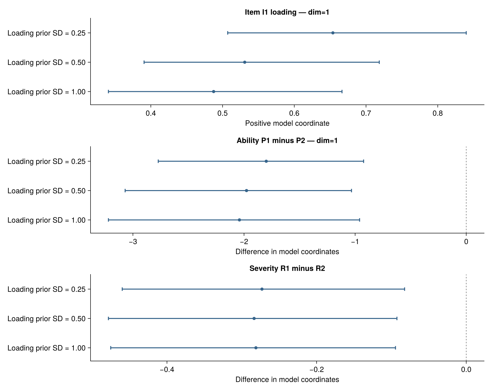
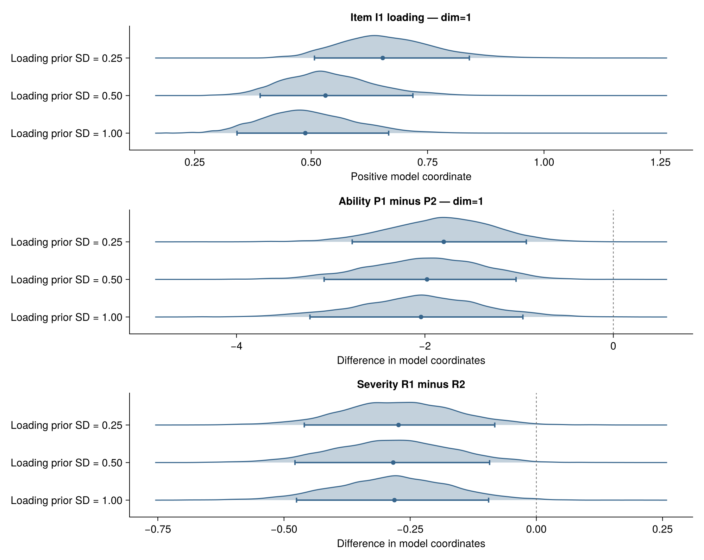
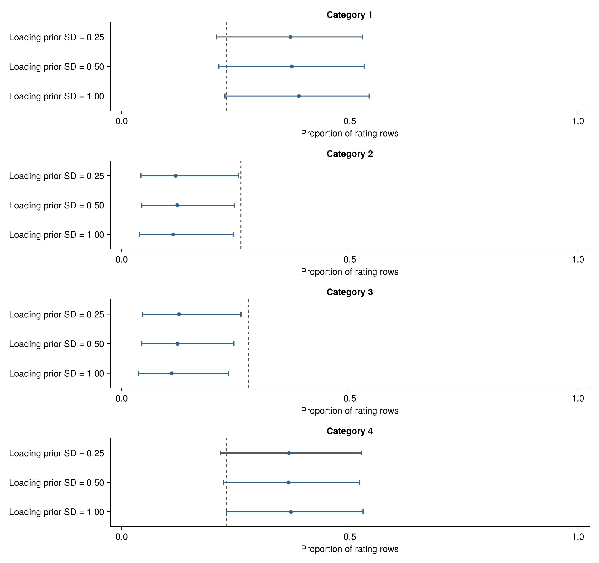
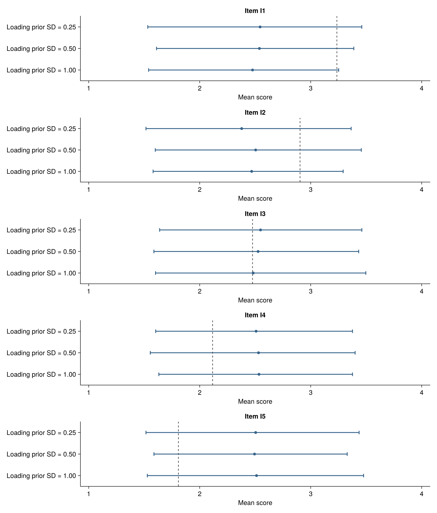
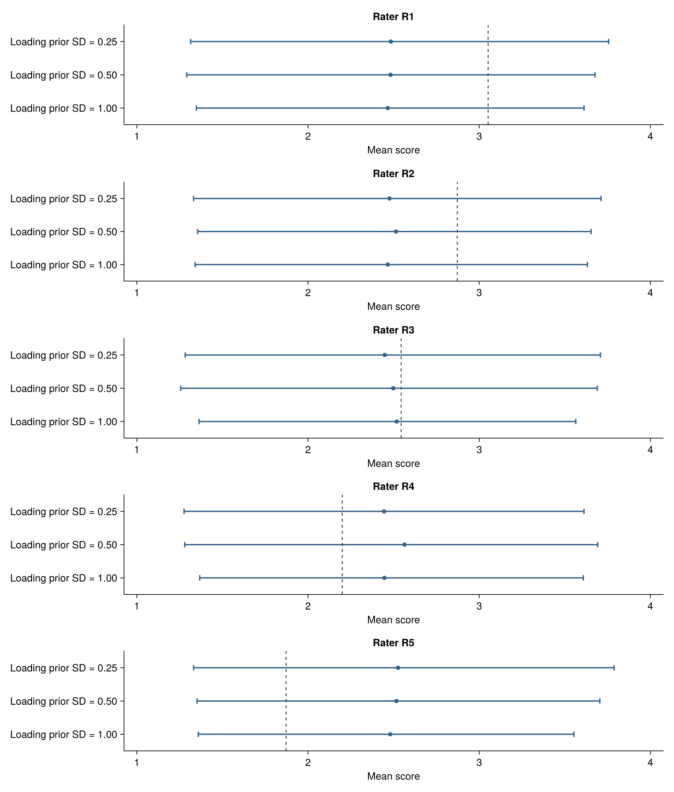

# Would a different prior change my answer?

This development candidate compares **already fitted prior variants** for the
same data and model. Start with a scientific question: for example, whether one
rater is more severe than another, or how uncertain a particular loading is.
Declare plausible alternative priors and the quantities of interest before
examining their answers. A prior is not preferable simply because it produces a
preferred conclusion, a smaller interval, or a better recovery score.

The initial supported scope is the normalized-prior MGMFRM with the same Q
matrix, dimensions, category scale, identification, data and all prior settings
except the SD of log item loadings (`log_discrimination_sd`). These functions
require the `BayesianMGMFRM.` prefix and are not part of a released stable API.
They do not launch fits. MFRM/GMFRM, different identifying scales, free latent
correlations and the joint-rating prototype are not yet supported by this
particular comparison entry point.

## From saved fits to a scientific contrast

Use the ordinary saved-fit loader for fit caches. Earlier sample
records have a separate validated constructor; the repository example
`examples/prior_sensitivity.jl` demonstrates that path for trusted records.

```julia
using BayesianMGMFRM
const B = BayesianMGMFRM

narrow = load_fit_cache("narrow-fit.jls")
wide = load_fit_cache("wide-fit.jls")
B.recovery_quantities(narrow) # Inspect exact names, dimensions and units.

result = B.prior_sensitivity(
    ["Narrow" => narrow, "Wide" => wide];
    planned_prior_ids = ["Narrow", "Wide", "Third planned prior"],
    failures = ["Third planned prior" => "Sampling failed; no usable fit"],
    dataset_id = "ratings-v1",
    observation_ids = rating_ids, # Unique IDs in the original fitted row order.
    estimands = [
        "Rater 1 minus rater 2" => ("rater[R1]", "rater[R2]"),
    ],
    cutoffs = Dict("Rater 1 minus rater 2" => 0.0),
    interval = 0.99,
)
```

Replace the names with those actually returned by your fit's quantity inventory.
Positive severity differences mean the first named rater is more severe in this
parameterization. The difference is calculated within each joint posterior
draw, preserving dependence between raters. Subtracting separately shuffled
draws, or subtracting two marginal interval endpoints, would answer a different
question. Contrasts across dimensions or coordinate blocks are rejected.

Keep the full planned prior roster. Failed and missing variants remain visible;
they are not silently removed from the denominator. Numerical warnings remain
attached to completed fits. Changing the number of retained draws between
variants is allowed and does not create artificial pairing.

## Three kinds of uncertainty

- **Posterior uncertainty:** the median and equal-tailed credible interval within
  each fit. Set `interval=0.90` or `0.99` explicitly. These are not HDIs.
- **Monte Carlo uncertainty:** each mean, SD and reported quantile has its native
  chain-aware MCSE and availability status. A wider credible interval may still
  have precisely estimated endpoints; a narrow interval can have imprecise ones.
- **Sensitivity to prior choice:** changes in corresponding summaries across
  fits. There is no implicit posterior distribution for “the difference between
  two priors.” Cross-fit covariance is unknown; the report gives the sum of the
  two MCSEs as a conservative estimated standard-error upper bound for a summary
  change, not a confidence interval or an independent-fit standard error.

For a declared cutoff, the report says whether the interval is above, below, or
includes it. An endpoint within `mcse_multiplier` MCSEs of the cutoff is marked
unresolved by that numerical screen. The default multiplier is 2; it is not a
simultaneous confidence guarantee. This interval rule does not calculate a
posterior sign probability, a ROPE probability, or a Bayes factor.

No numerical precision threshold is silently selected. Supply `max_mcse` in
estimand units to screen the mean and all three displayed quantiles; otherwise
`precision_qualified` is `nothing`. A single tolerance is appropriate only if
its meaning is defensible for every selected estimand. Sampling diagnostics,
precision and scientific adequacy remain separate. MCSE uses the existing
[MCMCDiagnosticTools estimator](https://turinglang.org/MCMCDiagnosticTools.jl/stable/).

## Interval and ridge views

```julia
using CairoMakie
fig = B.plot_prior_sensitivity(result; kind=:interval)
ridge = B.plot_prior_sensitivity(result; kind=:ridge)
B.save_prior_sensitivity_bundle("prior-comparison", result)
restored = B.load_prior_sensitivity_bundle("prior-comparison")
```

Each estimand has its own panel; all prior rows in a panel share the same
horizontal scale. Missing/failed rows and orange warning rows remain visible.
Structural constants are diamonds, not estimated distributions. Titles and
complete notes are written outside the image by default. The bundle includes
PDF, SVG, PNG, numerical JSON, external notes and a reloadable record, together
with file hashes. The reader verifies those files without requiring CairoMakie.
Existing destinations are refused. Load only trusted Julia serialization files.

The ridge view uses a Gaussian kernel with a shared bandwidth within each
estimand. For positive loadings, it estimates density in log coordinates and
transforms back with the Jacobian, so the plotted distribution has positive
support. Default bandwidth is `0.9 * min(SD, IQR/1.34) * n^(-1/5)` of pooled
transformed display draws. `bandwidth` allows an explicit alternative in those
coordinates; the numerical export records the actual choice and grid. Draw
count is used for display smoothing, not as a claim of independent samples or
KDE precision. The [log-KDE methodology](https://arxiv.org/abs/1804.08365) explains
why transformation and the Jacobian matter for positive support.

Density heights share a scale within each panel and are not comparable across
panels. Inspect bandwidth sensitivity when interpreting shape. Overlapping
marginal ridges are not a paired contrast test, evidence of equivalence, or a
picture of the multidimensional joint correlation.

## Saved simulation illustration

The figures below reuse the first planned block, B01, of panel R1 from the
completed fixed-facet assessment. They compare loading-prior SDs of 0.25, 0.50
and 1.00 using 4,000 retained draws per fit. The three focal quantities are the
I1 loading, the P1−P2 ability difference on the first dimension, and the R1−R2
severity difference. Zero cutoffs are illustrative interval decision rules,
not retrospectively registered scientific thresholds.



The dots are posterior medians and the bars are 90% equal-tailed credible
intervals. The axes compare the same quantities across priors. Full external
notes and the underlying values are included below.



In this block, the I1 loading median changes from 0.654 to 0.531 to 0.488
as the prior SD widens. Its 90% intervals are [0.507, 0.840], [0.391, 0.718]
and [0.341, 0.667]. Both named contrasts retain intervals entirely below zero
under all three priors, and their endpoint MCSE screens remain stable. Thus
the loading estimate is sensitive while these particular interval-based
directional decisions are unchanged; this is a statement about this saved
block, not a general robustness or calibration claim.

These are actual saved simulation posteriors, not newly estimated results or
empirical data. This illustration contributes zero new fits and zero new
independent replications. The original assessment completed 192 fits, of which
184 passed its own diagnostic/precision qualification. Displaying this one block
neither replaces that assessment nor establishes a default prior. In the full
R1 assessment, the narrow prior's 90% interval covered the I1 loading truth in
only 1 of 32 blocks despite all 32 fitting qualifications; numerical success
alone did not establish calibration.

Download the [interval PDF](assets/prior-sensitivity/interval.pdf),
[interval SVG](assets/prior-sensitivity/interval.svg),
[interval note](assets/prior-sensitivity/interval-note.txt),
[ridge PDF](assets/prior-sensitivity/ridge.pdf),
[ridge SVG](assets/prior-sensitivity/ridge.svg),
[ridge note](assets/prior-sensitivity/ridge-note.txt),
[numerical summaries and selected draws](assets/prior-sensitivity/result.json),
and [density coordinates and bandwidths](assets/prior-sensitivity/plot-data.json).

## What this comparison cannot decide

Prior predictive comparison is a complementary step, detailed below. It does
not validate substantive plausibility automatically. Inspect the rating design,
within-person dependence and patterns beyond the displayed summaries too.
Predictive model comparison answers a different question. Bayes factors need
separate validated marginal-likelihood computation; these summary changes and
kernel densities do not supply it. See [Reading Results and Comparing Models](interpreting-results.md)
for model choice and interval interpretation.

## What do these priors predict before seeing scores?

A prior over parameters also implies a distribution over possible ratings. Draw
parameters from the prior, then generate a complete replicated rating dataset
from the response model. Repeating this procedure gives
`p(y_rep) = ∫ p(y_rep | theta) p(theta) dtheta`. The recorded persons, items,
raters, category scale and assignment rows stay fixed. Observed scores provide
reference marks; they do not update the generated parameter distribution.
This is the [prior predictive check described in the Stan User's Guide](https://mc-stan.org/docs/stan-users-guide/posterior-predictive-checks.html).

Use `B.prior_predictive_sensitivity` before fitting to examine scientifically
plausible alternatives. Pass explicitly constructed
`B.Experimental.NormalizedMGMFRMPrior` objects as `id => prior` pairs. Its first
supported scope matches the saved posterior comparison: only the log-loading
SD varies. The existing normalized-prior generator supplies the draws, including
the covariance induced by zero-sum blocks. A centered block's supplied scale is
a **kernel SD**, not each constrained coordinate's marginal SD.

For a saved comparison, the following connects the exact priors to the original
specification without fitting again. The widths in this example are illustration
settings, not recommended defaults.

```julia
posterior = B.load_prior_sensitivity("posterior-comparison.jls")
priors = [
    e.prior_id => B.Experimental.NormalizedMGMFRMPrior(;
        prior_model=e.evaluation.prior.prior_model,
        source_rater=e.evaluation.prior.source_rater,
        e.evaluation.prior.scales...,
    ) for e in posterior.ledger if e.evaluation !== nothing
]

checks = B.prior_predictive_sensitivity(spec, priors;
    planned_prior_ids=posterior.planned_prior_ids,
    dataset_id=posterior.dataset_id,
    observation_ids=posterior.observation_ids,
    seeds=Dict(id => 41250+i for (i, (id, _)) in enumerate(priors)),
    ndraws=500,
    interval=0.90,
    posterior=posterior,
)
B.save_prior_predictive_sensitivity("prior-predictions.jls", checks)
restored = B.load_prior_predictive_sensitivity("prior-predictions.jls")

using CairoMakie
fig = B.plot_prior_predictive_sensitivity(restored)
items = B.plot_prior_predictive_sensitivity(restored; statistic=:item_mean)
raters = B.plot_prior_predictive_sensitivity(restored; statistic=:rater_mean)
# Select exact level IDs when a design has many items or raters:
selected = B.plot_prior_predictive_sensitivity(restored;
    statistic=:item_mean, levels=["I1", "I2"])
```

Here `spec` must be the same original specification and data. The comparison
checks data, row IDs and order, dimension labels, prior records and target
identities before generating anything. Merely naming two variants “Narrow” does
not make their priors identical. `posterior` is optional; omitting it lets you
check priors before fitting. Missing/failed prior checks stay in their own
ledger, and a linked posterior's missing/failed/warning status stays separate.
A successful prior simulation does not repair a failed posterior fit.

`examples/prior_predictive_sensitivity.jl` saves this workflow's numerical table
and complete record. The complete record retains generated statistics for every
rating summary, including person and observed assignment-cell summaries, seeds,
actual priors, generator/RNG names, Julia version and the optional posterior hash.
The generator can be replayed in the recorded software environment. It is not a
promise of identical random streams across Julia versions. Loading the saved
statistics reproduces the comparison without regenerating draws.

### Predictive spread and numerical error answer different questions

The displayed 90% intervals describe variation in **replicated score
statistics** under the prior and response model. They are neither posterior
parameter CrIs nor uncertainty intervals around the Monte Carlo mean. Set
`interval=0.99` for 99% equal-tailed predictive intervals. Extreme endpoints
require more draws for stable estimation; this version does not estimate their
MCSE or automatically qualify them.

Each replication is a fresh independent parameter draw followed by conditional
responses. Mean MCSE is the sample SD of a statistic across replications divided
by `sqrt(ndraws)`. The same formula applied to the inclusive indicators
`statistic <= observed` and `statistic >= observed` gives tail-proportion MCSE.
These calculations do not use MCMC ESS. A zero empirical MCSE may mean that a
rare event was never sampled, so degenerate estimates are flagged explicitly.
Inclusive tails overlap at ties and need not sum to one. Tail probabilities,
interval-outside flags and existing implication diagnostics are descriptive,
not calibrated hypothesis tests or a method for ranking priors. Statistics from
one replicated dataset remain dependent; there is no simultaneous acceptance
rule across categories, persons, items and raters.

### Illustration: a reasonable average can conceal a category mismatch

The next figures use the same preselected B01/R1 design as the posterior example:
50 persons, five items, five raters and 1,250 rating rows. Each prior receives
exactly 500 newly generated IID prior/response draws, with seeds 41251–41253.
There are **zero new MCMC fits and zero new independent recovery replications**.
All three actual prior/target identities agree with the saved posterior
comparison. The observed data are simulated, not empirical ratings.

| Loading-prior SD | Replicated mean score (MCSE) | Category 2 expected proportion (MCSE) | Category 3 expected proportion (MCSE) |
| --- | --- | --- | --- |
| 0.25 | 2.499 (0.012) | 0.128 (0.003) | 0.136 (0.003) |
| 0.50 | 2.501 (0.011) | 0.130 (0.003) | 0.129 (0.003) |
| 1.00 | 2.481 (0.011) | 0.123 (0.003) | 0.121 (0.003) |
| Observed | 2.508 | 0.262 | 0.278 |

The overall expected score is close to the observed mean, while all three
priors expect markedly fewer middle-category ratings and more extreme ratings.
This is a concrete reason to inspect category use as well as averages. The
pattern is shared across these alternatives; it does not isolate the loading
prior as its cause. It calls for examining the joint prior and response model
against substantive expectations, not automatically choosing the closest prior.
The 500-draw illustration does not establish endpoint precision, a formal
prior–data conflict conclusion or recovery/calibration performance.

**Prior predictive category use**



*Note.* Dots are predictive medians; bars are 90% equal-tailed predictive
intervals. Dashed lines mark observed proportions. Every panel uses the same
0–1 proportion scale. The distribution is over replicated datasets on the fixed
rating design, not over posterior parameter estimates.
[Full external note](assets/prior-predictive-sensitivity/categories-note.txt),
[PDF](assets/prior-predictive-sensitivity/categories.pdf),
[SVG](assets/prior-predictive-sensitivity/categories.svg).

**Prior predictive item means**



*Note.* All five items are displayed in their recorded order. Dots, intervals
and dashed lines have the same meaning as above, now on the 1–4 mean-score scale.
Each item averages its actual assigned ratings; uneven assignments in other
designs may mix person and rater composition with item effects.
[Full external note](assets/prior-predictive-sensitivity/items-note.txt),
[PDF](assets/prior-predictive-sensitivity/items.pdf),
[SVG](assets/prior-predictive-sensitivity/items.svg).

**Prior predictive rater means**



*Note.* All five raters are displayed. These are mean-score predictions, not
rater-severity posteriors; each rater's observed assignment rows are retained.
Good agreement of rater means alone would not validate response dependence,
connectivity, dimensionality or item–rater interactions.
[Full external note](assets/prior-predictive-sensitivity/raters-note.txt),
[PDF](assets/prior-predictive-sensitivity/raters.pdf),
[SVG](assets/prior-predictive-sensitivity/raters.svg).

Download the [numerical summaries, priors, seeds and linked-result hash](assets/prior-predictive-sensitivity/summary.json).

## Candidate API reference

```@docs
BayesianMGMFRM.prior_sensitivity
BayesianMGMFRM.prior_sensitivity_plot_data
BayesianMGMFRM.plot_prior_sensitivity
BayesianMGMFRM.save_prior_sensitivity
BayesianMGMFRM.load_prior_sensitivity
BayesianMGMFRM.save_prior_sensitivity_bundle
BayesianMGMFRM.load_prior_sensitivity_bundle
BayesianMGMFRM.prior_predictive_sensitivity
BayesianMGMFRM.plot_prior_predictive_sensitivity
BayesianMGMFRM.save_prior_predictive_sensitivity
BayesianMGMFRM.load_prior_predictive_sensitivity
```
