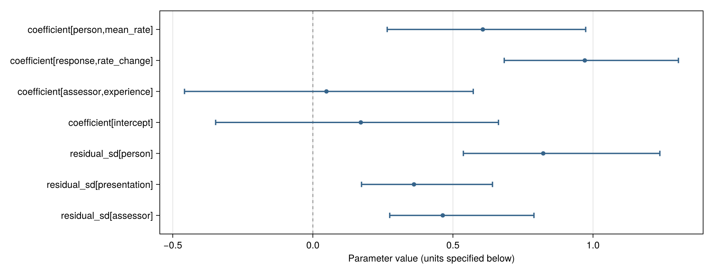
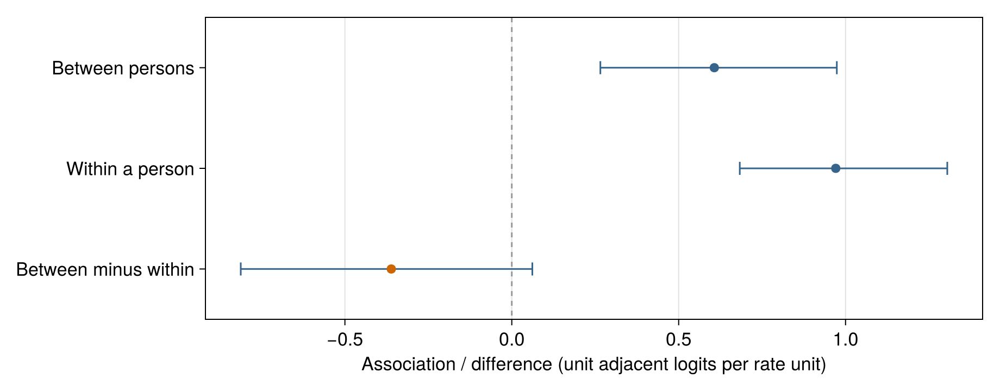
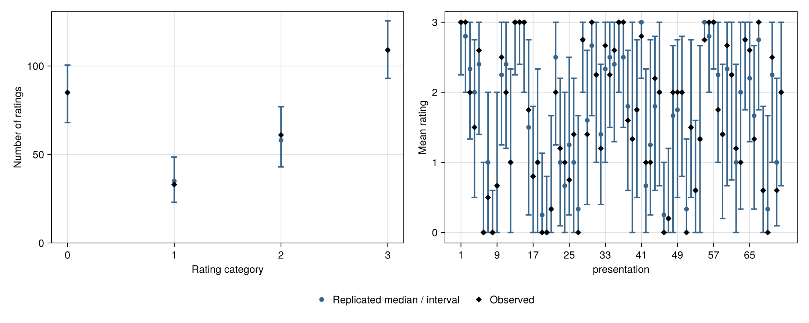
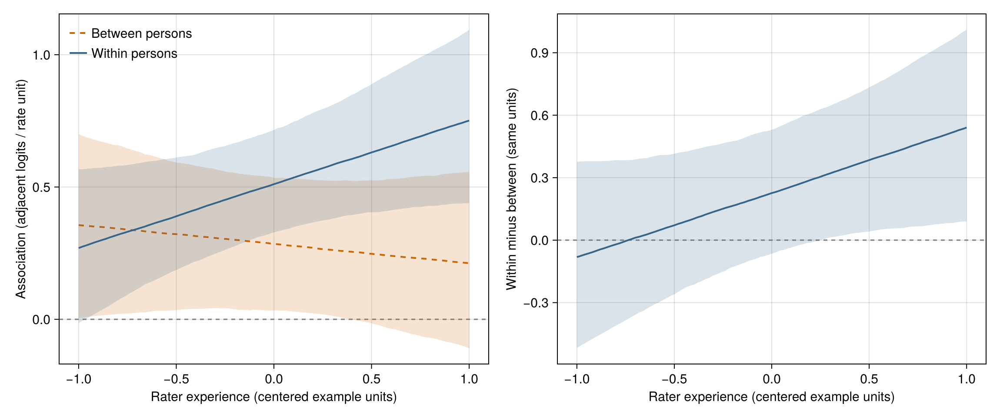
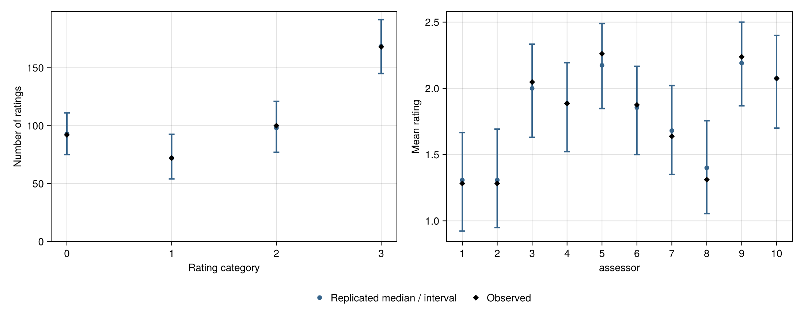

# Separate Between-Person and Within-Person Associations

Does a faster speaker tend to receive higher ratings? Does a speaker receive higher
ratings when speaking faster than their own observed average? These are different
questions. This experimental scalar model estimates both associations, together
with variation among people, performances and raters.

## Declare what belongs to a performance

Use one row per rating. Each `talk` ID belongs to one speaker; its `rate` must be
identical across raters. `experience` belongs to the rater. A person's mean rate
uses each distinct observed talk once, even if some talks have more ratings.

```julia
using BayesianMGMFRM, JSON3
using Distributions: Normal, LogNormal

input = JSON3.read(read(joinpath(pkgdir(BayesianMGMFRM),
    "examples", "data", "repeated_ratings.json"), String))
ratings = Dict{Symbol,Vector}(Symbol(k) => collect(v) for (k,v) in pairs(input))
spec = mfrm_spec(ratings;
    person=:speaker, performance=:talk, score=:rating,
    facets=(presentation=:talk, assessor=:judge, prompt=:prompt),
    steps=:global, category_levels=0:3,
    decompose=(rate=(between=:mean_rate, within=:rate_change),),
    predictors=(person=(mean_rate=Normal(0,.6),),
                response=(rate_change=Normal(0,.6),),
                assessor=(experience=Normal(0,.6),)),
    population=(person=LogNormal(log(.6),.45),
                presentation=LogNormal(log(.4),.45),
                assessor=LogNormal(log(.35),.45)),
    prior_sd=(facets=(prompt=0.,), step=.45), intercept=Normal(0,.8))
validate_design(spec)
design_summary(spec).decomposition
```

The example contains artificial data in arbitrary rate units; these priors are
explicit example choices, not defaults for speaking research. `decompose` does not
standardize, grand-mean center, detrend, or add a random effect. The separate
`presentation` declaration adds the performance residual. Its positive value
**lowers** ratings, like other named facet effects; performance quality has the
opposite sign. The names `presentation` and `assessor` are user choices.

## Fit and compare the two associations

Start Julia with `--threads=4` for four concurrent chains.

```julia
result = fit(spec; chains=4, warmup=600, ndraws=1000, seed=7102,
    chain_execution=:threads, max_parallel_chains=4)
report = fit_report(result; parameters=["coefficient[person,mean_rate]",
    "coefficient[response,rate_change]", "coefficient[assessor,experience]",
    "residual_sd[person]", "residual_sd[presentation]", "residual_sd[assessor]"])
difference = BayesianMGMFRM.posterior_contrast(result;
    left="coefficient[person,mean_rate]", right="coefficient[response,rate_change]")
ppc = predictive_check(result; ndraws=500, seed=8101, groupby=:presentation)
save_fit("repeated-fit.jls", result)
restored = load_fit("repeated-fit.jls")
```

The between coefficient compares people with different observed mean rates. The
within coefficient describes deviations from that person's observed mean, conditional
on the declared effects. Both are changes in unit **adjacent logits** per source unit,
not score points. Use the joint posterior difference to compare coefficients;
separate interval overlap or separate significance does not answer that question.
Only a declared same-source between/within pair has assured matching units for
this contrast. Inspect whole-fit diagnostics and focal MCSE before interpretation.



One artificial repeated-performance pilot. Points are posterior medians; bars are
95% equal-tailed credible intervals. Residual SDs are in unit adjacent logits;
coefficient units are logits per supplied predictor unit (intercept: logits).
This figure is not an empirical result about speaking speed or a recovery study.



The third interval uses paired draws from the joint posterior; it is not formed by
subtracting marginal interval endpoints. Zero marks equal conditional associations.
Here the between-minus-within median is −0.361, with a 95% interval [−0.812, 0.062].
The interval includes zero: this single example does not decisively separate the
associations. Its endpoint MCSEs are 0.012 and 0.017; no precision threshold was
applied. The whole-fit maximum R̂ is 1.004, minimum bulk ESS is 1,891, and retained
divergences are zero. These are numerical diagnostics, not calibration evidence.



This is a **posterior predictive check**: replicated categories are generated from
the fitted posterior, conditional on the observed people, talks and raters. Black
diamonds are observed statistics; blue points/bars are medians and 95% pointwise
predictive intervals from 500 replicates (not simultaneous bands). Aggregate
category agreement can miss temporal, within-person or rater-specific misfit.

Saved reports can be plotted without estimation: load `repeated-posterior.json`
or `repeated-ppc.json` from `examples/reports`, using the corresponding checksum in
`repeated-sha256.json`, then call `plot(stored; kind=:posterior)` or `:predictive`
after loading CairoMakie. The [visualization guide](visualization-gallery.md) explains
the common saved-report workflow.

For prior/PPC, chain traces and category-probability figures, use the
[saved diagnostic walkthrough](explanatory-diagnostics.md). It requires no refitting.

## Prediction and limits

Known-performance prediction preserves training means even for a one-talk subset.
Supply original rate and owner attributes. Changing a stored talk's rate or owner,
inventing a new talk, or supplying inconsistent derived columns is refused. Saving
retains raw rates, derived columns, ownership, equal-performance weighting and means.

The observed mean is a finite sample average, not a latent error-free habitual rate.
Missing performances, time trends, practice effects and changing tasks can change
its interpretation. Centering alone does not remove these influences or establish
causality. Within deviations need not sum to zero across **rating rows** when the
number of raters varies. Different performance counts also give differently precise
observed means; this model does not correct that measurement error.

Repeated performances per person and repeated, overlapping ratings are needed to
inform the separate SDs. The structural screen rejects coincident covariance
components and zero/aliased predictor columns; passing it does not prove sufficient
information or global identification. One performance per person cannot identify
separate person and performance variances. This example uses shared category support; [criterion-specific effects and
mixed supports](criterion-effects.md) require explicit declarations. Unit slopes
and multiplier remain fixed; random slopes, latent means and temporal dynamics are
separate extensions. See [model assumptions](explanatory-ratings.md).

## Mathematical connection

For person p, let m_p be the mean over their J_p unique observed performances and
w_pj = x_pj − m_p. The adjacent logit for categories k and k−1 is

```math
\log\frac{P(Y_{pjr}=k)}{P(Y_{pjr}=k-1)}=
\alpha+\beta_B m_p+u_p+\beta_W w_{pj}-d_{pj}-\gamma e_r-a_r-\tau_k.
```

Population residuals u, d and a are independent zero-mean Gaussian variables with
explicit SD priors. Steps are centered; the singleton prompt effect in this example
is zero. The identity β_B m + β_W(x−m) = β_W x + (β_B−β_W)m explains the contrast.
Rewriting the coefficients and assigning fresh independent priors would generally
change the joint prior; the implementation keeps the declared coordinates.

[Enders and Tofighi (2007), pp. 130–132](https://doi.org/10.1037/1082-989X.12.2.121)
explain the distinct within/between questions and coefficient contrast. Their
linear Gaussian examples motivate the decomposition; their estimation and variance
results are not proofs for this crossed-rater ordinal model.

## Does rater experience change either association?

Add **two** response products: `experience * mean_rate` and
`experience * rate_change`, retaining the main effects above. A single
`experience * rate` term constrains the two interaction coefficients to be equal.
The supplied recipe constructs products from the stored unique-performance means:

```julia
include(joinpath(pkgdir(BayesianMGMFRM), "examples", "repeated_moderation.jl"))
input = JSON3.read(read(joinpath(pkgdir(BayesianMGMFRM),
    "examples", "data", "moderation_ratings.json"), String))
ratings = Dict{Symbol,Vector}(Symbol(k) => collect(v) for (k,v) in pairs(input))
spec = RepeatedModerationExample.specification(ratings)
# New estimation is optional; the plotted report is already supplied.
result = fit(spec; chains=4, warmup=600, ndraws=1000, seed=9216,
    target_accept=.9, max_depth=10, chain_execution=:threads, max_parallel_chains=4)
report = RepeatedModerationExample.report(result)
```

The conditional slopes are `beta_B + delta_B * experience` and
`beta_W + delta_W * experience`. The recipe compares them using paired joint
draws, including coefficient covariance. Its explicit numeric products are
ordinary predictors, not automatic formula terms: recompute them consistently
for new data. The existing known-owner prediction restrictions still apply.



One artificial dataset: 36 people, 108 performances, 10 raters, 432 ratings.
Lines are posterior medians; shading is pointwise 95% CrIs in adjacent logits per
rate unit, conditional on the model. Experience is centered in arbitrary example
units. These are not simultaneous bands or new-rater predictive intervals. At
experience zero, within-minus-between is 0.226 [−0.065, 0.530]; at experience one,
it is 0.541 [0.090, 1.010]. However, the interaction difference itself is
0.312 [−0.015, 0.655]: the second interval above does **not** establish moderation.
That last interval also misses the generating difference 0.8. This single example
is not evidence of calibrated coverage or empirical effects.

Whole-fit maximum R̂ is 1.0044, minimum bulk ESS is 1,640, and retained divergences
are zero. The 18 declared focal quantities pass mean-MCSE/SD and endpoint-MCSE/
interval-width limits of .05. Only experience −1, 0 and 1 received these screens.
Eleven constant-rating pattern warnings remain in the reports; numerical
qualification does not erase them.



This **posterior predictive check** uses 500 replicates conditional on observed
people, performances and raters. The left panel shows category counts; the right
shows mean ratings for each rater. Diamonds are observed statistics; points and
bars are predictive medians and pointwise 95% intervals. Aggregate or rater-level
agreement alone does not establish adequacy. Predictive endpoint MCSE is unassessed.

To redraw the slope figure without fitting or generating predictions:

```julia
using CairoMakie
root = joinpath(pkgdir(BayesianMGMFRM), "examples")
hashes = JSON3.read(read(joinpath(root, "reports", "moderation-sha256.json"), String))
stored = load_report(joinpath(root, "reports", "moderation-posterior.json");
    expected_sha256=hashes["moderation-posterior.json"])
include(joinpath(root, "repeated_moderation_plot.jl"))
RepeatedModerationPlot.figure(stored)
```

These are scoped example recipes using the existing API, not a new generic
interaction or plotting API. Ten distinct raters remain ten sources of
experience information, despite 432 ratings. Random slopes, latent person means,
causal moderation and arbitrary criterion combinations are not established here.
