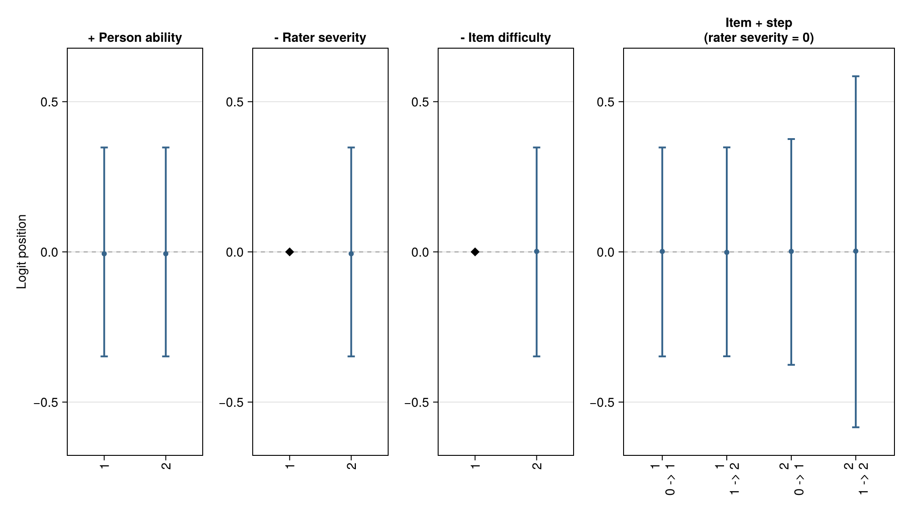
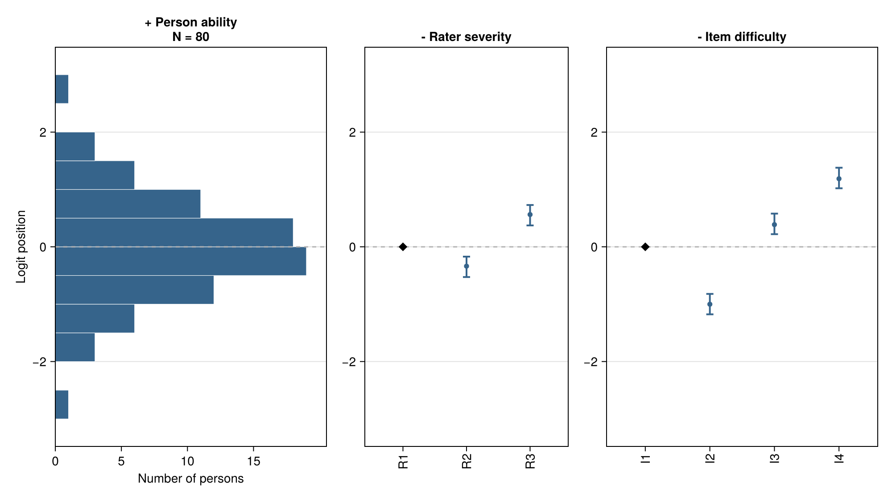
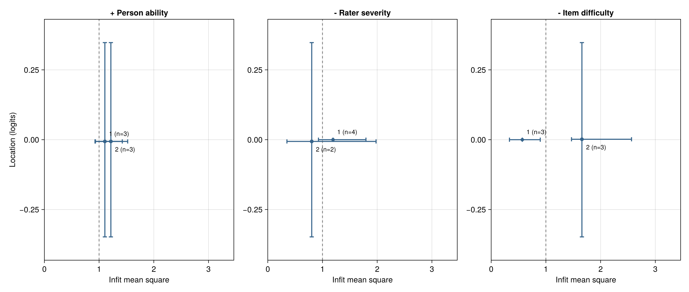
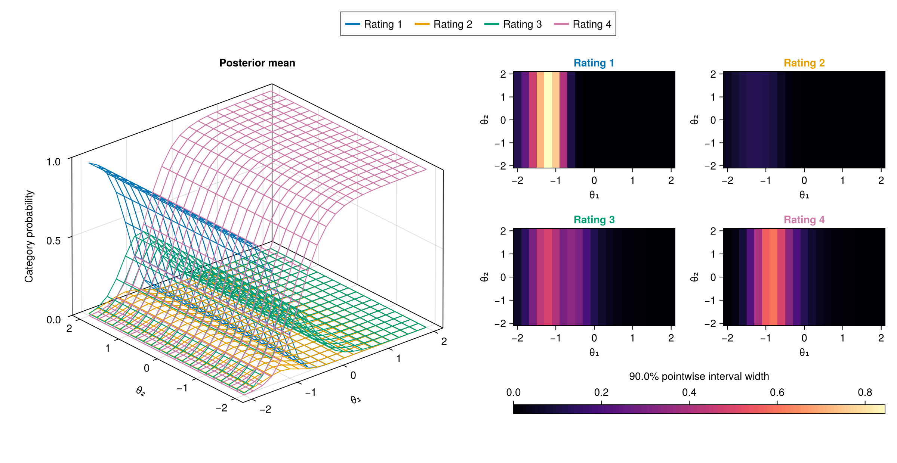
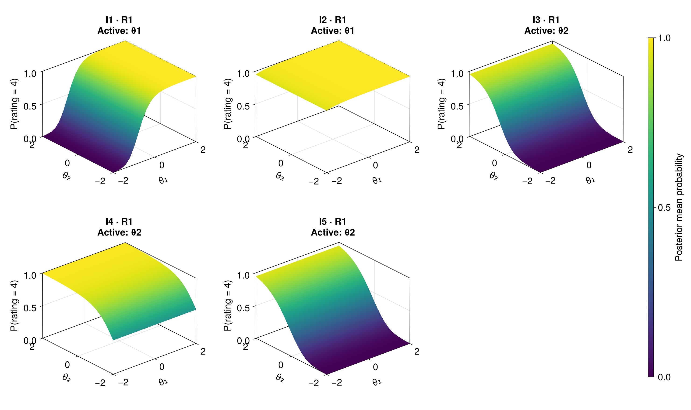
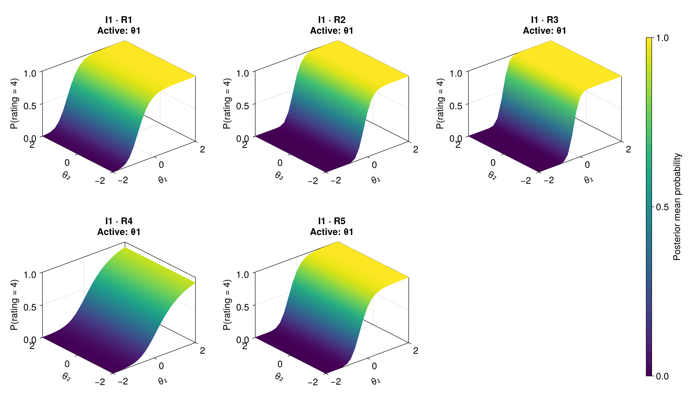

# Visualization Gallery

!!! note "Unreleased documentation preview — 13 October 2026"
    This manual includes unreleased interfaces and examples. It is not the
    documentation of an installed release. Model support and scientific
    acceptance remain as stated on each page.

A useful plot answers a question. Start with **location**, then examine
**response patterns**, and finally ask how a multidimensional model translates
abilities into **rating probabilities**.

| Question | Display | What the axes mean |
| --- | --- | --- |
| Where are people, items and raters on the measurement scale? | Wright Map | Separate facets share a vertical logit scale. |
| Which response patterns deserve a closer look at a given location? | Pathway Map | Infit on the horizontal axis; facet location on the vertical axis. |
| How do two abilities change the probability of a rating? | MGMFRM response surface | Two ability axes and a vertical probability axis. |

The Wright and Pathway illustrations use **deterministic artificial draws**, not
fitted posteriors. They demonstrate the output and its reading conventions, not
uncertainty calibrated by a study. The MGMFRM figures reuse a saved experimental fit
to simulated ratings. None of these pictures establishes a recommended model.
Select a figure to inspect it at full resolution. Titles and notes now appear
outside the images, matching the default plotting behavior. Each figure has a
separate downloadable text note; keep it with the image when sharing results.

To change an interval from 90% or 95% to 99%, follow the
[interval-level examples](interpreting-results.md#credible-interval-levels).
They also explain ETIs, HDIs and the precision of interval endpoints.

## Wright Map: locate the facets

**Figure 1**

*Facet Locations in an Artificial MFRM Illustration*

[](assets/visual-guide/wright-map.svg)

*Note.* This illustration uses 80 deterministic artificial draws, not a fitted posterior. Circles and bars summarize medians and central 95% intervals of those inputs; diamonds denote fixed references or anchors. External anchor uncertainty is excluded. All panels retain their original logit coordinates. The boundary panel uses zero rater severity and adjacent-category equality. The artificial draws trigger numerical MCMC warnings; they do not represent an estimation run.

[PDF](assets/visual-guide/wright-map.pdf) · [SVG](assets/visual-guide/wright-map.svg) · [Full text note](assets/visual-guide/wright-map-note.txt)

Read this map from left to right:

1. **Person ability:** higher locations increase the odds of a higher rating.
2. **Rater severity and item difficulty:** higher locations decrease those odds.
   The minus signs in the headings describe these effects; the plotted estimates
   have not been sign-reversed.
3. **Item plus category step:** at zero rater severity, a person at a boundary
   has equal probabilities for the two adjacent categories. With three or more
   categories, those two probabilities need not each be 50%.

With an actual fit, circles mark posterior medians and bars mark central 95%
credible intervals. Diamonds mark fixed references or anchors, whose external
uncertainty is excluded. The illustration uses the same summary machinery on
artificial inputs. Horizontal spacing simply separates labels. For boundaries,
item difficulty and the step are added within each draw before summarization.

The shared scale can reveal how item locations relate to person locations and
how raters differ in severity. It cannot show that an item measures the intended
construct, that an anchor is correct, or that the chains converged. The current
renderer supports stable unidimensional MFRM, including RSM and PCM. A single
Wright axis does not summarize all abilities of MGMFRM.

```julia
using BayesianMGMFRM, CairoMakie
fit_result = load_fit_cache("analysis-fit.jls")
figure = BayesianMGMFRM.plot_wright(fit_result; interval = 0.95)
save("wright-map.svg", figure)
# The title and note appear in Julia output by default.
```

See the [Wright Map reference](fitting.md#Wright-map) for selection and anchor
details. The [Facets manual](https://www.winsteps.com/facetman64/table6_0.htm)
describes the traditional shared-scale display; its expected-score columns are
different from the adjacent-category boundaries used here.

**Figure 2**

*Person Distribution Beside Item and Rater Locations*

[](assets/visual-guide/wright-histogram.svg)

*Note.* A separate artificial example uses 80 people, four items and three raters,
with 40 deterministic draws per parameter. Each person contributes one median
to the histogram; the bars count 80 people, not 3,200 person-by-draw values.
Bins are 0.5 logits wide from −3 to 3, left closed/right open with the final
upper edge included. Points and intervals in the other panels summarize the
artificial inputs; diamonds identify fixed references. The figure does not
show individual person uncertainty or uncertainty in the bin counts. These
inputs are not estimated posterior evidence; their numerical diagnostic
warnings are retained in the full note.

[PDF](assets/visual-guide/wright-histogram.pdf) · [SVG](assets/visual-guide/wright-histogram.svg) · [Full text note](assets/visual-guide/wright-histogram-note.txt) · [Numerical inputs](assets/visual-guide/wright-histogram.json)

The histogram makes a larger cohort readable without crowding the figure with
person labels. Compare its vertical extent with the item and rater positions.
The horizontal scale is now a **person count**, while horizontal spacing in
the item and rater panels still just separates labels. With an actual fit this
would be a distribution of posterior medians affected by prior shrinkage,
not an estimated population density or a distribution of all MCMC draws.
Use the individual-interval view in Figure 1 when uncertainty about a person
matters; changing bin widths can also change the apparent shape.

```julia
figure = BayesianMGMFRM.plot_wright(fit_result;
    person_display = :histogram, bins = 12, include_thresholds = false)
save("wright-histogram.svg", figure)
```

The [FACETS frequency-column example](https://www.winsteps.com/facetman64/vertical.htm)
motivates the layout. This option preserves the package's Bayesian quantities
and its existing individual-interval default. All persons are counted even
when their number exceeds the default limit of 60 individual positions; that
limit still applies to item, rater and boundary marks. See
[Person histogram overview](fitting.md#Person-histogram-overview) for explicit
edges, full-roster report output and saved-fit reproduction.

## Pathway Map: connect location with response patterns

**Figure 3**

*Location and Infit in an Artificial MFRM Illustration*

[](assets/visual-guide/pathway-map.svg)

*Note.* This illustration uses the same 80 artificial draws as Figure 1. Points are marginal medians; horizontal and vertical bars show separate central 95% intervals, not a joint 95% region. Infit = 1 is a reference, not an automatic acceptance threshold. The artificial inputs are not posterior evidence. With a fitted model, review sampler diagnostics and predictive checks before interpretation.

[PDF](assets/visual-guide/pathway-map.pdf) · [SVG](assets/visual-guide/pathway-map.svg) · [Full text note](assets/visual-guide/pathway-map-note.txt)

This is a Pathway-style display using **posterior infit mean squares**.
The traditional [Bond-and-Fox teaching approach](https://www.rasch.org/rmt/rmt222a.htm)
combines location, fit and precision; implementations also use standardized
infit t-statistics. The axes and intervals here have different definitions,
so t-statistic cutoffs such as −2 and +2 do not apply.

The vertical position retains the meaning of the corresponding Wright panel.
The horizontal position adds **infit mean square**, an information-weighted
summary of squared standardized residuals. Values above the reference of 1
indicate more residual variation than the model reference; values below 1
indicate less. Infit emphasizes ratings with more model information. Outfit,
available from the same data function, is more sensitive to unexpected ratings
with small predicted variance.

For example, a high rater location with infit near 1 would suggest severity
without the same signal of excess residual variation. A similar location
farther to the right would prompt inspection of that rater's response patterns.
These are reading examples, not findings from the artificial figure.

Here points are marginal medians. Horizontal and vertical bars summarize
separate 95% marginal intervals; their cross is **not a joint 95% region**.
The dashed line is a reference, not an automatic pass/fail cutoff. Posterior
residual summaries reuse observed data, and their finite-sample behavior depends
on the design. Interpret them alongside counts, predictive checks and the
substantive rating context. A flagged point does not by itself establish bias,
justify removing a rater, or choose MFRM over GMFRM.

The package supplies [`diagnostic_map_data`](@ref); the figure is an example
using CairoMakie, rather than a new package plotting API. Download the
[Pathway Map example](assets/visual-guide/pathway_map.jl), save it beside your
analysis, and use a stable MFRM cache:

```julia
using BayesianMGMFRM, CairoMakie
include("pathway_map.jl")
fit_result = load_fit_cache("analysis-fit.jls")
save("pathway-map.svg", pathway_map(fit_result))

# Inspect the exact numerical rows and their flags before interpreting them.
rows = diagnostic_map_data(fit_result; metrics = :infit,
    include_thresholds = false, interval = 0.95)
```

The example uses every retained draw and does not fit a model. Review sampler
diagnostics separately; missing summaries produce an error rather than omitted
points. See [Reading Results](interpreting-results.md) for the surrounding workflow.

## MGMFRM in 3D: abilities become probabilities

The callable surface method currently accepts independent `MGMFRMFit` results
with `GeneralizedPrior` and at least two ability dimensions. It does not accept
normalized or correlated fit types. See the [fitting guide](fitting.md#3D-item-response-surfaces-for-MGMFRM)
for the exact method and conditioning choices.

**Figure 4**

*Rating Probabilities Across Two MGMFRM Abilities*

[](assets/visual-guide/mgmfrm-response-surface.svg)

*Note.* Item I1 and rater R1, using all 16,000 saved joint draws from one experimental fit to simulated ratings. Height shows posterior mean category probability; the companion heatmaps show 90% pointwise interval widths. Q excludes the second ability for this item, so the surfaces are flat in that direction. There are no additional fixed ability dimensions. The saved fit had no warnings under its recorded MCMC thresholds. These intervals concern conditional probabilities, not future individual ratings; display ranges do not establish data support.

[PDF](assets/visual-guide/mgmfrm-response-surface.pdf) · [SVG](assets/visual-guide/mgmfrm-response-surface.svg) · [Full text note](assets/visual-guide/mgmfrm-response-surface-note.txt)

This figure reuses **16,000 retained joint draws** from one saved experimental
MGMFRM fit to simulated ratings. Its four colors identify ratings 1–4. Moving
along the first ability changes those probabilities: the lowest category loses
probability, the highest gains probability, and intermediate categories can
rise and fall. At each ability pair, all category probabilities sum to 1.

The surface is flat along the second ability because this item's Q row excludes
that dimension. This is a model restriction, not evidence that the second
ability is unimportant for every item. The heatmaps show widths of 90% pointwise
credible intervals for the probabilities, on a shared color scale. They do not
show probability height, future-rating intervals, simultaneous bands or MCSE.

Each grid point averages probabilities evaluated at the joint draws. In general,
that differs from evaluating the model once at posterior-mean parameters. The
selected rater's severity and consistency remain in the calculation. No new
sampling was performed to produce this gallery.

```julia
using BayesianMGMFRM, CairoMakie
restored = load_fit_cache("mgmfrm-fit.jls")
figure = BayesianMGMFRM.plot_response_surface(restored;
    item = "I1", rater = "R1", dimensions = (1, 2),
    x = range(-2, 2; length = 21), y = range(-2, 2; length = 21),
    category = :all, interval = 0.90)
save("mgmfrm-response-surface.svg", figure)
```

**Three display axes are not three latent dimensions.** The height here is a
probability. For an independent model with more than two abilities, the existing
surface function requires values for every undisplayed ability and shows a
conditional slice. A three-ability person scatterplot would instead require
three latent axes, uncertainty displays and identifiable dimension meanings.
It would not establish support for estimating a free correlation matrix with
three or more dimensions; that fitting extension remains unavailable.

This is a static figure. The current CairoMakie interface can change the viewing
angle or select one category; it does not provide browser rotation. See
[3D item response surfaces](fitting.md#3D-item-response-surfaces-for-MGMFRM)
for those controls. The saved fit had no warnings under its recorded MCMC
thresholds, but one figure and one fit do not establish recovery, calibration,
mixed-Q performance or model-selection validity.

See [Titles and notes outside the image](fitting.md#Titles-and-notes-outside-the-image)
for saving the note to a file or selecting the previous embedded layout.

### Compare items and raters

Figure 4 shows how to read all categories for one item–rater pair. To see how
that response changes across the instrument, compare **all five items at one
fixed rater**, then **all five raters at one fixed item**. These two comparisons
reuse the same saved fit. They are not separate fits or new simulations.

The following panels select the highest rating, **category 4**, so that each
panel contains one surface. Both figures use the same ability range (−2 to 2),
21 × 21 grid, viewing angle and 0–1 probability scale. Height and color encode
the same posterior mean probability. The I1–R1 reference appears in both
figures. Category 4 is one part of the response distribution; return to Figure 4
or select another category to inspect the others.

**Figure 5**

*Item Comparison at Rater R1*

[](assets/visual-guide/mgmfrm-item-comparison.svg)

*Note.* All five items from the same experimental fit to simulated ratings; rater R1 is fixed. Each surface averages category-4 probabilities across all 16,000 retained joint draws. Height and color share the 0–1 probability scale. Active dimensions are prescribed by Q: I1–I2 use θ₁, and I3–I5 use θ₂. The other axis is flat by construction. These images show posterior means only; the downloadable data retain 90% pointwise credible intervals. No additional ability dimensions are fixed. Display ranges do not establish data support.

[PDF](assets/visual-guide/mgmfrm-item-comparison.pdf) · [SVG](assets/visual-guide/mgmfrm-item-comparison.svg) · [Full text note](assets/visual-guide/mgmfrm-item-comparison-note.txt) · [Numerical data](assets/visual-guide/mgmfrm-item-comparison.json)

Start with the panel's **Active** label. I1 and I2 respond along θ₁, whereas I3,
I4 and I5 respond along θ₂. Within an active direction, compare where the
surface rises and how steeply. Item differences can reflect difficulty,
category steps and loadings, as well as Q. This is not a ranking of difficulty
on a single ability axis: the items do not all measure the same ability.
I2's category-4 mean probability stays above 0.947 throughout this displayed
grid. Its shallow-looking surface reflects probabilities already close to 1
in this range; that is different from excluding an ability through Q.

**Figure 6**

*Rater Comparison at Item I1*

[](assets/visual-guide/mgmfrm-rater-comparison.svg)

*Note.* All five raters from the same experimental fit to simulated ratings; item I1 is fixed. Each surface averages category-4 probabilities across all 16,000 retained joint draws. The ability grid, viewing angle and 0–1 probability scale match Figure 5. Item I1 excludes θ₂, so every panel is flat along that axis. These images show posterior means only; the downloadable data retain 90% pointwise credible intervals. Rater differences include severity and consistency. They do not establish bias or rater quality.

[PDF](assets/visual-guide/mgmfrm-rater-comparison.pdf) · [SVG](assets/visual-guide/mgmfrm-rater-comparison.svg) · [Full text note](assets/visual-guide/mgmfrm-rater-comparison-note.txt) · [Numerical data](assets/visual-guide/mgmfrm-rater-comparison.json)

Here the item is held constant, so every panel has the same active dimension.
Differences show how the fitted rater changes the probability of assigning the
highest category at a given ability. Both severity and consistency enter the
calculation. Do not infer a reliable between-rater difference from the distance
between mean surfaces, or from overlap of separate marginal intervals. A
probability contrast requires evaluating the difference at matched ability
points within each joint draw and summarizing those differences.
For example, at θ₁ = θ₂ = 0, the mean category-4 probability is approximately
0.93 for R1 and 0.34 for R4. These are conditional example probabilities from
one simulated dataset, not a rater-quality ranking.

The saved fit had no warnings under its recorded MCMC thresholds. That does
not establish calibration or adequate precision for every contrast. For a
particular pair, `plot_response_surface` displays the pointwise interval-width
heatmaps shown in Figure 4. The numerical downloads use rows for `x` and columns
for `y`, and include each panel's mean, lower/upper endpoints and interval width.
Their intervals describe conditional probabilities, not future individual
ratings, simultaneous bands or intervals for differences.

Download the [comparison example](assets/visual-guide/response_surface_variants.jl)
to create these editable figures from a two-ability MGMFRM cache. This example
calls the existing numerical function; it adds no new fitting or plotting API.
The first supplied item and rater are the references, and the supplied order
sets the panel order. Titles and notes remain outside the images by default.

```julia
using BayesianMGMFRM, CairoMakie
include("response_surface_variants.jl")
restored = load_fit_cache("mgmfrm-fit.jls")
comparison = response_surface_variants(restored;
    items = ["I1", "I2", "I3", "I4", "I5"],
    raters = ["R1", "R2", "R3", "R4", "R5"], category = 4)
save("item-comparison.svg", comparison.items)
save("rater-comparison.svg", comparison.raters)
# Pointwise intervals are also available in comparison.item_data/rater_data.
```

## Choose the plot after the question

Use the Wright Map for locations, the Pathway Map for diagnostic follow-up, and
the response surface for model-implied probabilities. Read each together with
its uncertainty and source. Then return to
[model comparison and simulation](interpreting-results.md): attractive or smooth
figures cannot replace predictive evaluation, recovery or SBC.

## Prior predictive sensitivity

The [prior sensitivity guide](prior-sensitivity.md#What-do-these-priors-predict-before-seeing-scores?)
compares category use, every item mean and every rater mean across explicit
loading priors. Its worked example shows why matching the overall average can
still conceal a category-use mismatch. Predictive intervals describe replicated
score statistics; the adjacent posterior ridge views describe parameter draws.
